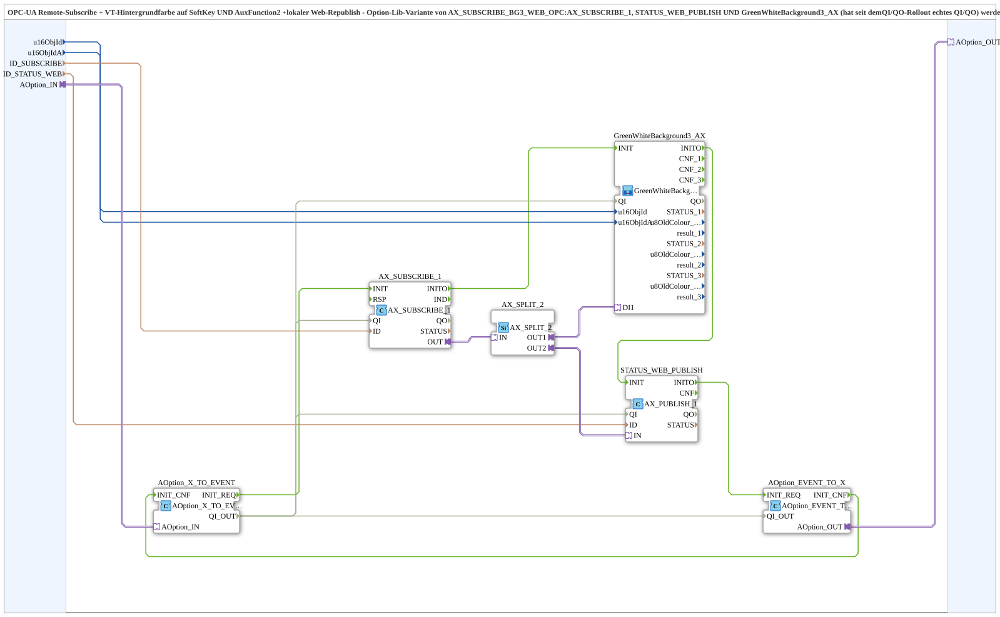

# AX_SUBSCRIBE_BG3_WEB_Option_OPC

* * * * * * * * * *

## Introduction

`AX_SUBSCRIBE_BG3_WEB_Option_OPC` is the option-lib variant of [`AX_SUBSCRIBE_BG3_WEB_OPC`](./AX_SUBSCRIBE_BG3_WEB_OPC.md): OPC-UA remote subscribe with VT background colour on SoftKey AND AuxFunction2 plus local web republish. `AX_SUBSCRIBE_1`, `STATUS_WEB_PUBLISH` and `GreenWhiteBackground3_AX` (which has had a real `QI`/`QO` since the QI/QO rollout) are initialized and gated here by the adapter socket [`Option::AOption`](../../Option/AOption.md): all three sequentially in the order `AX_SUBSCRIBE_1` -> `GreenWhiteBackground3_AX` -> `STATUS_WEB_PUBLISH`. The plug `AOption_OUT` passes the activation on to a downstream group (daisy chain).

## Interface Structure

### **Event Inputs**

None (initialization runs via the adapter `AOption_IN`).

### **Event Outputs**

None.

### **Data Inputs**

| Variable | Type | Default | Comment |
|----------|------|---------|---------|
| `u16ObjId` | UINT | `ID_NULL` | Object ID SoftKey/background (VT). |
| `u16ObjIdA` | UINT | `ID_NULL` | Object ID AuxFunction2/background (VT). |
| `ID_SUBSCRIBE` | WSTRING | | Remote subscribe address (status/colour, `ACTION=SUBSCRIBE`). |
| `ID_STATUS_WEB` | WSTRING | | Local publish address for the state reported back by the target module, so that a web client (e.g. `vt-ui-mirror`) can show the same background colour as the real VT. |

### **Data Outputs**

None.

### **Adapters**

| Adapter | Type | Direction | Comment |
|---------|------|-----------|---------|
| `AOption_IN` | `Option::AOption` | Socket | Drives `INIT`/`QI` of `AX_SUBSCRIBE_1`, `STATUS_WEB_PUBLISH` and `GreenWhiteBackground3_AX`; typically fed by the `AOption_OUT` of [`Softkey_Aux_IXA_TO_Remote_WRITE_Option`](./Softkey_Aux_IXA_TO_Remote_WRITE_Option.md). |
| `AOption_OUT` | `Option::AOption` | Plug | Passes the activation on to a downstream group (daisy chain); leave unused if nothing follows. |

## Function Blocks (FBs) Used

### Sub-blocks: AX_SUBSCRIBE_BG3_WEB_Option_OPC

- **Type**: SubAppType
- **Internal FBs used**:
    - **AOption_X_TO_EVENT** (`Option::conversion::AOption_X_TO_EVENT`): converts the socket `AOption_IN` into `INIT_REQ`/`QI_OUT`, see [`AOption_X_TO_EVENT`](../../Option/conversion/AOption_X_TO_EVENT.md).
    - **AX_SUBSCRIBE_1** (`adapter::net::AX_SUBSCRIBE_1`): OPC-UA subscribe on `ID_SUBSCRIBE`.
    - **AX_SPLIT_2** (`adapter::events::unidirectional::AX_SPLIT_2`): distributes the subscribe value to two branches.
    - **GreenWhiteBackground3_AX** (SubApp `MyLib::sys::GreenWhiteBackground3_AX`): sets the background colour on SoftKey and AuxFunction2; initialized and gated by the option socket sequentially, after `AX_SUBSCRIBE_1` and before `STATUS_WEB_PUBLISH`.
    - **STATUS_WEB_PUBLISH** (`adapter::net::AX_PUBLISH_1`): local publish of the status on `ID_STATUS_WEB`.
    - **AOption_EVENT_TO_X** (`Option::conversion::AOption_EVENT_TO_X`): passes the activation on to `AOption_OUT`.

## Program Flow and Connections

1. Option chain: `AOption_X_TO_EVENT.INIT_REQ` -> `AX_SUBSCRIBE_1.INIT`; `AX_SUBSCRIBE_1.INITO` -> `GreenWhiteBackground3_AX.INIT`; `GreenWhiteBackground3_AX.INITO` -> `STATUS_WEB_PUBLISH.INIT`; `STATUS_WEB_PUBLISH.INITO` -> `AOption_EVENT_TO_X.INIT_REQ`; `AOption_EVENT_TO_X.INIT_CNF` -> `AOption_X_TO_EVENT.INIT_CNF`.
2. `AOption_X_TO_EVENT.QI_OUT` -> `AX_SUBSCRIBE_1.QI`, `STATUS_WEB_PUBLISH.QI`, `GreenWhiteBackground3_AX.QI` and `AOption_EVENT_TO_X.QI_OUT`.
3. Adapters: `AOption_IN` -> `AOption_X_TO_EVENT.AOption_IN`; `AOption_EVENT_TO_X.AOption_OUT` -> `AOption_OUT`.
4. Data: `AX_SUBSCRIBE_1.OUT` -> `AX_SPLIT_2.IN`; `AX_SPLIT_2.OUT1` -> `GreenWhiteBackground3_AX.DI1`; `AX_SPLIT_2.OUT2` -> `STATUS_WEB_PUBLISH.IN`.
5. Parameters: `ID_SUBSCRIBE` -> `AX_SUBSCRIBE_1.ID`; `ID_STATUS_WEB` -> `STATUS_WEB_PUBLISH.ID`; `u16ObjId`/`u16ObjIdA` -> `GreenWhiteBackground3_AX.u16ObjId`/`u16ObjIdA`.
6. The block has no event and no `QI`/`QO` interface; activation and acknowledgment run exclusively via the adapters `AOption_IN`/`AOption_OUT`.

## Technical Features

- **All three blocks gated:** `AX_SUBSCRIBE_1`, `STATUS_WEB_PUBLISH` and `GreenWhiteBackground3_AX` hang on the option socket (version 1.1; `GreenWhiteBackground3_AX` has had a real `QI`/`QO` since the QI/QO rollout, the earlier assumption of no gating was outdated).
- **Sequential initialization:** The option chain initializes `AX_SUBSCRIBE_1`, `GreenWhiteBackground3_AX` and `STATUS_WEB_PUBLISH` one after the other; only after `STATUS_WEB_PUBLISH.INITO` does `AOption_EVENT_TO_X.INIT_REQ` fire.
- **Option initialization instead of `INIT`/`QI`:** The block has no `INIT`/`INITO`/`QI`/`QO` connections of its own; initialization runs via the `INIT_REQ`/`INIT_CNF` handshake of the option chain, and the acknowledgment returns via `AOption_EVENT_TO_X.INIT_CNF` to `AOption_X_TO_EVENT`.
- **Daisy chain:** `AOption_OUT` allows further instances or groups to be attached to the same option.
- The counterpart without option is [`AX_SUBSCRIBE_BG3_WEB_OPC`](./AX_SUBSCRIBE_BG3_WEB_OPC.md).

## Application Scenarios

- Status half of [`Softkey_Aux_IXA_TO_Remote_WRITE_BG_Option_OPC`](./Softkey_Aux_IXA_TO_Remote_WRITE_BG_Option_OPC.md): background colour on SoftKey and Aux from a remote subscribe, active only when the option is selected.

## Summary

`AX_SUBSCRIBE_BG3_WEB_Option_OPC` combines remote subscribe, background colour on SoftKey and Aux and local web republish, and gates subscribe, publish and background colour via an `AOption` socket with forwarding through `AOption_OUT`.

---

### 🌐 Related topic subpages on ms-muc-docs.de

- [🌐 Eclipse 4diac IDE & color reference on ms-muc-docs.de](https://www.ms-muc-docs.de/iec-61499/eclipse-4diac/)
