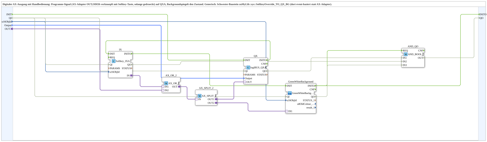

# AX_SoftkeyOverride_TO_QXA_BG

* * * * * * * * * *

## Introduction

The **AX_SoftkeyOverride_TO_QXA_BG** is a generic subapplication that combines a program signal (via an AX adapter) with a manual softkey input to control a digital output (QXA). The effective output state is also mirrored to a background indicator for visual feedback. It is a sister block to `MyLib::sys::SoftkeyOverride_TO_QX_BG` but uses an adapter-based signal instead of an event-based trigger.

## Interface Structure

### **Event Inputs**

- `INIT` (EInit): initialization request; starts the init chain at `QX.INIT`.

### **Event Outputs**

- `INITO` (EInit): initialization confirmation; comes from `GreenWhiteBackground.INITO`, the end of the init chain.

### **Data Inputs**

- `QI` (BOOL) – Quality input, enables the service (initial value: `TRUE`); passed on to `QX.QI`, `IX.QI` and `GreenWhiteBackground.QI`.
- `u16ObjId` (UINT) – Object ID of the softkey used for manual override. Default value: `ID_NULL`.
- `Output` (`logiBUS::io::DQ::logiBUS_DO_S`) – Desired output value sent to the QXA block. Initial value: `logiBUS_DO::Invalid`.

### **Data Outputs**

- `QO` (BOOL) – Quality output, AND combination (`AND_QO`, `AND_BOOL_3`) of the `QO` outputs of `QX`, `IX` and `GreenWhiteBackground`.

### **Adapters**

- `OUT` (adapter::types::unidirectional::AX) – Receives the program signal that is logically OR-ed with the softkey state.

## Functionality

The subapplication continuously processes the AX program signal from the `OUT` adapter and the softkey state from the internal `Softkey_IXA` block (identified by `u16ObjId`). These two signals are combined using an AX_OR_2 logic gate. The resulting boolean value is split via an AX_SPLIT_2 adapter:

- One branch (OUT1) is sent to the `QX` block (`logiBUS_QXA`) which drives the actual digital output.
- The second branch (OUT2) is connected to the `GreenWhiteBackground1_AX` subapplication to display the current output state.

Initialization and quality: `INIT` → `QX.INIT`, `QX.INITO` → `IX.INIT`, `IX.INITO` → `GreenWhiteBackground.INIT`, `GreenWhiteBackground.INITO` → `INITO` and `AND_QO.REQ`. `QI` is passed on to `QX`, `IX` and `GreenWhiteBackground`; `QX.QO`, `IX.QO` and `GreenWhiteBackground.QO` are combined in `AND_QO` (`iec61131::booleanOperators::AND_BOOL_3`) into the output `QO`.

The `Output` data input provides the value to be used by the QX block when the output is active.

## Technical Features

- Integrates `Softkey_IXA` for reading the softkey state.
- Uses `AX_OR_2` to perform the logical OR operation between the program signal and the manual override.
- Employs `AX_SPLIT_2` to fan out the combined signal.
- Contains `GreenWhiteBackground1_AX` for visual state indication.
- Uses `logiBUS_QXA` as the digital output driver; its quality input `QI` (like those of `Softkey_IXA` and the background) comes from the block input `QI` instead of being fixed to `TRUE`.
- The init chain (`INIT` → `QX` → `IX` → `GreenWhiteBackground` → `INITO`) and the AND combination of the quality outputs (`QI`/`QO`) follow the standard interface pattern of the wrapper subapps.

## State Overview

| Program Signal (AX) | Softkey Pressed | Output (QXA) | Background |
|---------------------|-----------------|--------------|------------|
| 0                   | 0               | OFF          | OFF        |
| 1                   | 0               | ON           | ON         |
| 0                   | 1               | ON           | ON         |
| 1                   | 1               | ON           | ON         |

The output is ON whenever either the program signal or the manual softkey is active.

## Application Scenarios

This subapplication is ideal for control systems requiring a manual override capability, e.g., a machine operator can force a digital output (like a valve, motor, or lamp) on or off using a softkey while automatic control is active. The background display helps operators quickly identify the current output state even in complex HMI environments.

## Comparison with Similar Blocks

- **SoftkeyOverride_TO_QX_BG**: This sister block achieves the same logical function but uses an event-based mechanism to trigger the override. It does not require an AX adapter and instead relies on event inputs and outputs.
- **AX_SoftkeyOverride_TO_QXA_BG**: The present block is adapter-centric, making it easier to integrate into systems where signals are communicated via unidirectional AX connections.

## Conclusion

AX_SoftkeyOverride_TO_QXA_BG provides a clean, reusable solution for combining an automatic control signal with a manual softkey override to drive a digital output and its corresponding visual indicator. Its adapter-based interface simplifies integration into larger control networks and ensures consistent behavior across different applications.
