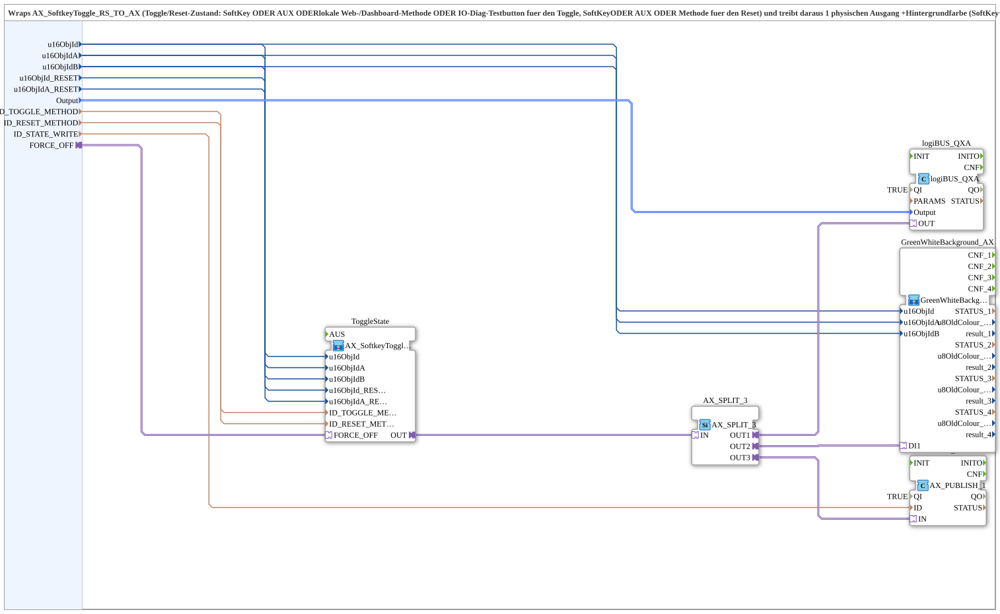

# AX_SoftkeyToggle_RS_TO_QXA_BG

* * * * * * * * * *

## Introduction

`AX_SoftkeyToggle_RS_TO_QXA_BG` wraps [`AX_SoftkeyToggle_RS_TO_AX`](./AX_SoftkeyToggle_RS_TO_AX.md) (toggle/reset state) and uses it to drive **one physical output**, the **background colour** and a **local state publish**:

- Toggle: SoftKey **or** AUX **or** local web/dashboard method **or** IO-diag test button
- Reset: SoftKey **or** AUX **or** method
- Background colour: SoftKey, AUX handle and IO-diag test button together from one `GreenWhiteBackground4_AX`
- Publish: state for the web client/OPC dashboard background colour

Generic for any on/off output that must also be reset by a global "all off" key (e.g. saw blade drive).

## Function Blocks (FBs) Used

### Sub-blocks: AX_SoftkeyToggle_RS_TO_QXA_BG

- **Type**: SubAppType
- **Internal blocks used**:
    - **ToggleState**: SubApp [`MyLib::sys::AX_SoftkeyToggle_RS_TO_AX`](./AX_SoftkeyToggle_RS_TO_AX.md) - toggle/reset state (incl. `FORCE_OFF`)
    - **AX_SPLIT_3**: `adapter::events::unidirectional::AX_SPLIT_3` - distributes the state to three consumers
    - **logiBUS_QXA**: `logiBUS::io::DQ::logiBUS_QXA` (`QI` from the block input `QI`) - physical output
    - **GreenWhiteBackground_AX**: SubApp [`MyLib::sys::GreenWhiteBackground4_AX`](./GreenWhiteBackground4_AX.md) - background colour for SoftKey, AUX and test button
    - **PUBLISH_STATE**: `adapter::net::AX_PUBLISH_1` (`QI` from the block input `QI`) - local state publish
    - **AND_QO**: `iec61131::booleanOperators::AND_BOOL_4` - ANDs the `QO` outputs of `logiBUS_QXA`, `PUBLISH_STATE`, `GreenWhiteBackground_AX` and `ToggleState` into the block output `QO`
- **Imports**: `ID_NULL`, `logiBUS_DO`, `logiBUS_DO_S`

## Interface Structure

### **Event Inputs**

- **INIT** (`EInit`): Initialization Request

### **Event Outputs**

- **INITO** (`EInit`): Initialization Confirm

The signal processing (toggle/reset) still travels via the adapters.

### **Data Inputs**

- **QI** (`BOOL`, default `TRUE`): Quality Input - TRUE to enable the service
- **u16ObjId** (`UINT`, default `ID_NULL`): Object ID of the on/off softkey (toggle), also carries the background colour
- **u16ObjIdA** (`UINT`, default `ID_NULL`): Object ID of the `AuxFunction2` (joystick) for the toggle - equal to the SoftKey, also shows the background colour on the aux handle
- **u16ObjIdB** (`UINT`, default `ID_NULL`): Object ID of the IO-diag test button (outputs diagnostic page) - toggles equally, shows the background colour together with SoftKey and AUX
- **u16ObjId_RESET** (`UINT`, default `ID_NULL`): Object ID of the "all off" softkey (reset, hard to OFF), e.g. `SoftKey_AUS`
- **u16ObjIdA_RESET** (`UINT`, default `ID_NULL`): Object ID of the `AuxFunction2` (joystick) for the reset - equal to the "all off" softkey
- **Output** (`logiBUS::io::DQ::logiBUS_DO_S`, default `logiBUS_DO::Invalid`): Output `Output_Q1..Q12`
- **ID_TOGGLE_METHOD** (`WSTRING`): Local method address (`ACTION=CREATE_METHOD`) for the argument-less toggle trigger - called by the web client (`vt-ui-mirror`) and directly by the OPC dashboard
- **ID_RESET_METHOD** (`WSTRING`): Local method address (`ACTION=CREATE_METHOD`) for the argument-less reset trigger (hard to OFF) - called by the web client and OPC dashboard
- **ID_STATE_WRITE** (`WSTRING`): Local publish address (`ACTION=WRITE`) for the actual toggle state (`AX_T_FF_SR.Q`) - subscribed remotely by the web client/dashboard

### **Data Outputs**

- **QO** (`BOOL`): Quality Output - TRUE if the service executed successfully (AND of the `QO` of the inner blocks)

### **Adapters**

- **FORCE_OFF** (socket, `adapter::types::unidirectional::AX`): Optional: a rising edge hard-resets to OFF (e.g. safety shutdown) - pure passthrough socket to `ToggleState.FORCE_OFF`. Leave unwired (fixed FALSE literal) if not needed.

## Program Flow and Connections

- `u16ObjId`, `u16ObjIdA`, `u16ObjIdB`, `u16ObjId_RESET`, `u16ObjIdA_RESET`, `ID_TOGGLE_METHOD`, `ID_RESET_METHOD` → like-named inputs of `ToggleState`
- `FORCE_OFF` → `ToggleState.FORCE_OFF`
- `ToggleState.OUT` → `AX_SPLIT_3.IN`
- `AX_SPLIT_3.OUT1` → `logiBUS_QXA.OUT` (`Output` → `logiBUS_QXA.Output`)
- `AX_SPLIT_3.OUT2` → `GreenWhiteBackground_AX.DI1` (`u16ObjId`, `u16ObjIdA`, `u16ObjIdB` → like-named inputs)
- `AX_SPLIT_3.OUT3` → `PUBLISH_STATE.IN` (`ID_STATE_WRITE` → `PUBLISH_STATE.ID`)
- Initialization chain: `INIT` → `logiBUS_QXA.INIT`, `logiBUS_QXA.INITO` → `PUBLISH_STATE.INIT`, `PUBLISH_STATE.INITO` → `GreenWhiteBackground_AX.INIT`, `GreenWhiteBackground_AX.INITO` → `ToggleState.INIT`, `ToggleState.INITO` → `INITO`; additionally `ToggleState.INITO` → `AND_QO.REQ`
- `QI` → `logiBUS_QXA.QI`, `PUBLISH_STATE.QI`, `GreenWhiteBackground_AX.QI` and `ToggleState.QI`
- `logiBUS_QXA.QO` → `AND_QO.IN1`, `PUBLISH_STATE.QO` → `AND_QO.IN2`, `GreenWhiteBackground_AX.QO` → `AND_QO.IN3`, `ToggleState.QO` → `AND_QO.IN4`; `AND_QO.OUT` → `QO`

## Technical Details

- Since version 7.0 only a wrapper: toggle, reset and `AX_T_FF_SR` live in `AX_SoftkeyToggle_RS_TO_AX`, which is also used for multi-channel sequencing (several time-shifted outputs)
- Since version 6.0: one `GreenWhiteBackground4_AX` instead of two `GreenWhiteBackground1_AX`, so the joystick handle also receives feedback
- Version 8.0 (2026-09-15): `FORCE_OFF` socket added (purely additive; existing instances must wire it, e.g. to a fixed FALSE literal)
- History: 1.0 reset-set-toggle variant of `AX_SoftkeyToggle_TO_QXA_BG`; 2.0 IO-diag test button, two local RPC methods and state publish; 3.0 AUX added; 4.0/5.0 factored out into `Softkey_Aux_Method_IE` and `Softkey_Aux_Method_Button_IE`

## Application Scenarios

- On/off output operated via SoftKey, joystick, IO-diag test button and web/dashboard plus a global "all off" key (e.g. saw blade drive)

## Summary

`AX_SoftkeyToggle_RS_TO_QXA_BG` connects the toggle/reset state from `AX_SoftkeyToggle_RS_TO_AX` with a physical output, background colour and local state publish.
