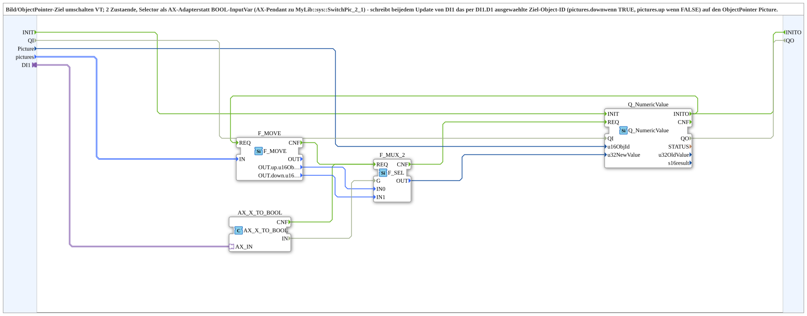

# AX_SwitchPic_2_1

* * * * * * * * * *

## Introduction

`AX_SwitchPic_2_1` switches the target of a VT **ObjectPointer** (picture) between two states. The selector arrives as an **AX adapter** instead of a `BOOL` input variable (AX counterpart of `MyLib::sys::SwitchPic_2_1`): on every update of `DI1`, the target object ID selected via `DI1.D1` (`pictures.down` if `TRUE`, `pictures.up` if `FALSE`) is written to the ObjectPointer `Picture`. No external trigger is needed, since `DI1`'s own `E1`/`D1` feeds it directly. Initialization runs via `INIT`/`INITO` of the inner `Q_NumericValue` (quality pattern with `QI`/`QO`).

## Interface Structure

### **Event Inputs**

- **INIT** (`EInit`): initialization request - to `Q_NumericValue.INIT`; further events arrive via the adapter socket

### **Event Outputs**

- **INITO** (`EInit`): initialization confirmation - from `Q_NumericValue.INITO`

### **Data Inputs**

- **QI** (`BOOL`, default `TRUE`): Quality Input - TRUE to enable the service (to `Q_NumericValue.QI`)
- **Picture** (`UINT`): Object ID of the ObjectPointer to write into
- **pictures** (`isobus::UT::Q::types::s2x1ObjectIDs`): The two target object IDs (`up`, `down`); default: both `ID_NULL`

### **Data Outputs**

- **QO** (`BOOL`): Quality Output - TRUE if the service was executed successfully (from `Q_NumericValue.QO`)

### **Adapters**

- **DI1** (socket): Unidirectional adapter of type `adapter::types::unidirectional::AX` - selector: `down` (`pictures.down`) if `TRUE`, `up` (`pictures.up`) if `FALSE`. Every update writes immediately.

## Function Blocks (FBs) Used

- **F_MOVE**: `iec61131::selection::F_MOVE` (`DataType=isobus::UT::Q::types::s2x1ObjectIDs`) - copies `pictures` to `OUT.up.u16ObjId`/`OUT.down.u16ObjId`
- **AX_X_TO_BOOL**: `adapter::conversion::unidirectional::AX_X_TO_BOOL` - converts the AX selector into event `CNF` and value `IN` (`BOOL`)
- **F_MUX_2**: `iec61131::selection::F_SEL` - selects `IN0` (`up`) for `G=FALSE`, `IN1` (`down`) for `G=TRUE`
- **Q_NumericValue**: `isobus::UT::Q::Q_NumericValue` - writes the selected value (`u32NewValue`) to the VT object `u16ObjId`

## Program Flow and Connections

1. `INIT` → `Q_NumericValue.INIT`; `Q_NumericValue.INITO` → `INITO` and → `F_MOVE.REQ`; `F_MOVE.CNF` → `F_MUX_2.REQ` (initialization of the target object IDs).
2. `DI1` → `AX_X_TO_BOOL.AX_IN`; `AX_X_TO_BOOL.CNF` → `F_MUX_2.REQ`, `AX_X_TO_BOOL.IN` → `F_MUX_2.G`.
3. `F_MOVE.OUT.up.u16ObjId` → `F_MUX_2.IN0`; `F_MOVE.OUT.down.u16ObjId` → `F_MUX_2.IN1`.
4. `F_MUX_2.CNF` → `Q_NumericValue.REQ`; `F_MUX_2.OUT` → `Q_NumericValue.u32NewValue`; `Picture` → `Q_NumericValue.u16ObjId`.
5. `QI` → `Q_NumericValue.QI`; `Q_NumericValue.QO` → `QO`.

## Technical Details

- Unlike `SwitchPic_2_1` (there `DI1: BOOL` plus an external `EI` event), the AX variant needs no external trigger.
- The target `ID_NULL` can be used, for example, to switch an ObjectPointer "empty".

## Application Scenarios

- Switching an ObjectPointer between e.g. `Rectangle_Aktiv` and `ID_NULL` depending on the operating state (e.g. display for elevator belt, hedgehog belt, filling belt)

## Summary

`AX_SwitchPic_2_1` writes one of two configurable object IDs to a VT ObjectPointer on every update of an AX selector.
