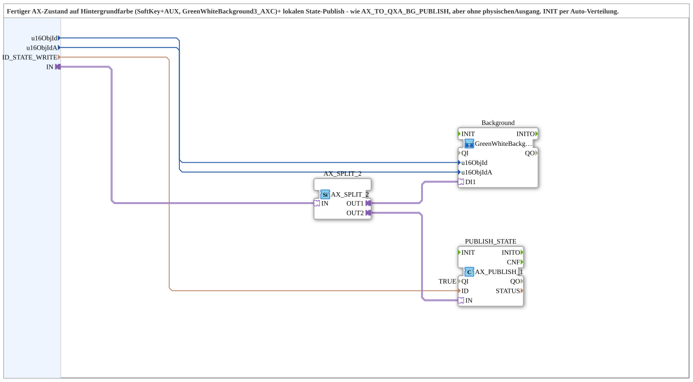

# AX_TO_BG_PUBLISH

* * * * * * * * * *

## Introduction

`AX_TO_BG_PUBLISH` brings a finished AX state to the background colour (SoftKey and AUX, `GreenWhiteBackground3_AXC`) and to a local state publish. It corresponds to [`AX_TO_QXA_BG_PUBLISH`](./AX_TO_QXA_BG_PUBLISH.md), but without a physical output. Initialization is done by automatic distribution (no event connections of its own). The block was extracted from `Baender_EinAus.SUB` (`Background_Alle`/`AX_PUBLISH_Alle`) as a reusable block.

## Interface Structure

### **Event Inputs**

None.

### **Event Outputs**

None.

### **Data Inputs**

| Variable | Type | Default | Comment |
|----------|------|---------|---------|
| `u16ObjId` | UINT | `ID_NULL` | Object ID SoftKey; carries the background colour. |
| `u16ObjIdA` | UINT | `ID_NULL` | Object ID AuxFunction2 (joystick); also shows the background colour on the Aux handle. |
| `ID_STATE_WRITE` | WSTRING |  | Local publish address (`ACTION=WRITE`) for the state; subscribed remotely. |

### **Data Outputs**

None.

### **Adapters**

| Adapter | Type | Direction | Comment |
|---------|------|-----------|---------|
| `IN` | `adapter::types::unidirectional::AX` | Socket | Finished AX state; distributed to background and publish. |

## Function Blocks (FBs) Used

- **AX_SPLIT_2** (`adapter::events::unidirectional::AX_SPLIT_2`): adapter fan-out (strictly 1:1)
- **Background** (SubApp `MyLib::sys::GreenWhiteBackground3_AXC`): sets the background colour of SoftKey and Aux; see [`GreenWhiteBackground3_AXC`](./GreenWhiteBackground3_AXC.md)
- **PUBLISH_STATE** (`adapter::net::AX_PUBLISH_1`, `QI = TRUE`): local state publish

## Program Flow and Connections

1. `IN` -> `AX_SPLIT_2.IN`.
2. `AX_SPLIT_2.OUT1` -> `Background.DI1`; `AX_SPLIT_2.OUT2` -> `PUBLISH_STATE.IN`.
3. `u16ObjId` -> `Background.u16ObjId`; `u16ObjIdA` -> `Background.u16ObjIdA`; `ID_STATE_WRITE` -> `PUBLISH_STATE.ID`.
4. The block has no event and no `QI`/`QO` connections; `PUBLISH_STATE.QI` is fixed to `TRUE` via parameter.

## Technical Features

- The `AX_SPLIT_2` is needed because the adapter fan-out is strictly 1:1.
- Initialization runs by automatic distribution instead of via a dedicated `INIT` input.
- Compared with [`AX_TO_QXA_BG_PUBLISH`](./AX_TO_QXA_BG_PUBLISH.md) the physical output (`Output`) as well as `QI`/`QO` and `INIT`/`INITO` are missing.

## Application Scenarios

- Pure display and publish channels without a hardware output of their own, e.g. identically structured channels with background colour on the SoftKey and Aux handle plus state publishing.

## Summary

`AX_TO_BG_PUBLISH` distributes a finished AX state to the background colour of SoftKey and Aux and to a local state publish, without a physical output.

---

### 🌐 Related topic subpages on ms-muc-docs.de

- [🌐 Eclipse 4diac IDE & color reference on ms-muc-docs.de](https://www.ms-muc-docs.de/iec-61499/eclipse-4diac/)
