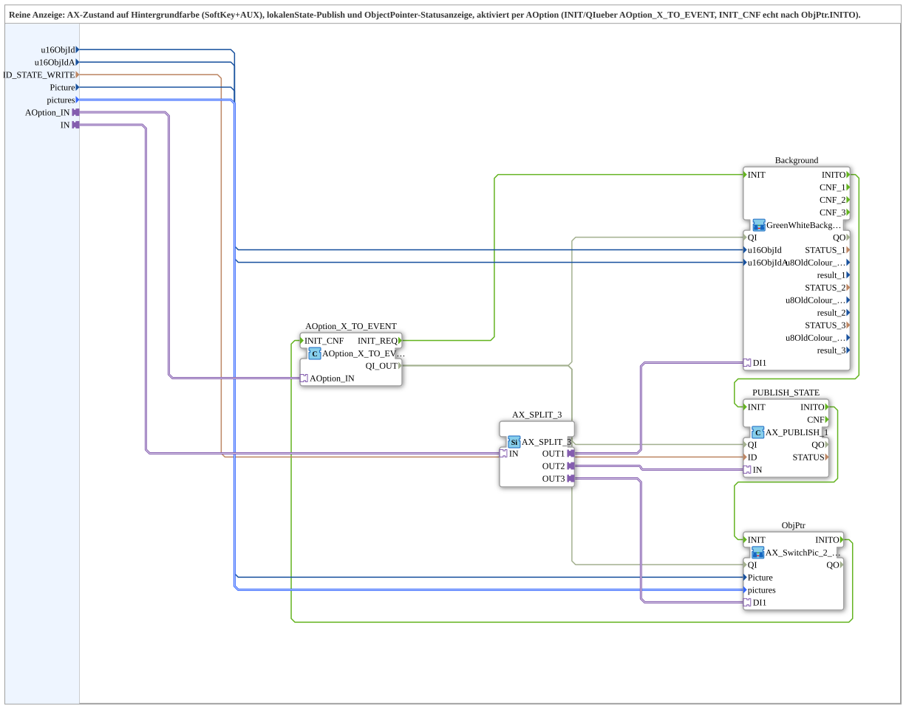

# AX_TO_BG_PUBLISH_SWITCHPIC_Option

* * * * * * * * * *

## Introduction

`AX_TO_BG_PUBLISH_SWITCHPIC_Option` is a pure display: it brings a finished AX state to the background colour (SoftKey and AUX), a local state publish and the ObjectPointer status display ([`AX_SwitchPic_2_1`](./AX_SwitchPic_2_1.md)). It is activated via `AOption`: `INIT` and `QI` come through `AOption_X_TO_EVENT`, and `INIT_CNF` is returned for real after `ObjPtr.INITO`. It is the display part of [`AX_TO_QXA_BG_PUBLISH_SWITCHPIC_OPT`](./AX_TO_QXA_BG_PUBLISH_SWITCHPIC_OPT.md) as a block of its own and corresponds to [`AX_TO_QXA_BG_PUBLISH_SWITCHPIC`](./AX_TO_QXA_BG_PUBLISH_SWITCHPIC.md) without the physical output.

## Interface Structure

### **Event Inputs**

None.

### **Event Outputs**

None.

### **Data Inputs**

| Variable | Type | Default | Comment |
|----------|------|---------|---------|
| `u16ObjId` | UINT | `ID_NULL` | Object ID SoftKey; carries the background colour. |
| `u16ObjIdA` | UINT | `ID_NULL` | Object ID AuxFunction2 (joystick); also shows the background colour on the Aux handle. |
| `ID_STATE_WRITE` | WSTRING |  | Local publish address (`ACTION=WRITE`) for the state; subscribed remotely. |
| `Picture` | UINT |  | Object ID of the ObjectPointer carrying the status box content. |
| `pictures` | `isobus::UT::Q::types::s2x1ObjectIDs` | `(up := (u16ObjId := ID_NULL), down := (u16ObjId := ID_NULL))` | The two target object IDs (`up` = off, `down` = on). |

### **Data Outputs**

None.

### **Adapters**

| Adapter | Type | Direction | Comment |
|---------|------|-----------|---------|
| `AOption_IN` | `Option::AOption` | Socket | Enables/disables the display. |
| `IN` | `adapter::types::unidirectional::AX` | Socket | Finished AX state for background, publish and ObjectPointer. |

## Function Blocks (FBs) Used

- **AOption_X_TO_EVENT** (`Option::conversion::AOption_X_TO_EVENT`): converts the option into `INIT_REQ`/`QI_OUT` and accepts `INIT_CNF`
- **AX_SPLIT_3** (`adapter::events::unidirectional::AX_SPLIT_3`): adapter fan-out (strictly 1:1)
- **Background** (SubApp `MyLib::sys::GreenWhiteBackground3_AX`): background colour of SoftKey and Aux; see [`GreenWhiteBackground3_AX`](./GreenWhiteBackground3_AX.md)
- **PUBLISH_STATE** (`adapter::net::AX_PUBLISH_1`): local state publish
- **ObjPtr** (SubApp `MyLib::sys::AX_SwitchPic_2_1`): ObjectPointer status display; see [`AX_SwitchPic_2_1`](./AX_SwitchPic_2_1.md)

## Program Flow and Connections

1. Initialization chain: `AOption_X_TO_EVENT.INIT_REQ` -> `Background.INIT`; `Background.INITO` -> `PUBLISH_STATE.INIT`; `PUBLISH_STATE.INITO` -> `ObjPtr.INIT`; `ObjPtr.INITO` -> `AOption_X_TO_EVENT.INIT_CNF`.
2. Qualifier: `AOption_X_TO_EVENT.QI_OUT` -> `Background.QI`, `PUBLISH_STATE.QI` and `ObjPtr.QI`.
3. Option: `AOption_IN` -> `AOption_X_TO_EVENT.AOption_IN`.
4. AX state: `IN` -> `AX_SPLIT_3.IN`; `OUT1` -> `Background.DI1`; `OUT2` -> `PUBLISH_STATE.IN`; `OUT3` -> `ObjPtr.DI1`.
5. Data: `u16ObjId` -> `Background.u16ObjId`; `u16ObjIdA` -> `Background.u16ObjIdA`; `ID_STATE_WRITE` -> `PUBLISH_STATE.ID`; `Picture` -> `ObjPtr.Picture`; `pictures` -> `ObjPtr.pictures`.
6. The block has no event or `QI`/`QO` connections of its own and no plug; activation and acknowledgment run via `AOption_IN`.

## Technical Features

- The `AX_SPLIT_3` is needed because the adapter fan-out is strictly 1:1.
- `INIT_CNF` comes for real from the end of the chain (`ObjPtr.INITO`), not from a short-circuit connection.
- There is no `AOption_OUT` plug; the block therefore cannot be daisy-chained.

## Application Scenarios

- Pure display side of a channel (background colour, state publish, status picture) that is active only when the option is selected, e.g. on an `AOption_OR_2` combination of several variants.

## Summary

`AX_TO_BG_PUBLISH_SWITCHPIC_Option` shows a finished AX state as background colour, state publish and status picture and is activated via `AOption`.

---

### 🌐 Related topic subpages on ms-muc-docs.de

- [🌐 Eclipse 4diac IDE & color reference on ms-muc-docs.de](https://www.ms-muc-docs.de/iec-61499/eclipse-4diac/)
