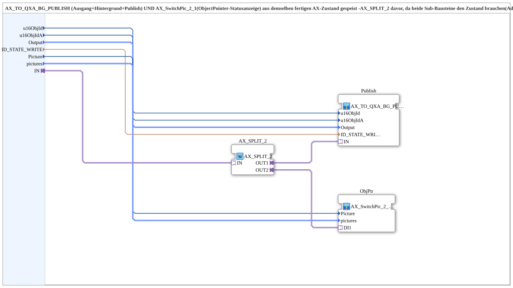

# AX_TO_QXA_BG_PUBLISH_SWITCHPIC

* * * * * * * * * *

## Introduction

`AX_TO_QXA_BG_PUBLISH_SWITCHPIC` feeds [`AX_TO_QXA_BG_PUBLISH`](./AX_TO_QXA_BG_PUBLISH.md) (output + background + publish) **and** [`AX_SwitchPic_2_1`](./AX_SwitchPic_2_1.md) (ObjectPointer status display) from the same finished AX state. An `AX_SPLIT_2` in front is required because both sub-blocks need the state (adapter fan-out rule). Extracted from `Baender_EinAus`, where this combination existed three times identically (Igel, Elevator, Querband).

## Interface Structure

### **Event Inputs**

- **INIT** (`EInit`): initialisation; passed on to `Publish.INIT` instead of automatic distribution

### **Event Outputs**

- **INITO** (`EInit`): initialisation completed; real confirm from `ObjPtr.INITO` (end of the chain `Publish` → `ObjPtr`)

### **Data Inputs**

- **QI** (`BOOL`): qualifier for the physical output; FALSE keeps this instance completely inactive (default `TRUE`)
- **u16ObjId** (`UINT`): object ID of the SoftKey, carries the background colour (default `ID_NULL`)
- **u16ObjIdA** (`UINT`): object ID of the AuxFunction2 (joystick), also shows the background colour on the aux handle (default `ID_NULL`)
- **Output** (`logiBUS::io::DQ::logiBUS_DO_S`): selection of the output `Output_Q1`..`Output_Q12` (default `logiBUS_DO::Invalid`)
- **ID_STATE_WRITE** (`WSTRING`): local publish address (`ACTION=WRITE`) for the actual state, subscribed remotely by web client/dashboard
- **Picture** (`UINT`): object ID of the ObjectPointer that carries the status box content
- **pictures** (`isobus::UT::Q::types::s2x1ObjectIDs`): the two target object IDs (`up` = off, `down` = on); default both `ID_NULL`

### **Data Outputs**

- **QO** (`BOOL`): Quality Output, AND of `Publish.QO` and `ObjPtr.QO`

### **Adapters**

- **IN** (socket, `adapter::types::unidirectional::AX`): finished, already merged AX state, distributed to output + background + publish and to the ObjectPointer status display

## Function Blocks (FBs) Used

- **`AX_SPLIT_2`** (`adapter::events::unidirectional::AX_SPLIT_2`)
- **`Publish`** (SubApp `MyLib::sys::AX_TO_QXA_BG_PUBLISH`)
- **`ObjPtr`** (SubApp `MyLib::sys::AX_SwitchPic_2_1`)
- **`AND_QO`** (`iec61131::booleanOperators::AND_BOOL_2`)

## Functionality

- `IN` → `AX_SPLIT_2.IN`
- `AX_SPLIT_2.OUT1` → `Publish.IN`; `u16ObjId`, `u16ObjIdA`, `Output`, `ID_STATE_WRITE`, `QI` → the like-named inputs of `Publish`
- `INIT` → `Publish.INIT`; `Publish.INITO` → `ObjPtr.INIT`; `ObjPtr.INITO` → `INITO` (and → `AND_QO.REQ`)
- `QI` → `ObjPtr.QI` (in addition to `Publish.QI`)
- `Publish.QO` → `AND_QO.IN1`; `ObjPtr.QO` → `AND_QO.IN2`; `AND_QO.OUT` → `QO`
- `AX_SPLIT_2.OUT2` → `ObjPtr.DI1`; `Picture` → `ObjPtr.Picture`, `pictures` → `ObjPtr.pictures`

## Technical Details

- The `AX_SPLIT_2` is necessary because an adapter must not branch to two sub-blocks
- No logic of its own, just a combination of two existing SubApps
- Version 1.1: `QI` and `INIT` are passed on to `Publish` (`AX_TO_QXA_BG_PUBLISH` v1.1) (QI gate classic-vs-PVEA, initialisation sequenced by the caller)
- Version 1.2: new event output `INITO`, passed on from `Publish.INITO` via `ObjPtr`; additionally `QO` as AND of `Publish.QO` and `ObjPtr.QO`

## Application Scenarios

- Several identically structured channels (e.g. conveyor belts) that each switch an output, show the softkey colour, publish, and additionally switch a status picture

## Summary

`AX_TO_QXA_BG_PUBLISH_SWITCHPIC` distributes a finished AX state to output/background/publish and an ObjectPointer status display.

---

### 🌐 Related topic pages on ms-muc-docs.de

- [🌐 Eclipse 4diac IDE & color reference on ms-muc-docs.de](https://www.ms-muc-docs.de/iec-61499/eclipse-4diac/)
