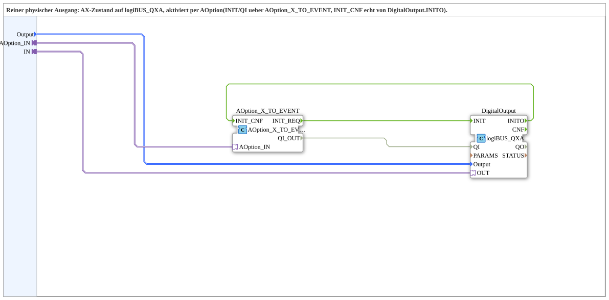
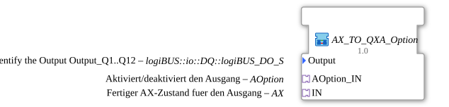

# AX_TO_QXA_Option

* * * * * * * * * *

## Introduction

`AX_TO_QXA_Option` is a pure physical output: it brings a finished AX state to `logiBUS_QXA`. It is activated via `AOption` (`INIT`/`QI` through `AOption_X_TO_EVENT`, `INIT_CNF` for real from `DigitalOutput.INITO`). It is the output part of [`AX_TO_QXA_BG_PUBLISH_SWITCHPIC_OPT`](./AX_TO_QXA_BG_PUBLISH_SWITCHPIC_OPT.md) as a block of its own, following the pattern of `OptionalGroup_001`.

## Interface Structure

### **Event Inputs**

None.

### **Event Outputs**

None.

### **Data Inputs**

| Variable | Type | Default | Comment |
|----------|------|---------|---------|
| `Output` | `logiBUS::io::DQ::logiBUS_DO_S` | `logiBUS_DO::Invalid` | Selection of the output `Output_Q1`..`Output_Q12`. |

### **Data Outputs**

None.

### **Adapters**

| Adapter | Type | Direction | Comment |
|---------|------|-----------|---------|
| `AOption_IN` | `Option::AOption` | Socket | Enables/disables the output. |
| `IN` | `adapter::types::unidirectional::AX` | Socket | Finished AX state for the output. |

## Function Blocks (FBs) Used

- **AOption_X_TO_EVENT** (`Option::conversion::AOption_X_TO_EVENT`): converts the option into `INIT_REQ`/`QI_OUT` and accepts `INIT_CNF`
- **DigitalOutput** (`logiBUS::io::DQ::logiBUS_QXA`): physical output

## Program Flow and Connections

1. Option: `AOption_IN` -> `AOption_X_TO_EVENT.AOption_IN`.
2. Initialization: `AOption_X_TO_EVENT.INIT_REQ` -> `DigitalOutput.INIT`; `DigitalOutput.INITO` -> `AOption_X_TO_EVENT.INIT_CNF`.
3. Qualifier: `AOption_X_TO_EVENT.QI_OUT` -> `DigitalOutput.QI`.
4. AX state: `IN` -> `DigitalOutput.OUT`.
5. Data: `Output` -> `DigitalOutput.Output`.
6. The block has no event or `QI`/`QO` connections of its own and no plug.

## Technical Features

- No logic of its own: only the option connection and `logiBUS_QXA`.
- `INIT_CNF` comes for real from `DigitalOutput.INITO`.
- There is no `AOption_OUT` plug; the block therefore cannot be daisy-chained.

## Application Scenarios

- Physical output that is to be switched only when the option (e.g. classic) is selected, separate from display and publish.

## Summary

`AX_TO_QXA_Option` drives a physical output from a finished AX state and is activated via `AOption`.

---

### 🌐 Related topic subpages on ms-muc-docs.de

- [🌐 Eclipse 4diac IDE & color reference on ms-muc-docs.de](https://www.ms-muc-docs.de/iec-61499/eclipse-4diac/)
