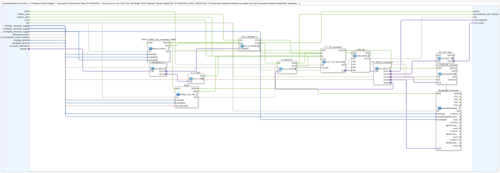

# Automatik_Toggle_Button

* * * * * * * * * *

## Introduction

`Automatik_Toggle_Button` is an **automatic/manual toggle**: a VT button (or softkey or AUX function) toggles the automatic state. The state is output as an AX plug (`AUTOMATIK`), as its inverse (`AX_MAN`, e.g. for the `MAN` input of a PID controller) and as a local publish (`ID_AUTOMATIK_STATE_WRITE`) for the VT status and web dashboard. The SubApp is reusable for any automatic function (oil cooler, pickup, ...) and was extracted from `Aufnahme_Automatik.SUB`.

## Interface Structure

### **Event Inputs**

- **FORCE_ON**: Switches the automatic hard ON (e.g. from a superordinate automatic or a method call). Runs via `AX_E_PERMIT_2` and is therefore `PERMIT`-filtered. Leave unconnected if not needed.
- **FORCE_OFF**: Switches the automatic hard OFF (e.g. by a collision protection). Leave unconnected if not needed.
- **AUS**: Hard reset to manual/OFF from outside as an event (e.g. a centrally read common softkey), in addition to the block's own `u16ObjId_RESET`/`u16ObjIdA_RESET`/`ID_RESET_METHOD` path. Leave unconnected if not needed.

### **Event Outputs**

- **AUTOMATIK_SET_FROM_VT**: Fires only on a click (button/softkey/aux, `PERMIT`-filtered) that switches the automatic from OFF to ON. A click that switches the automatic off does not fire this event. It is a genuine display click event, not a state level or republish.

### **Data Inputs**

- **u16ObjId_Automatik_Toggle** (`UINT`, default `ID_NULL`): Object ID of the VT softkey (automatic/manual toggle)
- **u16ObjIdA_Automatik_Toggle** (`UINT`, default `ID_NULL`): Object ID of the AuxFunction2 (joystick), equivalent to the VT button; optional
- **u16ObjIdB_Automatik_Toggle** (`UINT`): Object ID of the VT button (automatic/manual toggle)
- **bDefaultAutomatik** (`BOOL`, default `FALSE`): Automatic state at start
- **ID_AUTOMATIK_STATE_WRITE** (`WSTRING`): Local publish address (`BOOL`, `ACTION=WRITE`) for the automatic on/off state (status text on the VT, web client/dashboard)
- **u16ObjId_RESET** (`UINT`, default `ID_NULL`): Object ID of the softkey "All off" (reset, hard to manual/OFF), e.g. `SoftKey_AUS`
- **u16ObjIdA_RESET** (`UINT`, default `ID_NULL`): Object ID of the AuxFunction2 (joystick) for the reset
- **ID_RESET_METHOD** (`WSTRING`): Local method address (`ACTION=CREATE_METHOD`) for the argument-less reset trigger; called by the web client and the OPC dashboard

### **Data Outputs**

*No data outputs*

### **Adapters**

- **PERMIT** (socket, `adapter::types::unidirectional::AX`): Enable. Gates the entire on/off; on the transition 1→0 a one-time `RESET` is triggered.
- **AUTOMATIK** (plug, `AX`): Automatic active (raw, e.g. for an enable AND combination)
- **AX_MAN** (plug, `AX`): NOT automatic active (for the `MAN` input of a PID controller)

## Function Blocks (FBs) Used

- **Button_Softkey_Aux_Automatik_Toggle**: SubApp `MyLib::sys::Button_Softkey_Aux_IE` - merges button, softkey and aux into one `IND`
- **Reset**: SubApp `MyLib::sys::Softkey_Aux_Method_IE` - reset via softkey, aux or method call
- **E_T_FF_Automatik**: [`AX_T_FF_SR_SYM_INIT`](../../adapter/events/unidirectional/BOOL/AX_T_FF_SR_SYM_INIT.md) (`QI=TRUE`) - stores the automatic state, start value `bDefaultAutomatik`
- **AX_E_PERMIT_2**: [`AX_E_PERMIT_2`](../../adapter/events/unidirectional/BOOL/AX_E_PERMIT_2.md) - lets `FORCE_ON` and the click through only when `PERMIT=TRUE`
- **AX_SPLIT_2**: distributes `PERMIT` to `AX_E_PERMIT_2` and `E_F_TRIG`
- **E_F_TRIG**: [`AX_F_TRIG`](../../adapter/events/unidirectional/BOOL/AX_F_TRIG.md) - falling edge on `PERMIT`
- **E_SWITCH**: [`AX_E_SWITCH`](../../adapter/events/unidirectional/BOOL/AX_E_SWITCH.md) - filters the click by the state before the click
- **AX_SPLIT_4_Automatik**: [`AX_SPLIT_5`](../../adapter/events/unidirectional/BOOL/AX_SPLIT_5.md) - distributes the state to five targets
- **AX_NOT_Man**: [`AX_NOT_INIT`](../../adapter/booleanOperators/AX_NOT_INIT.md) - inverse for `AX_MAN`
- **AX_PUBLISH_Automatik**: [`AX_PUBLISH_1`](../../adapter/net/AX_PUBLISH_1.md) (`QI=TRUE`) - publishes the state under `ID_AUTOMATIK_STATE_WRITE`
- **Background_Automatik**: [`GreenWhiteBackground4_AX`](./GreenWhiteBackground4_AX.md) - colors button and AUX green/white

## Program Flow and Connections

1. `Button_Softkey_Aux_Automatik_Toggle.IND` → `AX_E_PERMIT_2.EI2`; `FORCE_ON` → `AX_E_PERMIT_2.EI1`.
2. `AX_E_PERMIT_2.EO1` → `E_T_FF_Automatik.S` (switch-on via `FORCE_ON`).
3. `AX_E_PERMIT_2.EO2` → `E_SWITCH.EI`; `E_SWITCH.G` receives the state `Q` before the click (`AX_SPLIT_4_Automatik.OUT5`).
    - `E_SWITCH.EO0` (OFF → ON) → `AUTOMATIK_SET_FROM_VT` and `E_T_FF_Automatik.S`
    - `E_SWITCH.EO1` (ON → OFF) → `E_T_FF_Automatik.R`
4. `Reset.IND`, `AUS`, `FORCE_OFF` and `E_F_TRIG.EO` → `E_T_FF_Automatik.R`.
5. `PERMIT` → `AX_SPLIT_2` → `AX_E_PERMIT_2.PERMIT` and `E_F_TRIG.QI`.
6. `E_T_FF_Automatik.Q` → `AX_SPLIT_4_Automatik`: `OUT1` → `AUTOMATIK`, `OUT2` → `AX_NOT_Man` → `AX_MAN`, `OUT3` → `AX_PUBLISH_Automatik`, `OUT4` → `Background_Automatik.DI1`, `OUT5` → `E_SWITCH.G`.

## Technical Details

- **Button instead of softkey**: The VT button must be non-latching (`Latchable=0`); the feedback of the automatic display is provided by `Background_Automatik`.
- **PERMIT** gates the entire on/off and resets once on the transition 1→0 - it thereby acts like an `AX_PERMIT`.
- `FORCE_ON`/`FORCE_OFF`/`AUS` are genuine events; callers with level-based sources must provide the edge detection themselves.
- `AUTOMATIK_SET_FROM_VT` reacts only to the display click OFF → ON, not to `FORCE_ON` echoes.

## Application Scenarios

- Automatic/manual switching with status display for automatic functions (oil cooler, pickup, bunker harvest, ...)
- Manual mode signal for PID controllers (`AX_MAN`)

## Summary

`Automatik_Toggle_Button` encapsulates operation, state storage, enable, reset and status output of an automatic function in one reusable SubApp.
