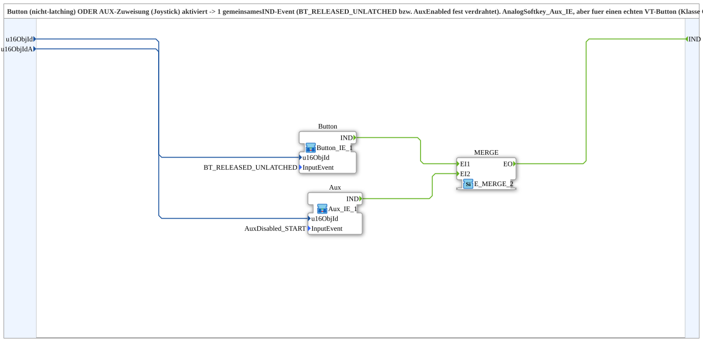

# Button_Aux_IE

* * * * * * * * * *

## Introduction

`Button_Aux_IE` combines a non-latching VT button **or** an AUX assignment (joystick) into one common `IND` event. The activation type is hard-wired (`BT_RELEASED_UNLATCHED` and `AuxEnabled` respectively). The block corresponds to `Softkey_Aux_IE`, but for a real VT button (class `CButton`) instead of a SoftKey: `Softkey_IE` and `Button_IE` are two separate FORTE service interface blocks for different VT activation messages; a button never delivers an `SK_PRESSED`.

The button **must** be non-latching (`Latchable=0` in the pool). A latching button can sensibly be read only via `Button_IXA` (continuous state/level), not via this event/`InputEvent` pattern.

## Function Blocks (FBs) Used

### Sub-blocks: Button_Aux_IE

- **Type**: SubAppType
- **Internal blocks used**:
    - **Button**: SubApp [`Button_IE_1`](./Button_IE_1.md) with `InputEvent=BT_RELEASED_UNLATCHED`
    - **Aux**: SubApp [`Aux_IE_1`](./Aux_IE_1.md) with `InputEvent=AuxDisabled_START`
    - **MERGE**: `iec61499::events::E_MERGE_2` - merges both `IND` events
    - **AND_QO**: `iec61131::booleanOperators::AND_BOOL_2` - combines `Button.QO` and `Aux.QO` into `QO`
- **Imports**: `BT_RELEASED_UNLATCHED` (`ButtonActivationCode`), `AuxDisabled_START` (`AuxiliaryState`)

## Interface Structure

### **Event Inputs**

- **INIT** (`EInit`): initialisation request

### **Event Outputs**

- **INITO** (`EInit`): initialisation confirmation
- **IND**: Fires when the button (`BT_RELEASED_UNLATCHED`) or the aux assignment (`AuxEnabled`) is activated

### **Data Inputs**

- **QI** (`BOOL`, default `TRUE`): Quality Input - TRUE enables the service
- **u16ObjId** (`UINT`): Object ID of the button (`CButton`, non-latching)
- **u16ObjIdA** (`UINT`): Object ID of the `AuxFunction2`

### **Data Outputs**

- **QO** (`BOOL`): Quality Output - AND of `Button.QO` and `Aux.QO`

## Program Flow and Connections

- `u16ObjId` → `Button.u16ObjId`
- `u16ObjIdA` → `Aux.u16ObjId`
- `Button.IND` → `MERGE.EI1`
- `Aux.IND` → `MERGE.EI2`
- `MERGE.EO` → `IND`
- `INIT` → `Button.INIT`; `Button.INITO` → `Aux.INIT`; `Aux.INITO` → `INITO` (and → `AND_QO.REQ`)
- `QI` → `Button.QI` and `QI` → `Aux.QI`
- `Button.QO` → `AND_QO.IN1`; `Aux.QO` → `AND_QO.IN2`; `AND_QO.OUT` → `QO`

## Technical Details

- Bugfix for `Automatik_Toggle_Button`: it previously used `Softkey_Aux_IE` with a button object ID, but `Softkey_IE` receives no button activation message (confirmed by the author of the FORTE implementation)
- The `E_MERGE_2` forwards the event whichever of the two sources fires
- Version 1.0 (2026-09-20)

## Application Scenarios

- A control element that is to be triggered either via a VT button or an AUX joystick input
- Toggle logic (e.g. `Automatik_Toggle_Button`) with two equivalent triggers

## Summary

`Button_Aux_IE` combines `Button_IE_1` and `Aux_IE_1` via an `E_MERGE_2` into a single `IND` event for button and AUX.
