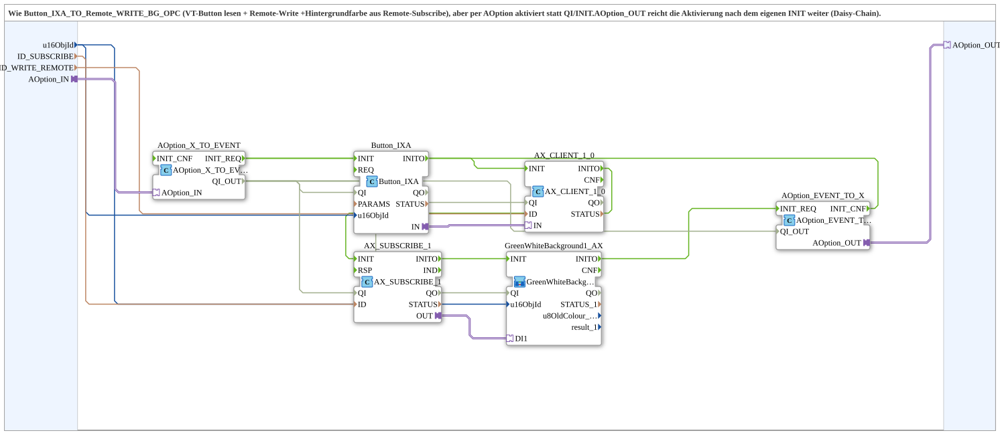

# Button_IXA_TO_Remote_WRITE_BG_Option_OPC

* * * * * * * * * *

## Introduction

`Button_IXA_TO_Remote_WRITE_BG_Option_OPC` reads a VT button, writes to a target module via remote OPC-UA write and sets the background colour from a remote subscribe - like [`Button_IXA_TO_Remote_WRITE_BG_OPC`](./Button_IXA_TO_Remote_WRITE_BG_OPC.md), but activated via `AOption` instead of `QI`/`INIT`. `AOption_OUT` passes the activation on after its own `INIT` (daisy chain like `OptionalGroup_001a`). The block is a copy of `Button_IXA_TO_Remote_WRITE_BG_OPC` in which `INIT`/`INITO`/`QI`/`QO` were replaced by `AOption_IN` and `AOption_OUT`.

## Interface Structure

### **Event Inputs**

None.

### **Event Outputs**

None.

### **Data Inputs**

| Variable | Type | Default | Comment |
|----------|------|---------|---------|
| `u16ObjId` | UINT | `ID_NULL` | Object ID button/background (VT). |
| `ID_SUBSCRIBE` | WSTRING |  | Remote subscribe address (status/colour, `ACTION=SUBSCRIBE`). |
| `ID_WRITE_REMOTE` | WSTRING |  | Remote write address to the target module (command, `ACTION=WRITE`, CLIENT). |

### **Data Outputs**

None.

### **Adapters**

| Adapter | Type | Direction | Comment |
|---------|------|-----------|---------|
| `AOption_IN` | `Option::AOption` | Socket | Drives `INIT`/`QI`; connect to `AOption_AUI_DEMUX_N.OUTx` or the `AOption_OUT` of an upstream instance. |
| `AOption_OUT` | `Option::AOption` | Plug | Passes the activation on to the next link after its own INIT (daisy chain); must be connected, end of chain e.g. `DummyGroup`. |

## Function Blocks (FBs) Used

- **AOption_X_TO_EVENT** (`Option::conversion::AOption_X_TO_EVENT`): converts the option into `INIT_REQ`/`QI_OUT` and accepts `INIT_CNF`
- **Button_IXA** (`isobus::UT::io::Button::Button_IXA`): reads the VT button
- **AX_CLIENT_1_0** (`adapter::net::AX_CLIENT_1_0`): remote write to the target module
- **AX_SUBSCRIBE_1** (`adapter::net::AX_SUBSCRIBE_1`): remote subscribe of status/colour
- **GreenWhiteBackground1_AX** (SubApp `MyLib::sys::GreenWhiteBackground1_AX`): background colour; see [`GreenWhiteBackground1_AX`](./GreenWhiteBackground1_AX.md)
- **AOption_EVENT_TO_X** (`Option::conversion::AOption_EVENT_TO_X`): passes the activation on to `AOption_OUT`

## Program Flow and Connections

1. Initialization chain: `AOption_X_TO_EVENT.INIT_REQ` -> `Button_IXA.INIT`; `Button_IXA.INITO` -> `AX_CLIENT_1_0.INIT`; `AX_CLIENT_1_0.INITO` -> `AX_SUBSCRIBE_1.INIT`; `AX_SUBSCRIBE_1.INITO` -> `GreenWhiteBackground1_AX.INIT`; `GreenWhiteBackground1_AX.INITO` -> `AOption_EVENT_TO_X.INIT_REQ`; `AOption_EVENT_TO_X.INIT_CNF` -> `AOption_X_TO_EVENT.INIT_CNF`.
2. Qualifier: `AOption_X_TO_EVENT.QI_OUT` -> `Button_IXA.QI`, `AX_CLIENT_1_0.QI`, `AX_SUBSCRIBE_1.QI`, `GreenWhiteBackground1_AX.QI` and `AOption_EVENT_TO_X.QI_OUT`.
3. Option: `AOption_IN` -> `AOption_X_TO_EVENT.AOption_IN`; `AOption_EVENT_TO_X.AOption_OUT` -> `AOption_OUT`.
4. Command: `Button_IXA.IN` -> `AX_CLIENT_1_0.IN`.
5. Status: `AX_SUBSCRIBE_1.OUT` -> `GreenWhiteBackground1_AX.DI1`.
6. Data: `u16ObjId` -> `Button_IXA.u16ObjId` and `GreenWhiteBackground1_AX.u16ObjId`; `ID_WRITE_REMOTE` -> `AX_CLIENT_1_0.ID`; `ID_SUBSCRIBE` -> `AX_SUBSCRIBE_1.ID`.

## Technical Features

- The block has no event or `QI`/`QO` connections of its own; activation and acknowledgment run exclusively via `AOption_IN`/`AOption_OUT`.
- `AOption_OUT` must be connected onward (e.g. `DummyGroup` as end of chain), otherwise no `INIT_CNF` is returned.

## Application Scenarios

- Optional operator station with a VT button for a remote actuator including coloured status display, active only when the option is selected.
- Several instances sharing the same option, chained via `AOption_OUT`.

## Summary

`Button_IXA_TO_Remote_WRITE_BG_Option_OPC` bundles VT button, remote write and background colour from remote subscribe behind an `AOption` socket and passes the activation on via `AOption_OUT`.

---

### 🌐 Related topic subpages on ms-muc-docs.de

- [🌐 Eclipse 4diac IDE & color reference on ms-muc-docs.de](https://www.ms-muc-docs.de/iec-61499/eclipse-4diac/)
