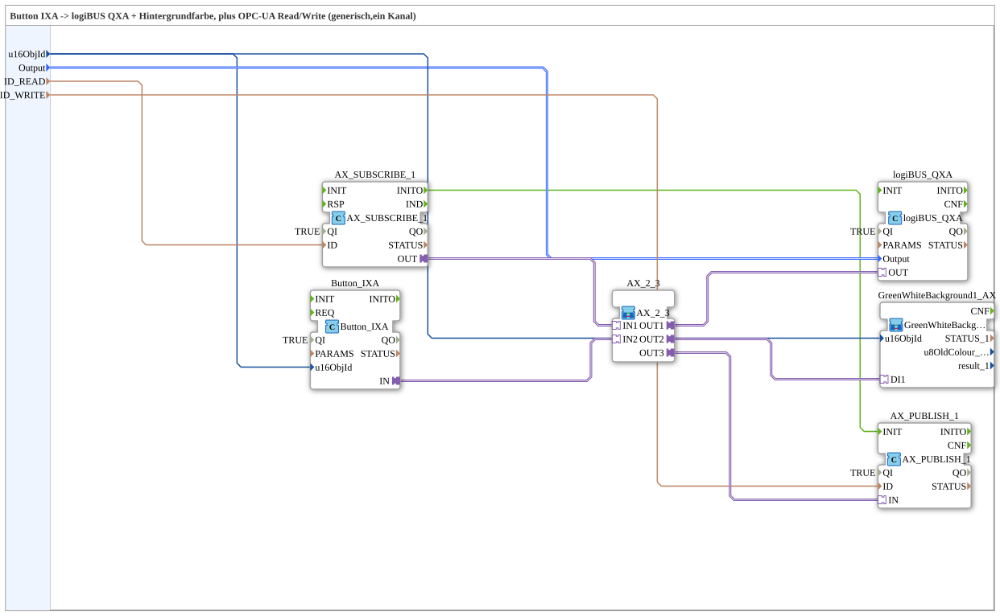

# Button_IXA_TO_logiBUS_QXA_BG_OPC

* * * * * * * * * *

## Introduction

`Button_IXA_TO_logiBUS_QXA_BG_OPC` is the reusable block for **a single digital output** that can be switched both via a VT button and via OPC-UA (web client) — including a VT status display. It is instantiated 12 times with different parameters in [`InputOutputTesterButton_DIDO_OPC_UA`](https://meisterschulen-am-ostbahnhof-munchen-docs.readthedocs.io/projects/4diac-exercises-docs/en/latest/Uebungen/test_AX/Meins/InputOutputTester/Button_DIDO_OPC_UA/InputOutputTesterButton_DIDO_OPC_UA/).

## Function Blocks (FBs) Used

### Sub-blocks: Button_IXA_TO_logiBUS_QXA_BG_OPC

- **Type**: SubAppType
- **Interface (additional)**: event input `INIT`, event output `INITO` (each `EInit`), data input `QI` (`BOOL`, default `TRUE`), data output `QO` (`BOOL`).
- **Internal FBs used**:
    - **Button_IXA**: `isobus::UT::io::Button::Button_IXA` — VT button, `u16ObjId` identifies the VT button. Since version 1.2 temporarily **non-latching** (momentary level, no click toggle any more).
    - **AX_2_3**: SubApp [`AX_2_3`](./AX_2_3.md) — combines `IN1` (OPC-UA subscribe) and `IN2` (VT button) with `AX_OR_2` into one common level and distributes it with `AX_SPLIT_3` to three destinations (`OUT1`..`OUT3`).
    - **logiBUS_QXA**: `logiBUS::io::DQ::logiBUS_QXA` — physical digital output.
    - **GreenWhiteBackground1_AX** (SubApp, `MyLib::sys`): VT background color matching the output state.
    - **AX_SUBSCRIBE_1** / **AX_PUBLISH_1**: `adapter::net::AX_SUBSCRIBE_1`/`AX_PUBLISH_1` — OPC-UA read/write access.
    - **AND_QO**: `iec61131::booleanOperators::AND_BOOL_5` — combines the `QO` outputs of `logiBUS_QXA`, `Button_IXA`, `AX_SUBSCRIBE_1`, `AX_PUBLISH_1` and `GreenWhiteBackground1_AX` into the `QO` of the SubApp.
- **Functionality**: Two independent switching sources (VT button, OPC-UA write) are ORed in `AX_2_3`; the resulting level simultaneously feeds the physical output, the VT status color, and the OPC-UA echo.

## Program Flow and Connections

1. **VT button path**: `Button_IXA.IN` (adapter) → `AX_2_3.IN2`.
2. **OPC-UA path**: `AX_SUBSCRIBE_1.OUT` (adapter, web write) → `AX_2_3.IN1`.
3. **Shared state**: `AX_2_3.OUT1` → `logiBUS_QXA.OUT` (physical output), `AX_2_3.OUT2` → `GreenWhiteBackground1_AX.DI1` (VT status color), `AX_2_3.OUT3` → `AX_PUBLISH_1.IN` (OPC-UA echo to the web client).
4. **Initialization chain**: `INIT` → `logiBUS_QXA.INIT` → `Button_IXA.INIT` → `AX_SUBSCRIBE_1.INIT`; `AX_SUBSCRIBE_1.INITO` → `AX_PUBLISH_1.INIT` (hidden connection) — ensures the publish adapter is only initialized after the subscribe adapter is ready; `AX_PUBLISH_1.INITO` → `GreenWhiteBackground1_AX.INIT`; `GreenWhiteBackground1_AX.INITO` → `INITO` (and → `AND_QO.REQ`).
5. **Parameters**: `u16ObjId` → `Button_IXA.u16ObjId` and `GreenWhiteBackground1_AX.u16ObjId`; `Output` → `logiBUS_QXA.Output`; `ID_READ` → `AX_SUBSCRIBE_1.ID`; `ID_WRITE` → `AX_PUBLISH_1.ID`.
6. **Quality**: `QI` → `.QI` of `logiBUS_QXA`, `Button_IXA`, `AX_SUBSCRIBE_1`, `AX_PUBLISH_1` and `GreenWhiteBackground1_AX`; their `QO` outputs → `AND_QO.IN1`..`IN5`; `AND_QO.OUT` → `QO`. The instances are no longer hard-wired to `QI=TRUE` but are enabled via the `QI` of the SubApp.

## Technical Details

- **Momentary level instead of click toggle**: Since version 1.2 a simple `AX_OR_2` (inside `AX_2_3`) replaces the former SR latch (`AX_ASR_RF_TRIG` × 2 + `ASR_MERGE_2` + `ASR_AX_SR`). VT button **and** remote command are therefore momentary (level); the output follows the OR of both sources. The variant with edge detection and latch is [`Button_IXA_TO_logiBUS_QXA_BG_OPC_LATCHING`](./Button_IXA_TO_logiBUS_QXA_BG_OPC_LATCHING.md).
- **Separate OPC-UA keys**: `ID_READ` (subscribe key, writable) and `ID_WRITE` (publish key, readable) are separate parameters; the echo path (`AX_PUBLISH_1`) writes the ORed level, `AX_SUBSCRIBE_1` only reads the web client's write access.
- **`AX_SUBSCRIBE_1`'s `RSP` event is a no-op**: verified in FORTE source (`CCommFB::sendData()`, `commfb.cpp`) — for the *Subscriber* service type, the `RSP` branch is a complete no-op; the `INIT`/`RSP` event pair only exists because `CCommFB` is the shared base class for all "responder"-style service FBs (e.g. `SERVER`, where `RSP` does trigger something real).
- **Boot order**: `AX_SUBSCRIBE_1.INITO` triggers `AX_PUBLISH_1.INIT` to avoid race conditions at deployment (compare the same pattern in the PWM example's `RampLimitFS_TO_logiBUS_QDA_PWM_OPC`).

## Application Scenarios

- Any digital output that needs to be switchable in momentary mode both locally (VT button) and remotely (web/OPC-UA), with VT status color and OPC-UA echo.

## Comparison with Similar Function Blocks

Compared to its input counterpart [`logiBUS_IXA_BG_OPC`](./logiBUS_IXA_BG_OPC.md), this block adds the second write source (OPC-UA subscribe), which is ORed with the VT button via `AX_2_3`. The latching variant with edge detection and latch is [`Button_IXA_TO_logiBUS_QXA_BG_OPC_LATCHING`](./Button_IXA_TO_logiBUS_QXA_BG_OPC_LATCHING.md).

## Summary

`Button_IXA_TO_logiBUS_QXA_BG_OPC` connects a digital output bidirectionally with OPC-UA: VT button and web command are ORed in `AX_2_3` and the level is distributed to hardware, VT display, and OPC-UA echo; `INIT`/`INITO` are chained through the services, `QO` is the AND of the services.

## 🛠️ Related Exercises

- [InputOutputTesterButton_DIDO_OPC_UA](https://meisterschulen-am-ostbahnhof-munchen-docs.readthedocs.io/projects/4diac-exercises-docs/en/latest/Uebungen/test_AX/Meins/InputOutputTester/Button_DIDO_OPC_UA/InputOutputTesterButton_DIDO_OPC_UA/)

---

### 🌐 Related topic subpages on ms-muc-docs.de

- [🌐 Eclipse 4diac IDE & color reference on ms-muc-docs.de](https://www.ms-muc-docs.de/iec-61499/eclipse-4diac/)
