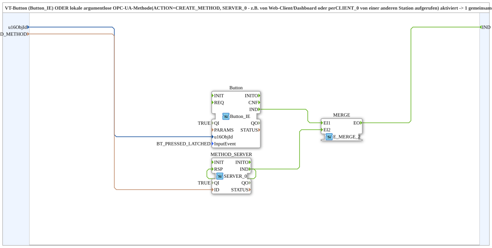

# Button_Method_IE

* * * * * * * * * *

## Introduction

`Button_Method_IE` raises a common `IND` event when either a **VT button** (`Button_IE`) is activated or a **local argument-less OPC-UA method** (`ACTION=CREATE_METHOD`, `SERVER_0`) is called, e.g. by the web client/dashboard or via `CLIENT_0` from another station. The block is analogous to [`Softkey_Aux_Method_IE`](./Softkey_Aux_Method_IE.md), but for a regular VT button instead of SoftKey/AUX. It was extracted from `logiBUS_AI_Calibrate_IDA_OPC`, where the combination (CO/CS) occurred twice identically.

## Interface Structure

### **Event Inputs**

None.

### **Event Outputs**

- **IND**: fires when the button **or** the local method is activated/called

### **Data Inputs**

- **u16ObjId** (`UINT`): object ID of the button
- **ID_METHOD** (`WSTRING`): local method address (`ACTION=CREATE_METHOD`) for the argument-less trigger; called by the web client/dashboard and via `CLIENT_0` from another station

### **Data Outputs**

None.

### **Adapters**

None.

## Function Blocks (FBs) Used

- **`Button`** (`isobus::UT::io::Button::Button_IE`): parameters `QI = TRUE`, `InputEvent = BT_PRESSED_LATCHED`
- **`METHOD_SERVER`** (`iec61499::net::SERVER_0`): parameter `QI = TRUE`, provides the local method
- **`MERGE`** (`iec61499::events::E_MERGE_2`): merges both triggers

## Functionality

- `u16ObjId` → `Button.u16ObjId`; `ID_METHOD` → `METHOD_SERVER.ID`
- `Button.IND` → `MERGE.EI1`
- `METHOD_SERVER.IND` → `MERGE.EI2`
- `METHOD_SERVER.IND` → `METHOD_SERVER.RSP` (immediate response)
- `MERGE.EO` → `IND`

## Technical Details

- **`RSP` must be wired back to `IND`.** The trigger is argument-less and needs no processing. Without the loop-back, FORTE's `onServerMethodCall` blocks the OPC-UA server thread for up to 4 s and meanwhile holds open62541's global `serviceMutex`, which every `AX_PUBLISH_1` on another FORTE thread also needs (see `Ventilsteuerung/OPC_UA_VERNETZUNG.md`, item 12).
- `BT_PRESSED_LATCHED` as the button event (latched press/release)

## Application Scenarios

- A button that should additionally be triggered via web client, OPC dashboard or from another station (e.g. a calibration trigger)

## Summary

`Button_Method_IE` combines a VT button and a local OPC-UA method into one common `IND` event.

---

### 🌐 Related topic pages on ms-muc-docs.de

- [🌐 Eclipse 4diac IDE & color reference on ms-muc-docs.de](https://www.ms-muc-docs.de/iec-61499/eclipse-4diac/)
