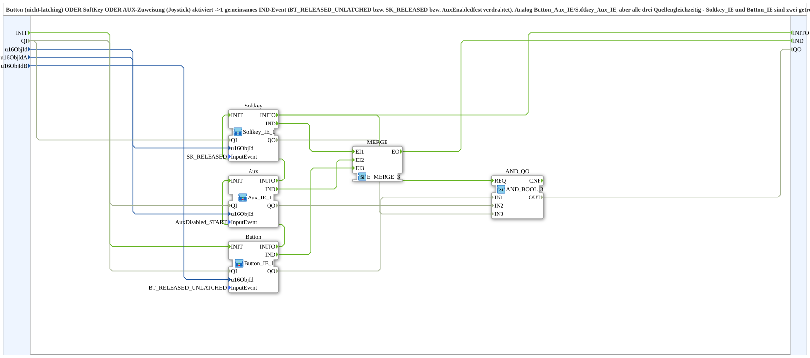

# Button_Softkey_Aux_IE

* * * * * * * * * *

## Introduction

`Button_Softkey_Aux_IE` combines a non-latching VT button **or** a SoftKey **or** an AUX assignment (joystick) into one common `IND` event. The activation types are hard-wired (`BT_RELEASED_UNLATCHED`, `SK_RELEASED` and `AuxEnabled` respectively). The block corresponds to `Button_Aux_IE` and `Softkey_Aux_IE`, but serves all three sources at once. `Softkey_IE` and `Button_IE` are separate FORTE service interface blocks for different VT activation messages; a button never delivers an `SK_PRESSED`.

The button **must** be non-latching (`Latchable=0` in the pool); a latching button can sensibly be read only via `Button_IXA` (level).

## Function Blocks (FBs) Used

### Sub-blocks: Button_Softkey_Aux_IE

- **Type**: SubAppType
- **Internal blocks used**:
    - **Button**: SubApp [`Button_IE_1`](./Button_IE_1.md) with `InputEvent=BT_RELEASED_UNLATCHED`
    - **Softkey**: SubApp [`Softkey_IE_1`](./Softkey_IE_1.md) with `InputEvent=SK_RELEASED`
    - **Aux**: SubApp [`Aux_IE_1`](./Aux_IE_1.md) with `InputEvent=AuxDisabled_START`
    - **MERGE**: `iec61499::events::E_MERGE_3` - merges the three `IND` events
- **Imports**: `BT_RELEASED_UNLATCHED`, `AuxDisabled_START`, `SK_RELEASED`

## Interface Structure

### **Event Inputs**

None.

### **Event Outputs**

- **IND**: Fires when a button (`BT_RELEASED_UNLATCHED`), softkey (`SK_RELEASED`) or aux (`AuxEnabled`) is activated

### **Data Inputs**

- **u16ObjId** (`UINT`): Object ID of the softkey (`CSoftkey`, non-latching)
- **u16ObjIdA** (`UINT`): Object ID of the `AuxFunction2`
- **u16ObjIdB** (`UINT`): Object ID of the button (`CButton`, non-latching)

### **Data Outputs**

None.

## Program Flow and Connections

- `u16ObjId` → `Softkey.u16ObjId`; `Softkey.IND` → `MERGE.EI1`
- `u16ObjIdA` → `Aux.u16ObjId`; `Aux.IND` → `MERGE.EI2`
- `u16ObjIdB` → `Button.u16ObjId`; `Button.IND` → `MERGE.EI3`
- `MERGE.EO` → `IND`

## Technical Details

- Version 1.1 (2026-09-29): `packageName` typo fixed (`MyLib_AX::sys` → `MyLib::sys`), instance `Softkey_IE_1` renamed to `Softkey`, comment corrected (it described only 2 of 3 sources)
- Version 1.0 (2026-09-20): bugfix for `Automatik_Toggle_Button`, which previously used `Softkey_Aux_IE` with a button object ID

## Application Scenarios

- A control element that can be triggered via a button, a SoftKey or an AUX input

## Summary

`Button_Softkey_Aux_IE` bundles `Button_IE_1`, `Softkey_IE_1` and `Aux_IE_1` via an `E_MERGE_3` into a single `IND` event.
