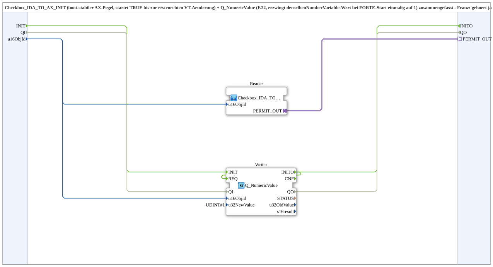

# Checkbox_IDA_TO_AX_INIT_Force1

* * * * * * * * * *

## Introduction

`Checkbox_IDA_TO_AX_INIT_Force1` combines `Checkbox_IDA_TO_AX_INIT` (boot-stable AX level, starts `TRUE` until the first real VT change) and `Q_NumericValue` (forces the value 1 of the associated NumberVariable once at FORTE start). Both blocks read/write the same `u16ObjId`, hence they belong together; the `u16ObjId` is a parameter for reuse. The SubApp was extracted from `Aufnahme_Automatik.SUB` (`Permit_Automatik` plus `Q_NumericValue_Force1_Geschwindigkeitsregelung`).

## Interface Structure

### **Event Inputs**

*No direct event inputs*

### **Event Outputs**

*No direct event outputs*

### **Data Inputs**

- **u16ObjId** (`UINT`, default `ID_NULL`): Object ID of the VT checkbox NumberVariable (the same object for reading and the Force1 write)

### **Data Outputs**

*No data outputs*

### **Adapters**

- **PERMIT_OUT** (plug, `adapter::types::unidirectional::AX`): Boot-stable checkbox state (starts `TRUE`, afterwards follows the real VT checkbox)

## Function Blocks (FBs) Used

- **Reader**: SubApp `MyLib_AX::sys::Checkbox_IDA_TO_AX_INIT` - provides the boot-stable checkbox state as AX
- **Writer**: `isobus::UT::Q::Q_NumericValue` with `u32NewValue=1` - fixed FB-side one-time writer (not the `InitialValue` property of the VT pool)

## Program Flow and Connections

- `u16ObjId` → `Reader.u16ObjId` and `Writer.u16ObjId`
- `Writer.INITO` → `Writer.REQ`: the value 1 is written once at start.
- `Reader.PERMIT_OUT` → `PERMIT_OUT`

## Technical Details

- Through the feedback `INITO` → `REQ`, the writer fires exactly once on initialization; afterwards the checkbox stays under the user's control.

## Application Scenarios

- Enable checkbox (e.g. for an automatic) that should be active at start and whose NumberVariable is set consistently to 1 at FORTE start

## Summary

`Checkbox_IDA_TO_AX_INIT_Force1` provides a checkbox enable that is active at start and boot-stable as AX, and sets the associated VT object consistently to 1.
