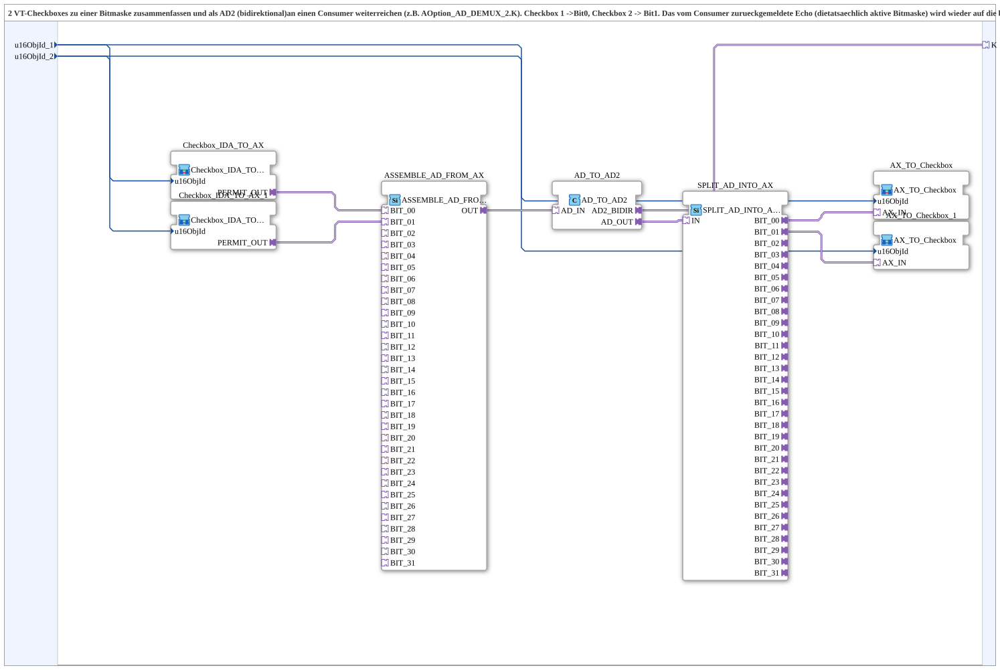

# Checkbox_TO_AD2_2

* * * * * * * * * *

## Introduction

`Checkbox_TO_AD2_2` combines two VT checkboxes into a bitmask and passes it bidirectionally as an AD2 adapter (`K`) to a consumer (e.g. `AOption_AD_DEMUX_2.K`). Checkbox 1 corresponds to bit 0, checkbox 2 to bit 1. The bitmask reported back by the consumer (the actually active one) is written back to the two checkboxes.

## Interface

### Input variables

- `u16ObjId_1` (UINT, default `ID_NULL`): ObjectID of checkbox 1 (bit 0).
- `u16ObjId_2` (UINT, default `ID_NULL`): ObjectID of checkbox 2 (bit 1).

### Adapters

- **Plug `K`** (`adapter::types::bidirectional::AD2`): bitmask to the consumer and echo back.

The block has no event ports of its own.

## How it works

Forward direction (VT → consumer):

1. Two instances of [`Checkbox_IDA_TO_AX`](./Checkbox_IDA_TO_AX.md) each read one checkbox and deliver an AX level (`PERMIT_OUT`).
2. `ASSEMBLE_AD_FROM_AX` assembles the levels into a DWORD (`BIT_00` and `BIT_01`).
3. `AD_TO_AD2` converts it into the bidirectional AD2 adapter, which is output on `K`.

Reverse direction (consumer → VT):

1. The echo reported back via `K` appears at `AD_TO_AD2.AD_OUT`.
2. `SPLIT_AD_INTO_AX` splits the DWORD into `BIT_00` and `BIT_01`.
3. Two instances of [`AX_TO_Checkbox`](./AX_TO_Checkbox.md) write the bits to the respective checkbox.

`u16ObjId_1` and `u16ObjId_2` each go to both the `Checkbox_IDA_TO_AX` and the `AX_TO_Checkbox` instance of the corresponding checkbox.

## Technical notes

- Extracted from `Uebung_094b5_AX` for reuse; designed for N=2 bits/checkboxes, analogous to `AOption_AD_DEMUX_2`.
- Does not store anything itself; persistence is the consumer's responsibility.

## Summary

Bundles two VT checkboxes as a bitmask onto a bidirectional AD2 plug and mirrors the consumer echo back to the checkboxes.

## 🛠️ Related Exercises

- [Uebung_094b5b_AX](https://meisterschulen-am-ostbahnhof-munchen-docs.readthedocs.io/projects/4diac-exercises-docs/en/latest/Uebungen/test_AX/Uebungen_doc/Uebung_094b5b_AX/)

---

### 🌐 Related topic subpages on ms-muc-docs.de

- [🌐 Eclipse 4diac IDE & color reference on ms-muc-docs.de](https://www.ms-muc-docs.de/iec-61499/eclipse-4diac/)
