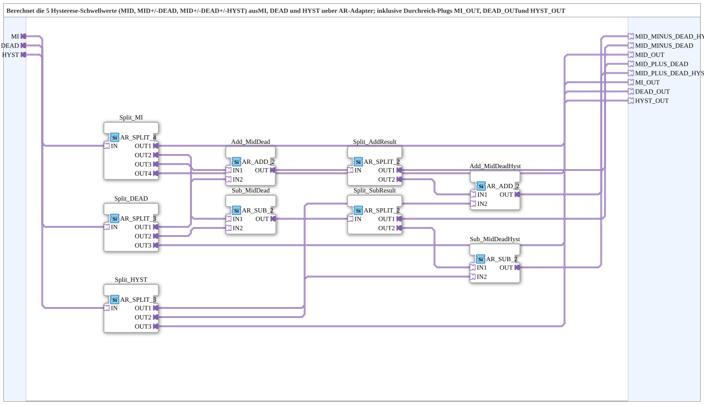

# DualHysteresis_Thresholds_AR

* * * * * * * * * *

## Introduction

`DualHysteresis_Thresholds_AR` calculates, from the set point `MI` (centre value), the dead band `DEAD` and the hysteresis `HYST`, the five thresholds of a two-way hysteresis (e.g. raise/lower) using AR adapters only. In addition, `MI`, `DEAD` and `HYST` are passed on through the pass-through plugs `MI_OUT`, `DEAD_OUT` and `HYST_OUT`.

## Interface Structure

### **Event Inputs**

The function block has no direct event inputs.

### **Event Outputs**

The function block has no direct event outputs.

### **Data Inputs**

The function block has no direct data inputs.

### **Data Outputs**

The function block has no direct data outputs.

### **Adapters**

- **MI** (socket, `AR`): set point / centre value (centre point)
- **DEAD** (socket, `AR`): dead band around `MI`
- **HYST** (socket, `AR`): hysteresis in addition to the dead band
- **MID_MINUS_DEAD_HYST** (plug, `AR`): threshold 1 = `MI - (DEAD + HYST)` [min / raise on / lower start]
- **MID_MINUS_DEAD** (plug, `AR`): threshold 2 = `MI - DEAD` [lower stop]
- **MID_OUT** (plug, `AR`): threshold 3 = `MI` (centre / set point), e.g. for a threshold marker
- **MID_PLUS_DEAD** (plug, `AR`): threshold 4 = `MI + DEAD` [raise stop]
- **MID_PLUS_DEAD_HYST** (plug, `AR`): threshold 5 = `MI + (DEAD + HYST)` [max / raise start]
- **MI_OUT**, **DEAD_OUT**, **HYST_OUT** (plugs, `AR`): pass-through plugs for `MI`, `DEAD` and `HYST` (e.g. for `DualHysteresis_AR_AX`)

## Functionality

Each input is first distributed to several consumers by a split block, because an adapter should never be branched without a split:

- `MI` → `Split_MI` (`AR_SPLIT_4`): `OUT1` → `MID_OUT`, `OUT2` → `Add_MidDead.IN1`, `OUT3` → `Sub_MidDead.IN1`, `OUT4` → `MI_OUT`.
- `DEAD` → `Split_DEAD` (`AR_SPLIT_3`): `OUT1` → `Add_MidDead.IN2`, `OUT2` → `Sub_MidDead.IN2`, `OUT3` → `DEAD_OUT`.
- `HYST` → `Split_HYST` (`AR_SPLIT_3`): `OUT1` → `Add_MidDeadHyst.IN2`, `OUT2` → `Sub_MidDeadHyst.IN2`, `OUT3` → `HYST_OUT`.

The calculation chain consists of `AR_ADD_2` and `AR_SUB_2` (`adapter::iec61131::arithmetic`):

- `Add_MidDead` = `MI + DEAD` → `Split_AddResult` (`AR_SPLIT_2`): `OUT1` → `MID_PLUS_DEAD`, `OUT2` → `Add_MidDeadHyst.IN1`.
- `Sub_MidDead` = `MI - DEAD` → `Split_SubResult` (`AR_SPLIT_2`): `OUT1` → `MID_MINUS_DEAD`, `OUT2` → `Sub_MidDeadHyst.IN1`.
- `Add_MidDeadHyst` = `(MI + DEAD) + HYST` → `MID_PLUS_DEAD_HYST`.
- `Sub_MidDeadHyst` = `(MI - DEAD) - HYST` → `MID_MINUS_DEAD_HYST`.

## Technical Details

- Pure calculation/wiring block without state of its own; the outputs follow the inputs
- `MI_OUT` is separate from the threshold `MID_OUT` (version 1.1: `Split_MI` extended from `AR_SPLIT_3` to `AR_SPLIT_4`) so that every plug has its own source
- The labels in square brackets (raise/lower) are the intended use of the thresholds in the caller logic

## Application Scenarios

- Two-way control (raise/lower) with dead band and hysteresis, e.g. filling belt or slope compensation height control, including threshold markers on the VT

## Conclusion

`DualHysteresis_Thresholds_AR` supplies, from `MI`, `DEAD` and `HYST`, the five thresholds `MI ± DEAD` and `MI ± (DEAD + HYST)` as well as `MI` itself using AR adapter arithmetic and passes the three input quantities on unchanged.
