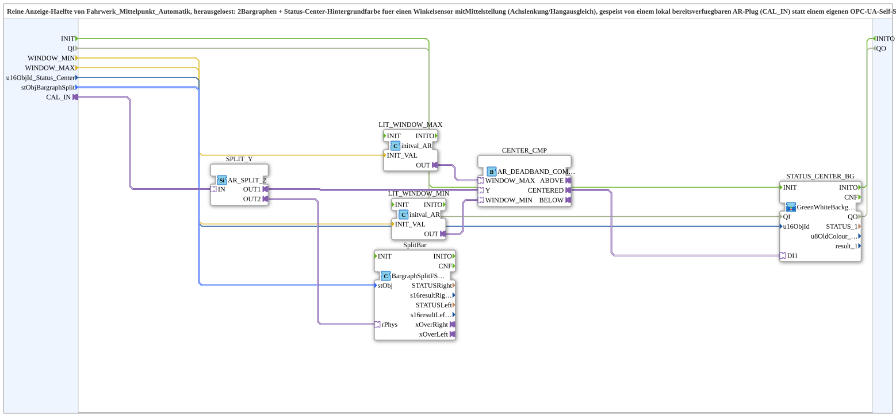

# Fahrwerk_Mittelpunkt_Anzeige

* * * * * * * * * *

## Introduction

`Fahrwerk_Mittelpunkt_Anzeige` is the **pure display half** of `Fahrwerk_Mittelpunkt_Automatik`: two bar graphs plus a status-centre background colour for an angle sensor with a centre position (axle steering/slope compensation). It is fed by an `AR` plug that is already available locally (`CAL_IN`) instead of by its own OPC-UA self-subscribe.

It is intended for cases where the actual automation (`AUTO_LINKS`/`AUTO_RECHTS` control) runs on a different station than the VT (e.g. slope compensation since the move to STG4), but a display is still needed there. No extra forwarding is necessary: the calibration channel consumer (`logiBUS_AI_Calibrated_Subscribe_VT_(3P_)OPC`) already has the value locally as the `CAL_OUT` plug, which is wired on directly here.

## Function Blocks (FBs) Used

### Sub-blocks: Fahrwerk_Mittelpunkt_Anzeige

- **Type**: SubAppType
- **Internal blocks used**:
    - **SPLIT_Y**: `adapter::events::unidirectional::AR_SPLIT_2` - distributes the angle to two consumers
    - **CENTER_CMP**: [`adapter::Engineering::measurements::AR_DEADBAND_COMPARE`](../../adapter/Engineering/measurements/AR_DEADBAND_COMPARE.md) - window comparison
    - **LIT_WINDOW_MIN**, **LIT_WINDOW_MAX**: `adapter::types::unidirectional::AR::initval::initval_AR` - convert the parameters `WINDOW_MIN`/`WINDOW_MAX` into `AR` signals
    - **SplitBar**: `isobus::UT::Q::BargraphSplitFS_AR` - two bar graphs (left/right of centre)
    - **STATUS_CENTER_BG**: SubApp [`MyLib::sys::GreenWhiteBackground1_AX`](./GreenWhiteBackground1_AX.md) - background colour of the `Status_Center` button

## Interface Structure

### **Event Inputs / Event Outputs**

None - events travel via the adapter.

### **Data Inputs**

- **WINDOW_MIN** (`REAL`, default `-2.0`): Lower window limit (%) from which "deflected left" applies - must match the `WINDOW_MIN` of the associated `Fahrwerk_Mittelpunkt_Automatik` instance
- **WINDOW_MAX** (`REAL`, default `2.0`): Upper window limit (%) from which "deflected right" applies - see `WINDOW_MIN`
- **u16ObjId_Status_Center** (`UINT`): Object ID of the `Status_Center` button (`Achslenkung_Status_Center` or `Hangausgleich_Status_Center`, "><" indicator)
- **stObjBargraphSplit** (`isobus::utils::bargraph::BargraphSplit_S`): Object IDs of the two bar graphs plus common magnitude limits (see `FBs::const::DefaultPool_BargraphSplit::Bargraph_Achslenkung_BargraphSplit` or `_Hangausgleich_BargraphSplit`)

### **Data Outputs**

None.

### **Adapters**

- **CAL_IN** (socket, `adapter::types::unidirectional::AR`): Calibrated angle from outside (e.g. `AnalogChannel_Hangausgleich_Winkel.CAL_OUT`)

## Program Flow and Connections

- `CAL_IN` → `SPLIT_Y.IN`
- `SPLIT_Y.OUT1` → `CENTER_CMP.Y`; `SPLIT_Y.OUT2` → `SplitBar.rPhys`
- `WINDOW_MIN` → `LIT_WINDOW_MIN.INIT_VAL`; `LIT_WINDOW_MIN.OUT` → `CENTER_CMP.WINDOW_MIN`
- `WINDOW_MAX` → `LIT_WINDOW_MAX.INIT_VAL`; `LIT_WINDOW_MAX.OUT` → `CENTER_CMP.WINDOW_MAX`
- `CENTER_CMP.CENTERED` → `STATUS_CENTER_BG.DI1`
- `u16ObjId_Status_Center` → `STATUS_CENTER_BG.u16ObjId`
- `stObjBargraphSplit` → `SplitBar.stObj`

## Technical Details

- Factored out of `Fahrwerk_Mittelpunkt_Automatik` (where `SUBSCRIBE_Y`, `SPLIT_Y`, `CENTER_CMP`, `SplitBar` and `STATUS_CENTER_BG` already appeared in exactly the same way)
- The automation itself has run on STG4 (no VT) since v3.0 of the slope compensation (there `u16ObjId_Status_Center` and `stObjBargraphSplit` are deliberately `ID_NULL`); this SubApp runs on STG1 instead, fed by the `CAL_OUT` plug that is available locally anyway - no additional remote round trip
- Version 1.0 (2026-09-26)

## Application Scenarios

- Displaying axle steering or slope compensation (two bar graphs plus centre indicator) on a station whose control runs on another station

## Summary

`Fahrwerk_Mittelpunkt_Anzeige` displays a calibrated angle as two bar graphs and as a status-centre background colour, without its own control and without an OPC-UA subscribe.
