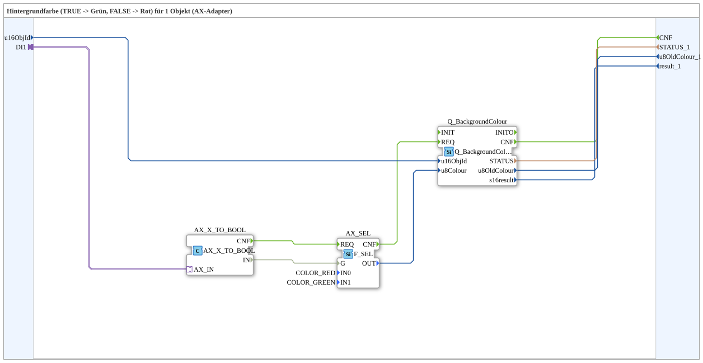

# GreenRedBackground1_AX_UNGATED

* * * * * * * * * *

## Introduction

`GreenRedBackground1_AX_UNGATED` sets the **background color** of a VT object via an AX adapter: `TRUE` → green, `FALSE` → red. "UNGATED" means that the selector is not gated by an additional enable signal - every update of `DI1` writes the color immediately.

## Interface Structure

### **Event Inputs**

- **INIT** (`EInit`): initialization request - to `Q_BackgroundColour.INIT`; further events arrive via the adapter socket

### **Event Outputs**

- **INITO** (`EInit`): initialization confirmation (from `Q_BackgroundColour.INITO`)
- **CNF**: Execution confirmation (from `Q_BackgroundColour.CNF`)

### **Data Inputs**

- **QI** (`BOOL`, default `TRUE`): Quality Input - TRUE to enable the service
- **u16ObjId** (`UINT`, default `ID_NULL`): Object ID of the softkey/button

### **Data Outputs**

- **QO** (`BOOL`): Quality Output - TRUE if the service was executed successfully (from `Q_BackgroundColour.QO`)
- **STATUS_1** (`STRING`): Service status
- **u8OldColour_1** (`USINT`): Old color value of the object
- **result_1** (`INT`): Return value (see `Q_BackgroundColour`)

### **Adapters**

- **DI1** (socket, `adapter::types::unidirectional::AX`): Selector - `TRUE` for green, `FALSE` for red

## Function Blocks (FBs) Used

- **AX_X_TO_BOOL**: `adapter::conversion::unidirectional::AX_X_TO_BOOL` - converts the AX selector into event `CNF` and value `IN` (`BOOL`)
- **AX_SEL**: `iec61131::selection::F_SEL` with `IN0 = COLOR_RED`, `IN1 = COLOR_GREEN` - selects the color
- **Q_BackgroundColour**: `isobus::UT::Q::Q_BackgroundColour` - writes the background color to the VT object

## Program Flow and Connections

1. `DI1` → `AX_X_TO_BOOL.AX_IN`; `AX_X_TO_BOOL.IN` → `AX_SEL.G`; `AX_X_TO_BOOL.CNF` → `AX_SEL.REQ`.
2. `AX_SEL.OUT` → `Q_BackgroundColour.u8Colour`; `AX_SEL.CNF` → `Q_BackgroundColour.REQ`.
3. `u16ObjId` → `Q_BackgroundColour.u16ObjId`.
4. `Q_BackgroundColour.CNF` → `CNF`; `STATUS`, `u8OldColour`, `s16result` → `STATUS_1`, `u8OldColour_1`, `result_1`.
5. `INIT` → `Q_BackgroundColour.INIT`; `Q_BackgroundColour.INITO` → `INITO`; `QI` → `Q_BackgroundColour.QI`; `Q_BackgroundColour.QO` → `QO`.

## Application Scenarios

- Green/red status display for buttons or areas (e.g. operation/fault) without additional enable logic

## Summary

`GreenRedBackground1_AX_UNGATED` immediately colors a VT object green or red depending on an AX signal.
