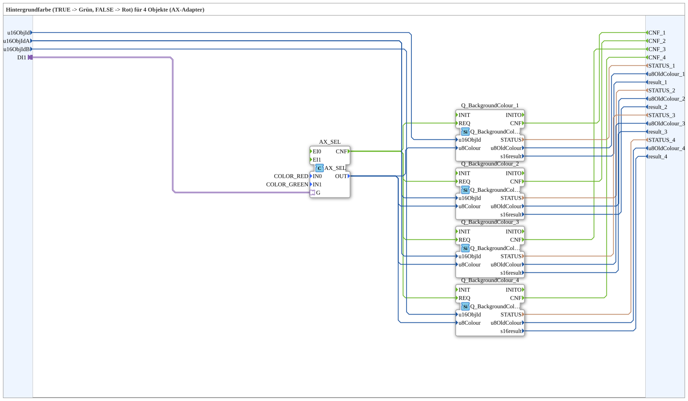
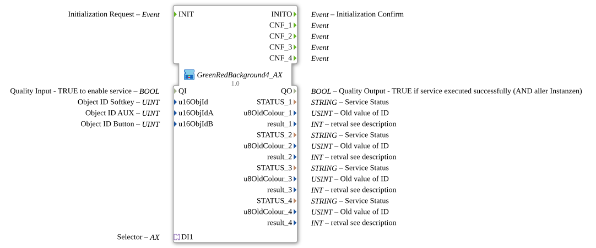

# GreenRedBackground4_AX

* * * * * * * * * *

## Introduction

`GreenRedBackground4_AX` switches the VT background color of 4 objects based on a boolean selector signal: `TRUE` → **Grün**, `FALSE` → **Rot**. The selector signal arrives via an `AX` adapter socket (`DI1`). The object ID is passed via inputs `u16ObjId, u16ObjIdA, u16ObjIdB`.

| Position | Object ID source | Block                                               |
| -------- | ---------------- | --------------------------------------------------- |
| 1        | `u16ObjId`       | `Q_BackgroundColour` (regular object)               |
| 2        | `u16ObjIdA`      | `Q_BackgroundColour` (regular object)               |
| 3        | `u16ObjIdA`      | `Q_BackgroundColourAux` (auxiliary function object) |
| 4        | `u16ObjIdB`      | `Q_BackgroundColour` (regular object)               |

For the general pattern (selector → `AX_SEL`/`F_SEL` → `Q_BackgroundColour`), see [Background Color Blocks (shared pattern)](./Background-Color-Blocks.md).

## Initialization and Status (INIT/INITO, QI/QO)

- **Event input** `INIT` (`EInit`, Initialization Request) and **event output** `INITO` (`EInit`, Initialization Confirm)
- **Data input** `QI` (`BOOL`, default `TRUE`, Quality Input) is forwarded to `Q_BackgroundColour_1.QI`, `Q_BackgroundColour_2.QI`, `Q_BackgroundColour_3.QI` and `Q_BackgroundColour_4.QI`
- **Data output** `QO` (`BOOL`, Quality Output): AND (`AND_QO`, type `iec61131::booleanOperators::AND_BOOL_4`) of the `QO` outputs of `Q_BackgroundColour_1.QO`, `Q_BackgroundColour_2.QO`, `Q_BackgroundColour_3.QO` and `Q_BackgroundColour_4.QO`
- **Initialization chain**: `INIT` → `Q_BackgroundColour_1.INIT`, `Q_BackgroundColour_1.INITO` → `Q_BackgroundColour_2.INIT`, `Q_BackgroundColour_2.INITO` → `Q_BackgroundColour_3.INIT`, `Q_BackgroundColour_3.INITO` → `Q_BackgroundColour_4.INIT`, `Q_BackgroundColour_4.INITO` → `INITO`
- `E_MERGE_QO_A` (type `iec61499::events::E_MERGE_4`) merges `Q_BackgroundColour_4.INITO`, `Q_BackgroundColour_1.CNF`, `Q_BackgroundColour_2.CNF` and `Q_BackgroundColour_3.CNF` and passes the result to `E_MERGE_QO.EI1`
- `E_MERGE_QO` (type `iec61499::events::E_MERGE_2`) merges `E_MERGE_QO_A.EO` and `Q_BackgroundColour_4.CNF` and triggers `AND_QO.REQ`

## Summary

One of many variants in the background color block family: color pair Grün/Rot, 4 objects, adapter selector.

---

### 🌐 Related topic subpages on ms-muc-docs.de

- [🌐 Eclipse 4diac IDE & color reference on ms-muc-docs.de](https://www.ms-muc-docs.de/iec-61499/eclipse-4diac/)
