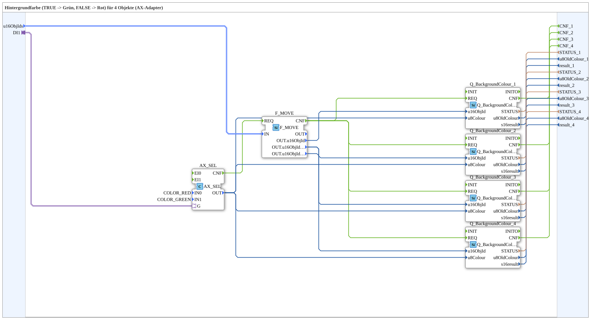

# GreenRedBackground4_AXS

* * * * * * * * * *

## Introduction

`GreenRedBackground4_AXS` switches the VT background color of 4 objects based on a boolean selector signal: `TRUE` → **Grün**, `FALSE` → **Rot**. The selector signal arrives via an `AX` adapter socket (`DI1`). The object ID is passed via the structured type `s3ObjectIDs` (`u16ObjIds`).

| Position | Object ID source       | Block                                               |
| -------- | ---------------------- | --------------------------------------------------- |
| 1        | `F_MOVE.OUT.u16ObjId`  | `Q_BackgroundColour` (regular object)               |
| 2        | `F_MOVE.OUT.u16ObjIdA` | `Q_BackgroundColour` (regular object)               |
| 3        | `F_MOVE.OUT.u16ObjIdA` | `Q_BackgroundColourAux` (auxiliary function object) |
| 4        | `F_MOVE.OUT.u16ObjIdB` | `Q_BackgroundColour` (regular object)               |

For the general pattern (selector → `AX_SEL`/`F_SEL` → `Q_BackgroundColour`), see [Background Color Blocks (shared pattern)](./Background-Color-Blocks.md).

**Initialization and quality:** The SubApp has `INIT`/`INITO` and `QI`/`QO`. `INIT` → `Q_BackgroundColour_1.INIT` → `Q_BackgroundColour_2.INIT` → `Q_BackgroundColour_3.INIT` → `Q_BackgroundColour_4.INIT` (each via `INITO`), `Q_BackgroundColour_4.INITO` → `INITO`. `QI` goes to all four instances. `QO` is the `AND` (`AND_QO`, `AND_BOOL_4`) of the four `QO` outputs; `AND_QO.REQ` is triggered via the cascade `E_MERGE_QO_A` (`E_MERGE_4`: `Q_BackgroundColour_4.INITO`, `Q_BackgroundColour_1.CNF`, `_2.CNF`, `_3.CNF`) and `E_MERGE_QO` (`E_MERGE_2`: output of `E_MERGE_QO_A` and `Q_BackgroundColour_4.CNF`).

## Summary

One of many variants in the background color block family: color pair Grün/Rot, 4 objects, adapter selector, struct. object ID.

---

### 🌐 Related topic subpages on ms-muc-docs.de

* [🌐 Eclipse 4diac IDE & color reference on ms-muc-docs.de](https://www.ms-muc-docs.de/iec-61499/eclipse-4diac/)
