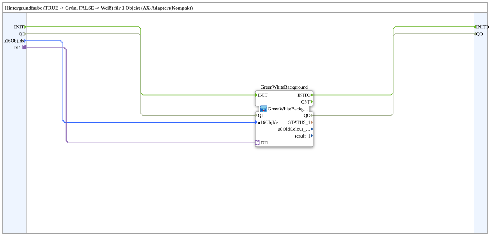

# GreenWhiteBackground1_AXSC

* * * * * * * * * *

## Introduction

`GreenWhiteBackground1_AXSC` is a **compact wrapper** around [`GreenWhiteBackground1_AXS`](GreenWhiteBackground1_AXS.md) — passes `u16ObjId`s and the selector straight through, without exposing the `CNF` event outputs and diagnostic values (`STATUS_n`, `u8OldColour_n`, `result_n`).

For the shared pattern, see [Background Color Blocks (shared pattern)](./Background-Color-Blocks.md).

## Initialization and Quality

- **Event input `INIT`** (`EInit`) and **event output `INITO`** (`EInit`) are passed through: `INIT` → `GreenWhiteBackground.INIT`; `GreenWhiteBackground.INITO` → `INITO`.
- **Data input `QI`** (`BOOL`, default `TRUE`) → `GreenWhiteBackground.QI`; **data output `QO`** (`BOOL`) ← `GreenWhiteBackground.QO`.

The inner SubApp instance `GreenWhiteBackground` is of type `GreenWhiteBackground1_AXS`.

## Summary

A pure pass-through to `GreenWhiteBackground1_AXS` for the common case where the diagnostic values aren't needed.

---

### 🌐 Related topic subpages on ms-muc-docs.de

- [🌐 Eclipse 4diac IDE & color reference on ms-muc-docs.de](https://www.ms-muc-docs.de/iec-61499/eclipse-4diac/)
