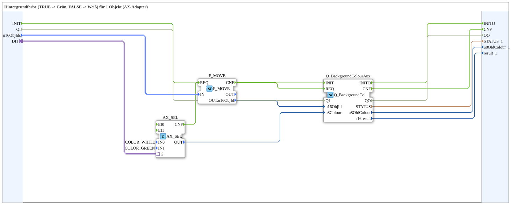

# GreenWhiteBackground1_aux_AXS

* * * * * * * * * *

## Introduction

`GreenWhiteBackground1_aux_AXS` switches the VT background color of one object based on a boolean selector signal: `TRUE` → **Grün**, `FALSE` → **Weiß**. The selector signal arrives via an `AX` adapter socket (`DI1`). The object ID is passed via the structured type `s1ObjectID` (`u16ObjIds`).

For the general pattern (selector → `AX_SEL`/`F_SEL` → `Q_BackgroundColour`), see [Background Color Blocks (shared pattern)](./Background-Color-Blocks.md).

Quality pattern: the SubApp has the event input `INIT`, the event output `INITO`, the data input `QI` (`BOOL`, default `TRUE`, "Quality Input - TRUE to enable service") and the data output `QO` (`BOOL`, "Quality Output - TRUE if service executed successfully"). They are passed straight through to `Q_BackgroundColourAux`: `INIT` → `Q_BackgroundColourAux.INIT`, `Q_BackgroundColourAux.INITO` → `INITO`, `QI` → `Q_BackgroundColourAux.QI`, `Q_BackgroundColourAux.QO` → `QO`.

## Summary

One of many variants in the background color block family: color pair Grün/Weiß, 1 object, adapter selector, struct. object ID.

---

### 🌐 Related topic subpages on ms-muc-docs.de

* [🌐 Eclipse 4diac IDE & color reference on ms-muc-docs.de](https://www.ms-muc-docs.de/iec-61499/eclipse-4diac/)
