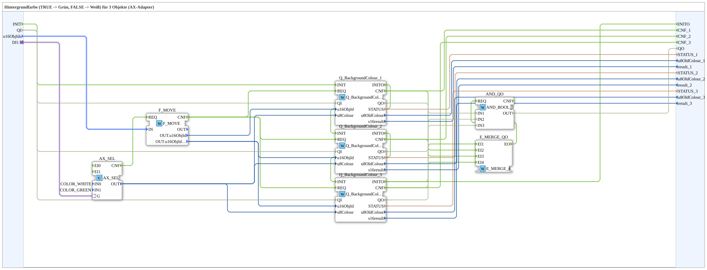
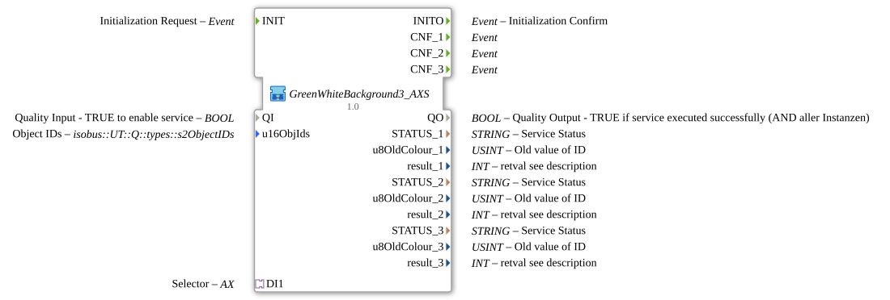

# GreenWhiteBackground3_AXS

* * * * * * * * * *

## Introduction

`GreenWhiteBackground3_AXS` switches the VT background color of 3 objects based on a boolean selector signal: `TRUE` → **Grün**, `FALSE` → **Weiß**. The selector signal arrives via an `AX` adapter socket (`DI1`). The object ID is passed via the structured type `s1ObjectID` (`u16ObjIds`).

| Position | Object ID source       | Block                                               |
| -------- | ---------------------- | --------------------------------------------------- |
| 1        | `F_MOVE.OUT.u16ObjId`  | `Q_BackgroundColour` (regular object)               |
| 2        | `F_MOVE.OUT.u16ObjIdA` | `Q_BackgroundColour` (regular object)               |
| 3        | `F_MOVE.OUT.u16ObjIdA` | `Q_BackgroundColourAux` (auxiliary function object) |

For the general pattern (selector → `AX_SEL`/`F_SEL` → `Q_BackgroundColour`), see [Background Color Blocks (shared pattern)](./Background-Color-Blocks.md).

## Initialization and Status (INIT/INITO, QI/QO)

- **Event input** `INIT` (`EInit`, Initialization Request) and **event output** `INITO` (`EInit`, Initialization Confirm)
- **Data input** `QI` (`BOOL`, default `TRUE`, Quality Input) is forwarded to `Q_BackgroundColour_1.QI`, `Q_BackgroundColour_2.QI` and `Q_BackgroundColour_3.QI`
- **Data output** `QO` (`BOOL`, Quality Output): AND (`AND_QO`, type `iec61131::booleanOperators::AND_BOOL_3`) of the `QO` outputs of `Q_BackgroundColour_1.QO`, `Q_BackgroundColour_2.QO` and `Q_BackgroundColour_3.QO`
- **Initialization chain**: `INIT` → `Q_BackgroundColour_1.INIT`, `Q_BackgroundColour_1.INITO` → `Q_BackgroundColour_2.INIT`, `Q_BackgroundColour_2.INITO` → `Q_BackgroundColour_3.INIT`, `Q_BackgroundColour_3.INITO` → `INITO`
- `E_MERGE_QO` (type `iec61499::events::E_MERGE_4`) merges `Q_BackgroundColour_3.INITO`, `Q_BackgroundColour_1.CNF`, `Q_BackgroundColour_2.CNF` and `Q_BackgroundColour_3.CNF` and triggers `AND_QO.REQ`

## Summary

One of many variants in the background color block family: color pair Grün/Weiß, 3 objects, adapter selector, struct. object ID.

---

### 🌐 Related topic subpages on ms-muc-docs.de

- [🌐 Eclipse 4diac IDE & color reference on ms-muc-docs.de](https://www.ms-muc-docs.de/iec-61499/eclipse-4diac/)
