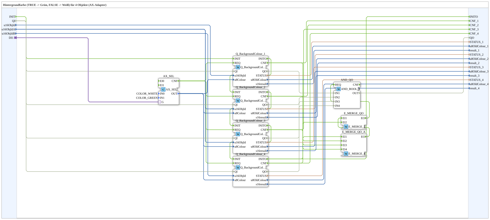

# GreenWhiteBackground4_AX

* * * * * * * * * *

## Introduction

`GreenWhiteBackground4_AX` switches the VT background color of 4 objects based on a boolean selector signal: `TRUE` → **Grün**, `FALSE` → **Weiß**. The selector signal arrives via an `AX` adapter socket (`DI1`). The object ID is passed via inputs `u16ObjId, u16ObjIdA, u16ObjIdB`.

| Position | Object ID source | Block                                               |
| -------- | ---------------- | --------------------------------------------------- |
| 1        | `u16ObjId`       | `Q_BackgroundColour` (regular object)               |
| 2        | `u16ObjIdA`      | `Q_BackgroundColour` (regular object)               |
| 3        | `u16ObjIdA`      | `Q_BackgroundColourAux` (auxiliary function object) |
| 4        | `u16ObjIdB`      | `Q_BackgroundColour` (regular object)               |

**Initialization and quality:** In addition to the previous events, the block has the event input `INIT`, the event output `INITO`, as well as `QI` (BOOL, input, initial value `TRUE`) and `QO` (BOOL, output, AND of all instances). Init chain: `INIT` → `Q_BackgroundColour_1` → `Q_BackgroundColour_2` → `Q_BackgroundColour_3` → `Q_BackgroundColour_4` → `INITO` (each `INITO` → next `INIT`). `QI` is passed on to all `Q_BackgroundColour_n.QI`. `QO` is formed by `AND_QO` (`iec61131::booleanOperators::AND_BOOL_4`): `Q_BackgroundColour_1.QO` → `AND_QO.IN1`, `Q_BackgroundColour_2.QO` → `AND_QO.IN2`, `Q_BackgroundColour_3.QO` → `AND_QO.IN3`, `Q_BackgroundColour_4.QO` → `AND_QO.IN4`, `AND_QO.OUT` → `QO`. `E_MERGE_QO_A` (`E_MERGE_4`) merges `Q_BackgroundColour_4.INITO` and the `CNF` outputs of `Q_BackgroundColour_1`, `Q_BackgroundColour_2` and `Q_BackgroundColour_3`, `E_MERGE_QO` (`E_MERGE_2`) adds `Q_BackgroundColour_4.CNF`; `E_MERGE_QO.EO` triggers `AND_QO.REQ`.

For the general pattern (selector → `AX_SEL`/`F_SEL` → `Q_BackgroundColour`), see [Background Color Blocks (shared pattern)](./Background-Color-Blocks.md).

## Summary

One of many variants in the background color block family: color pair Grün/Weiß, 4 objects, adapter selector.

---

### 🌐 Related topic subpages on ms-muc-docs.de

* [🌐 Eclipse 4diac IDE & color reference on ms-muc-docs.de](https://www.ms-muc-docs.de/iec-61499/eclipse-4diac/)
