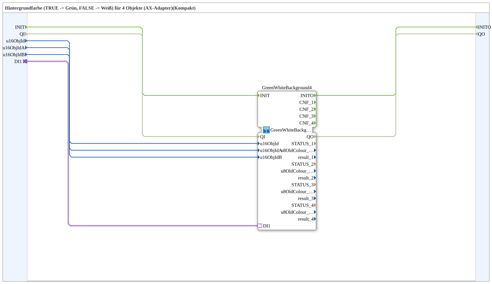

# GreenWhiteBackground4_AXC

* * * * * * * * * *

## Introduction

`GreenWhiteBackground4_AXC` is a **compact wrapper** around [`GreenWhiteBackground4_AX`](GreenWhiteBackground4_AX.md) — passes `u16ObjId` and the selector straight through, without exposing the `CNF` event outputs and diagnostic values (`STATUS_n`, `u8OldColour_n`, `result_n`).

For the shared pattern, see [Background Color Blocks (shared pattern)](./Background-Color-Blocks.md).

In addition, the wrapper exposes the initialization and quality interface: event input `INIT`, event output `INITO`, data input `QI` (`BOOL`, initial value `TRUE`) and data output `QO` (`BOOL`). They are passed 1:1 through to the inner instance `GreenWhiteBackground4`: `INIT` → `GreenWhiteBackground4.INIT`, `GreenWhiteBackground4.INITO` → `INITO`, `QI` → `GreenWhiteBackground4.QI`, `GreenWhiteBackground4.QO` → `QO`.

## Summary

A pure pass-through to `GreenWhiteBackground4_AX` for the common case where the diagnostic values aren't needed.

---

### 🌐 Related topic subpages on ms-muc-docs.de

* [🌐 Eclipse 4diac IDE & color reference on ms-muc-docs.de](https://www.ms-muc-docs.de/iec-61499/eclipse-4diac/)
