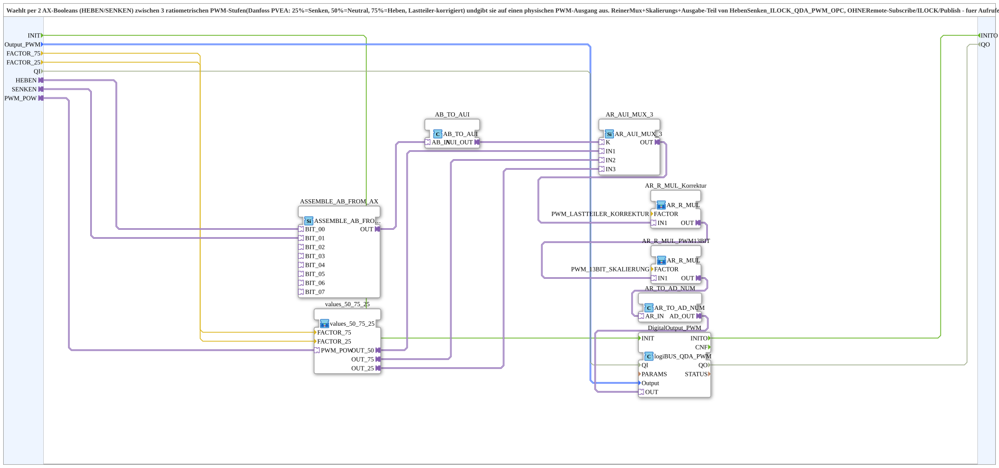

# HebenSenken_QDA_PWM

* * * * * * * * * *

## Introduction

`HebenSenken_QDA_PWM` selects, via two AX booleans (`HEBEN`/`SENKEN`), between three ratiometric PWM levels (Danfoss PVEA: 25 % = lower, 50 % = neutral, 75 % = raise, load-divider corrected) and outputs the selected level on a physical PWM output. It is the pure mux, scaling and output part of `HebenSenken_ILOCK_QDA_PWM_OPC`, without remote subscribe, ILOCK and publish. It suits callers that already supply `HEBEN`/`SENKEN` by other means (e.g. already gated/exclusive or using only one direction).

## Interface Structure

### **Event Inputs**

- **INIT** (`EInit`): initialisation; sequenced by the caller instead of automatic distribution, so that `QI` is settled before the physical channel is bound; passed on to `DigitalOutput_PWM.INIT`

### **Event Outputs**

The function block has no direct event outputs.

### **Data Inputs**

- **Output_PWM** (`logiBUS::io::DQ::logiBUS_DO_S`): physical PWM output (25/50/75 % duty cycle, ratiometric), default `logiBUS_DO::Invalid`
- **FACTOR_75** (REAL): multimeter-calibrated correction factor on the nominal `OUT_75` span (25.0), passed on to `values_50_75_25.FACTOR_75` (default `REAL#1.0`)
- **FACTOR_25** (REAL): multimeter-calibrated correction factor on the nominal `OUT_25` span (25.0), passed on to `values_50_75_25.FACTOR_25` (default `REAL#1.0`)
- **QI** (BOOL): qualifier for the physical PWM output (default TRUE); FALSE keeps the instance completely inactive (no hardware binding) in case the same physical channel is used differently depending on the machine variant

### **Data Outputs**

The function block has no direct data outputs.

### **Adapters**

- **HEBEN** (socket, `AX`): TRUE selects `OUT_75` (raise); wire permanently to FALSE if not needed
- **SENKEN** (socket, `AX`): TRUE selects `OUT_25` (lower); wire permanently to FALSE if not needed
- **PWM_POW** (socket, `AR`): PWM power, 1.0 = maximum power, 0.0 = off, 0.5 = half; passed on to `values_50_75_25.PWM_POW`

## Functionality

The chain in the network:

1. `HEBEN` → `ASSEMBLE_AB_FROM_AX.BIT_00` and `SENKEN` → `ASSEMBLE_AB_FROM_AX.BIT_01`: both booleans are assembled into a byte (`HEBEN` is the least significant bit).
2. `AB_TO_AUI` converts the byte into an `AUI` value that goes to `AR_AUI_MUX_3` as the selection `K`: `K = 0` (both FALSE) selects `IN1` = `OUT_50` (neutral), `K = 1` (`HEBEN`) selects `IN2` = `OUT_75`, `K = 2` (`SENKEN`) selects `IN3` = `OUT_25`.
3. `values_50_75_25` supplies the three set values `OUT_50`, `OUT_75`, `OUT_25` from `PWM_POW` and `FACTOR_75`/`FACTOR_25`.
4. `AR_AUI_MUX_3.OUT` → `AR_R_MUL_Korrektur` (factor `PWM_LASTTEILER_KORREKTUR`) → `AR_R_MUL_PWM13BIT` (factor `PWM_13BIT_SKALIERUNG`) → `AR_TO_AD_NUM` → `DigitalOutput_PWM.OUT`.
5. `DigitalOutput_PWM` (`logiBUS::io::DQ::logiBUS_QDA_PWM`) outputs the value at `Output_PWM`; `QI` is routed directly to `DigitalOutput_PWM.QI` and the event `INIT` to `DigitalOutput_PWM.INIT`.

## Technical Details

- There is **no** interlock: the caller must ensure that `HEBEN` and `SENKEN` are never TRUE at the same time, otherwise `AR_AUI_MUX_3` delivers undefined behaviour for `K = 3`
- The plug/variable names `_75`/`_25` are historical; the actually calibrated values at `PWM_POW = 1.0` are 90.0 and 15.0 (see [`values_50_75_25`](values_50_75_25.md))
- The input `QI` (version 1.1) allows the instance to be kept completely inactive when the channel is used otherwise
- The event input `INIT` (version 1.2) replaces the automatic distribution of the initialisation: the caller triggers it itself ("init like Tecu"), so that `QI` is settled before the physical channel is bound
- First caller: `Bunkerboden_PWM.SUB`, which uses only `SENKEN` (full throttle) and ties `HEBEN` permanently to FALSE

## Application Scenarios

- Control of a proportional valve (Danfoss PVEA) with 25/50/75 % PWM for lower/neutral/raise
- Applications with already gated or only one-sidedly used direction signals

## Conclusion

`HebenSenken_QDA_PWM` converts two direction booleans without interlock into one of the three ratiometric PWM levels and outputs it scaled at the physical PWM output.
