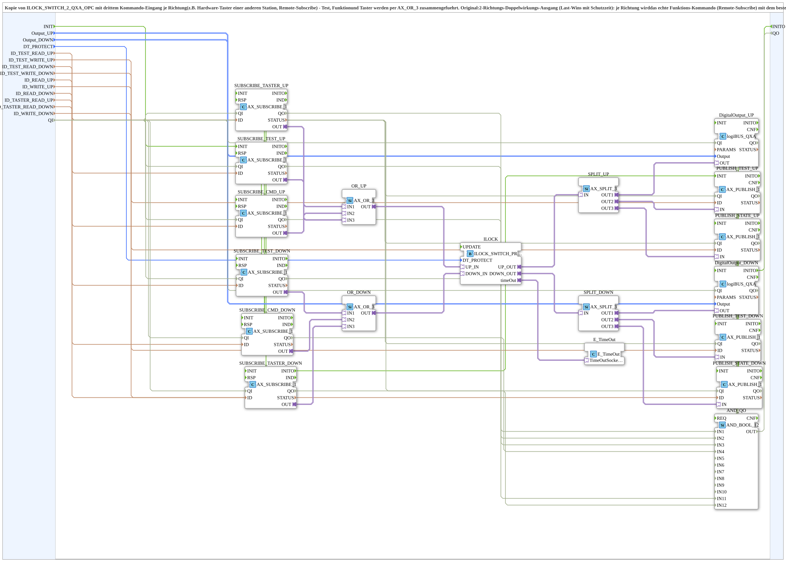

# ILOCK_SWITCH_2_QXA_TASTER_OPC

* * * * * * * * * *

## Introduction

`ILOCK_SWITCH_2_QXA_TASTER_OPC` is a copy of [`ILOCK_SWITCH_2_QXA_OPC`](./ILOCK_SWITCH_2_QXA_OPC.md) (v1.3, the original remains unchanged) with a third command input per direction (e.g. a hardware pushbutton of another station or a remote subscribe). Test command, function command and pushbutton are merged via `AX_OR_3`. Like the original, the SubApp is a 2-direction double-acting output (last-wins with protection time): for each direction the real function command (remote subscribe) and the existing IO-test command (remote subscribe) are merged before they enter the interlock. The IO test remains usable, but can no longer switch both directions permanently at the same time. The interlocked output drives the physical logiBUS channel and reports its actual state back both to the existing IO-test monitoring and to the real function feedback (e.g. `GreenWhiteBackground` on the SoftKey). The block is generic for any "digital DW" actuator (see `IO-Liste_Vereinheitlicht.md`) operated from a module without its own VT. First use: row adjustment KVE16 (pushbuttons S1.7/S1.8 on STG4 I4/I5, valve on STG3 Q5/Q6).

## Interface Structure

### **Event Inputs**

- `INIT` (`EInit`): Initialization - sequenced by the caller instead of automatic distribution, so that `QI` is settled before the physical channel binding.

### **Event Outputs**

- `INITO` (`EInit`): Initialization confirmed (from `DigitalOutput_DOWN.INITO`) - for callers that need a real confirm chain (e.g. behind an `Option::AOption` adapter).

### **Data Inputs**

| Name | Type | Description |
|------|-----|--------------|
| `Output_UP` | `logiBUS::io::DQ::logiBUS_DO_S` | Physical output, direction UP/left. Initial value `logiBUS_DO::Invalid`. |
| `Output_DOWN` | `logiBUS::io::DQ::logiBUS_DO_S` | Physical output, direction DOWN/right. Initial value `logiBUS_DO::Invalid`. |
| `DT_PROTECT` | `TIME` | Protection dead time before a change of direction. Initial value `T#300ms`. |
| `ID_TEST_READ_UP` | `WSTRING` | Existing IO-test subscribe address UP (e.g. `STG3_Q0x_READ`). |
| `ID_TEST_WRITE_UP` | `WSTRING` | Existing IO-test publish address UP (e.g. `STG3_Q0x_WRITE`). |
| `ID_TEST_READ_DOWN` | `WSTRING` | Existing IO-test subscribe address DOWN. |
| `ID_TEST_WRITE_DOWN` | `WSTRING` | Existing IO-test publish address DOWN. |
| `ID_READ_UP` | `WSTRING` | Real function command UP (subscribe). |
| `ID_WRITE_UP` | `WSTRING` | Real function feedback UP (publish). |
| `ID_READ_DOWN` | `WSTRING` | Real function command DOWN (subscribe). |
| `ID_TASTER_READ_UP` | `WSTRING` | Third command source UP, e.g. a hardware pushbutton (subscribe). |
| `ID_TASTER_READ_DOWN` | `WSTRING` | Third command source DOWN, e.g. a hardware pushbutton (subscribe). |
| `ID_WRITE_DOWN` | `WSTRING` | Real function feedback DOWN (publish). |
| `QI` | `BOOL` | Qualifier for the physical outputs - FALSE keeps this instance completely inactive (no hardware binding), for the case that the same physical channel is used differently depending on the machine variant. Initial value `TRUE`. |

### **Data Outputs**

| Name | Type | Description |
|------|-----|--------------|
| `QO` | `BOOL` | Quality Output - TRUE if the service was executed successfully (AND of all subscribe/publish/DigitalOutput instances). |

### **Adapters**

None.

## Function Blocks (FBs) Used

- **SUBSCRIBE_TEST_UP / SUBSCRIBE_TEST_DOWN** (`adapter::net::AX_SUBSCRIBE_1`): IO-test command per direction (`ID_TEST_READ_UP` / `ID_TEST_READ_DOWN`).
- **SUBSCRIBE_CMD_UP / SUBSCRIBE_CMD_DOWN** (`adapter::net::AX_SUBSCRIBE_1`): real function command per direction (`ID_READ_UP` / `ID_READ_DOWN`).
- **SUBSCRIBE_TASTER_UP / SUBSCRIBE_TASTER_DOWN** (`adapter::net::AX_SUBSCRIBE_1`): third command source per direction (`ID_TASTER_READ_UP` / `ID_TASTER_READ_DOWN`).
- **OR_UP / OR_DOWN** (`adapter::booleanOperators::AX_OR_3`): merge test, function and pushbutton per direction.
- **ILOCK** (`logiBUS::signalprocessing::interlock::ILOCK_SWITCH_PROTECT_AX`): interlock with protection time `DT_PROTECT`.
- **E_TimeOut** (`iec61499::events::E_TimeOut`): timer for the protection time, connected to `ILOCK.timeOut`.
- **SPLIT_UP / SPLIT_DOWN** (`adapter::events::unidirectional::AX_SPLIT_3`): distribute the interlocked state per direction to three targets.
- **DigitalOutput_UP / DigitalOutput_DOWN** (`logiBUS::io::DQ::logiBUS_QXA`): physical outputs.
- **PUBLISH_TEST_UP / PUBLISH_TEST_DOWN** (`adapter::net::AX_PUBLISH_1`): IO-test feedback (`ID_TEST_WRITE_UP` / `ID_TEST_WRITE_DOWN`).
- **PUBLISH_STATE_UP / PUBLISH_STATE_DOWN** (`adapter::net::AX_PUBLISH_1`): function feedback (`ID_WRITE_UP` / `ID_WRITE_DOWN`).
- **AND_QO** (`iec61131::booleanOperators::AND_BOOL_12`): combines the `QO` of the twelve subscribe/publish/DigitalOutput instances.

## Program Flow and Connections

1. Initialization chain: `INIT` → `SUBSCRIBE_TEST_UP.INIT` → `SUBSCRIBE_CMD_UP` → `SUBSCRIBE_TEST_DOWN` → `SUBSCRIBE_CMD_DOWN` → `SUBSCRIBE_TASTER_UP` → `SUBSCRIBE_TASTER_DOWN` → `PUBLISH_TEST_UP` → `PUBLISH_STATE_UP` → `PUBLISH_TEST_DOWN` → `PUBLISH_STATE_DOWN` → `DigitalOutput_UP` → `DigitalOutput_DOWN` (each `INITO` → next `INIT`); `DigitalOutput_DOWN.INITO` → `INITO` and → `AND_QO.REQ`.
2. Commands UP: `SUBSCRIBE_TEST_UP.OUT` → `OR_UP.IN1`, `SUBSCRIBE_CMD_UP.OUT` → `OR_UP.IN2`, `SUBSCRIBE_TASTER_UP.OUT` → `OR_UP.IN3`; `OR_UP.OUT` → `ILOCK.UP_IN`.
3. Commands DOWN: `SUBSCRIBE_TEST_DOWN.OUT` → `OR_DOWN.IN1`, `SUBSCRIBE_CMD_DOWN.OUT` → `OR_DOWN.IN2`, `SUBSCRIBE_TASTER_DOWN.OUT` → `OR_DOWN.IN3`; `OR_DOWN.OUT` → `ILOCK.DOWN_IN`.
4. Protection time: `DT_PROTECT` → `ILOCK.DT_PROTECT`; `ILOCK.timeOut` → `E_TimeOut.TimeOutSocket`.
5. Distribution UP: `ILOCK.UP_OUT` → `SPLIT_UP.IN`; `SPLIT_UP.OUT1` → `DigitalOutput_UP.OUT`, `SPLIT_UP.OUT2` → `PUBLISH_TEST_UP.IN`, `SPLIT_UP.OUT3` → `PUBLISH_STATE_UP.IN`.
6. Distribution DOWN: `ILOCK.DOWN_OUT` → `SPLIT_DOWN.IN`; `SPLIT_DOWN.OUT1` → `DigitalOutput_DOWN.OUT`, `SPLIT_DOWN.OUT2` → `PUBLISH_TEST_DOWN.IN`, `SPLIT_DOWN.OUT3` → `PUBLISH_STATE_DOWN.IN`.
7. Addresses: `ID_TEST_READ_UP` → `SUBSCRIBE_TEST_UP.ID`, `ID_READ_UP` → `SUBSCRIBE_CMD_UP.ID`, `ID_TASTER_READ_UP` → `SUBSCRIBE_TASTER_UP.ID`, `ID_TEST_READ_DOWN` → `SUBSCRIBE_TEST_DOWN.ID`, `ID_READ_DOWN` → `SUBSCRIBE_CMD_DOWN.ID`, `ID_TASTER_READ_DOWN` → `SUBSCRIBE_TASTER_DOWN.ID`, `ID_TEST_WRITE_UP` → `PUBLISH_TEST_UP.ID`, `ID_WRITE_UP` → `PUBLISH_STATE_UP.ID`, `ID_TEST_WRITE_DOWN` → `PUBLISH_TEST_DOWN.ID`, `ID_WRITE_DOWN` → `PUBLISH_STATE_DOWN.ID`.
8. Outputs: `Output_UP` → `DigitalOutput_UP.Output`; `Output_DOWN` → `DigitalOutput_DOWN.Output`.
9. Qualifier: `QI` → `DigitalOutput_UP.QI`, `DigitalOutput_DOWN.QI` and the `QI` of all six subscribe and four publish instances.
10. Quality evaluation: `SUBSCRIBE_TEST_UP.QO` → `AND_QO.IN1`, `SUBSCRIBE_CMD_UP.QO` → `IN2`, `SUBSCRIBE_TEST_DOWN.QO` → `IN3`, `SUBSCRIBE_CMD_DOWN.QO` → `IN4`, `PUBLISH_TEST_UP.QO` → `IN5`, `PUBLISH_STATE_UP.QO` → `IN6`, `PUBLISH_TEST_DOWN.QO` → `IN7`, `PUBLISH_STATE_DOWN.QO` → `IN8`, `DigitalOutput_UP.QO` → `IN9`, `DigitalOutput_DOWN.QO` → `IN10`, `SUBSCRIBE_TASTER_UP.QO` → `IN11`, `SUBSCRIBE_TASTER_DOWN.QO` → `IN12`; `AND_QO.OUT` → `QO`.

## Technical Features

- Compared with the original, the inputs `ID_TASTER_READ_UP` / `ID_TASTER_READ_DOWN` are new, `OR_UP` / `OR_DOWN` are now `AX_OR_3` (previously `AX_OR_2`) and `AND_QO` is now `AND_BOOL_12`.
- The feedback is always derived from the actual, interlocked state.
- The interlock prevents both directions from being active permanently at the same time; the protection time `DT_PROTECT` is observed before a change of direction.

## Application Scenarios

- Double-acting output (e.g. valve with two coils) that, in addition to function and IO-test command, is operated from a hardware pushbutton of another station (first use: row adjustment KVE16).
- Operating a "digital DW" actuator from a module without its own VT.

## Summary

`ILOCK_SWITCH_2_QXA_TASTER_OPC` extends [`ILOCK_SWITCH_2_QXA_OPC`](./ILOCK_SWITCH_2_QXA_OPC.md) by a third command input per direction (pushbutton) and merges test, function and pushbutton via `AX_OR_3` in front of the interlock.

---

### 🌐 Related topic subpages on ms-muc-docs.de

- [🌐 Eclipse 4diac IDE & color reference on ms-muc-docs.de](https://www.ms-muc-docs.de/iec-61499/eclipse-4diac/)
