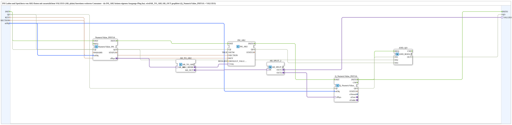

# INI_IN_AND_STORE_AR2

* * * * * * * * * *

## Introduction

`INI_IN_AND_STORE_AR2` is the AR2-adapter variant of [`INI_IN_AND_STORE_AR`](./INI_IN_AND_STORE_AR.md): a physically scaled REAL value entered via the VT (`NumericValue_PHYSA`) is persistently stored in an INI file (`eclipse4diac::storage::INI_AR2`, storage via the AR2 adapter socket instead of a plain value). Since `INI_AR2` has no output plug of its own, the `AR_TO_AR2` output is duplicated via `AR_SPLIT_2`: once back to the VT display (`Q_NumericValue_PHYSA`), once outward on `VALUEO` for a further consumer.

For the general pattern, see [INI_IN_AND_STORE / NVS_IN_AND_STORE (shared pattern)](./INI-NVS-Storage-Blocks.md).

## Technical notes

- `SETM=TRUE`: a live change during operation is confirmed/echoed immediately, not only at boot - important since the fresh value can be reused in the same run via `VALUEO`.
- `AR_TO_AR2` converts the plain-AR value from the VT input field into the bidirectional AR2 adapter that `INI_AR2` expects for storage.

## Quality ports (QI/QO)

The block has the event input `INIT` (`EInit`, Initialization Request), the event output `INITO` (`EInit`, Initialization Confirm), the data input `QI` (`BOOL`, default `TRUE`, Quality Input - TRUE enables the service) and the data output `QO` (`BOOL`, Quality Output - TRUE if the service was executed successfully).

- Initialization chain: `INIT` → `NumericValue_PHYSA.INIT`, `NumericValue_PHYSA.INITO` → `INI_AR2.INIT`, `INI_AR2.INITO` → `Q_NumericValue_PHYSA.INIT`, `Q_NumericValue_PHYSA.INITO` → `INITO` (and additionally → `AND_QO.REQ`)
- `QI` is connected to `Q_NumericValue_PHYSA.QI`, `NumericValue_PHYSA.QI` and `INI_AR2.QI`
- `QO` is the AND (`AND_QO`, type `iec61131::booleanOperators::AND_BOOL_3`) of `Q_NumericValue_PHYSA.QO`, `NumericValue_PHYSA.QO` and `INI_AR2.QO`

## Summary

AR2-adapter variant of the INI storage family, with an additional `VALUEO` output for a further consumer.

---

### 🌐 Related topic subpages on ms-muc-docs.de

- [🌐 Eclipse 4diac IDE & color reference on ms-muc-docs.de](https://www.ms-muc-docs.de/iec-61499/eclipse-4diac/)
