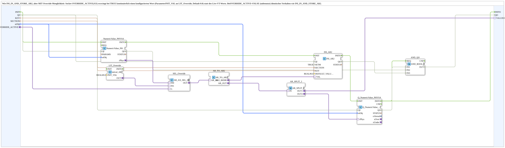

# INI_IN_AND_STORE_AR2_OVERRIDE

* * * * * * * * * *

## Introduction

`INI_IN_AND_STORE_AR2_OVERRIDE` is like [`INI_IN_AND_STORE_AR2`](./INI_IN_AND_STORE_AR2.md), but with an override option: while the `OVERRIDE_ACTIVE` socket (AX) is continuously TRUE, a configured value is forced instead of the live VT value (parameter `INIT_VAL` on `LIT_Override`, default `0.0`). With `OVERRIDE_ACTIVE`=FALSE (unused) the behavior is identical to `INI_IN_AND_STORE_AR2`.

For the general pattern, see [INI_IN_AND_STORE / NVS_IN_AND_STORE (shared pattern)](./INI-NVS-Storage-Blocks.md).

## Interface

### Input variables

- `KEY` (STRING): key name in the INI file.
- `SECTION` (STRING): section name in the INI file.
- `stObj` (`logiBUS::utils::conversion::phys::NumericObjectPool_S`): VT object with `u16ObjId`, `r32Scale`, `i32Offset`, `u8Decimals` (default `u16ObjId := ID_NULL`, `r32Scale := 1.0`, `i32Offset := 0`, `u8Decimals := 0`).

### Adapters

- **Plug `VALUEO`** (`adapter::types::unidirectional::AR`): value for a further consumer.
- **Socket `OVERRIDE_ACTIVE`** (`adapter::types::unidirectional::AX`): when continuously TRUE, the override value is forced.

The block has no event ports of its own.

## How it works

1. `NumericValue_PHYSA` (`QI`=TRUE) reads the VT input field as a physical value (`rPhys`).
2. `SEL_Override` (`AR_AX_SEL_AR`) selects: `IN0` = live VT value, `IN1` = override value from `LIT_Override` (`initval_AR`, `INIT_VAL`=`REAL#0.0`), selected via `G` = `OVERRIDE_ACTIVE`.
3. `AR_TO_AR2` converts into the bidirectional AR2 adapter for `INI_AR2` (`eclipse4diac::storage::INI_AR2`; `QI`=TRUE, `SETM`=TRUE, `DEFAULT_VALUE`=`REAL#0.0`; `KEY`/`SECTION` from outside).
4. `AR_TO_AR2.AR_OUT` is duplicated via `AR_SPLIT_2`: `OUT1` to `VALUEO`, `OUT2` to `Q_NumericValue_PHYSA` (VT display, `stObj`).

## Technical notes

- Unlike the AUDI2 variant ([`INI_IN_AND_STORE_AUDI2_OVERRIDE`](./INI_IN_AND_STORE_AUDI2_OVERRIDE.md), enum/dropdown, 1=disabled), AR is a continuous physical value: the override value has no fixed meaning but is freely configurable via `INIT_VAL` on `LIT_Override`.
- `SETM`=TRUE: the boot value loads automatically (INIT → INITO → GET → GETO, independent of `SETM`); `SETM`=TRUE additionally ensures that a live change during operation is confirmed/echoed immediately (e.g. for further use via `VALUEO`).

## Summary

AR2 storage block with a switchable, configurable override value.

---

### 🌐 Related topic subpages on ms-muc-docs.de

- [🌐 Eclipse 4diac IDE & color reference on ms-muc-docs.de](https://www.ms-muc-docs.de/iec-61499/eclipse-4diac/)
