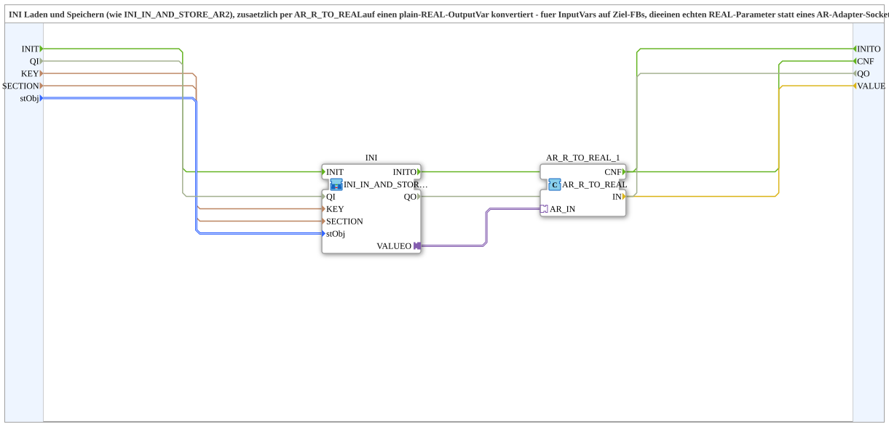

# INI_IN_AND_STORE_AR2_TO_REAL

* * * * * * * * * *

## Introduction

`INI_IN_AND_STORE_AR2_TO_REAL` loads and stores a value in the INI file (like [`INI_IN_AND_STORE_AR2`](INI_IN_AND_STORE_AR2.md)) and additionally converts it to a plain REAL output variable via `AR_R_TO_REAL`. This is needed for input variables of target blocks that expect a real REAL parameter instead of an AR adapter socket (e.g. `CTRL_PID_AR.KP`/`TN`/`TV`).

## Interface Structure

### **Event Inputs**

The function block has no direct event inputs.

### **Event Outputs**

- **CNF** (confirmation): fires when a (new or initially loaded) value is available. Connect it to a `REQ` input of a target FB (e.g. `CTRL_PID_AR.REQ`) so that it takes over the fresh value immediately instead of waiting for its own next adapter trigger

### **Data Inputs**

- **KEY** (STRING): key name in the INI file
- **SECTION** (STRING): section name in the INI file
- **stObj** (`logiBUS::utils::conversion::phys::NumericObjectPool_S`): object pool properties of the VT number variable (default: `u16ObjId := ID_NULL, r32Scale := 1.0, i32Offset := 0, u8Decimals := 0`)

### **Data Outputs**

- **VALUE** (REAL): persisted/loaded value as a plain REAL (no AR adapter)

### **Adapters**

No adapters are used.

## Functionality

The network contains two instances:

- `INI` ([`MyLib::sys::INI_IN_AND_STORE_AR2`](INI_IN_AND_STORE_AR2.md)): `KEY` → `INI.KEY`, `SECTION` → `INI.SECTION`, `stObj` → `INI.stObj`. The value is available at `INI.VALUEO` (AR).
- `AR_R_TO_REAL_1` (`adapter::conversion::unidirectional::AR_R_TO_REAL`): `INI.VALUEO` → `AR_R_TO_REAL_1.AR_IN`; `AR_R_TO_REAL_1.IN` → `VALUE` and `AR_R_TO_REAL_1.CNF` → `CNF`.

## Technical Details

- Extracted from `Aufnahme_Automatik.SUB`, where this combination was wired three times identically (KP/TN/TV)
- `CNF` is generated only after the AR-to-REAL conversion and thus signals that `VALUE` is up to date

## Application Scenarios

- Persisted controller parameters (e.g. KP/TN/TV of a PID controller) that are connected to REAL inputs of target FBs

## Conclusion

`INI_IN_AND_STORE_AR2_TO_REAL` combines INI persistence with an AR-to-REAL conversion and delivers the value together with a `CNF` event at a plain REAL output variable.
