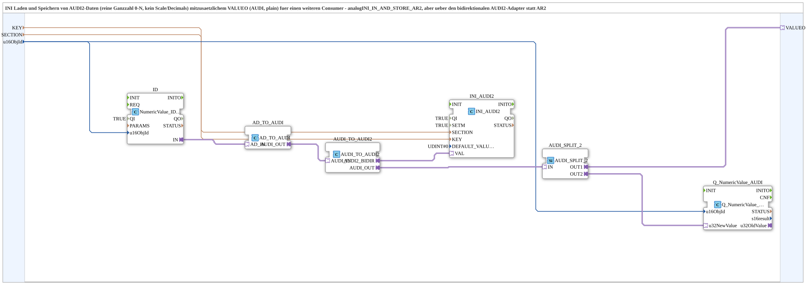

# INI_IN_AND_STORE_AUDI2

* * * * * * * * * *

## Introduction

`INI_IN_AND_STORE_AUDI2` loads and stores `AUDI2` data (plain integer 0..N, without scale/decimals) persistently in an INI file and additionally provides an output `VALUEO` (`AUDI`, plain) for a further consumer. The block is analogous to [`INI_IN_AND_STORE_AR2`](./INI_IN_AND_STORE_AR2.md) but works via the bidirectional `AUDI2` adapter instead of `AR2`. The general pattern is described in [INI_IN_AND_STORE / NVS_IN_AND_STORE](./INI-NVS-Speicherbausteine.md); a variant with `AUDI` is [`INI_IN_AND_STORE_AUDI`](./INI_IN_AND_STORE_AUDI.md).

## Interface Structure

### **Event Inputs**

None.

### **Event Outputs**

None.

### **Data Inputs**

- **KEY** (`STRING`): key name in the INI file
- **SECTION** (`STRING`): section name in the INI file
- **u16ObjId** (`UINT`): object ID of the VT number variable (default `ID_NULL`)

### **Data Outputs**

None.

### **Adapters**

- **VALUEO** (plug, `adapter::types::unidirectional::AUDI`): value for a further consumer

## Function Blocks (FBs) Used

- **`ID`** (`isobus::UT::io::NumericValue::NumericValue_IDA`, `QI = TRUE`): delivers the VT value entered by the operator
- **`AD_TO_AUDI`** (`adapter::conversion::unidirectional::AD_TO_AUDI`): converts the `AD` value to `AUDI`
- **`AUDI_TO_AUDI2`** (`adapter::conversion::bidirectional::AUDI_TO_AUDI2`): converts `AUDI` into the bidirectional `AUDI2` adapter
- **`INI_AUDI2`** (`eclipse4diac::storage::INI_AUDI2`): `QI = TRUE`, `SETM = TRUE`, `DEFAULT_VALUE = UDINT#0`; loads and stores the value
- **`AUDI_SPLIT_2`** (`adapter::events::unidirectional::AUDI_SPLIT_2`): duplicates the value
- **`Q_NumericValue_AUDI`** (`isobus::UT::Q::Q_NumericValue_AUDI`): writes the value into the VT number variable

## Functionality

- `ID.IN` → `AD_TO_AUDI.AD_IN` → `AUDI_TO_AUDI2.AUDI_IN`
- `AUDI_TO_AUDI2.AUDI2_BIDIR` → `INI_AUDI2.VAL` (load/store)
- `AUDI_TO_AUDI2.AUDI_OUT` → `AUDI_SPLIT_2.IN`
- `AUDI_SPLIT_2.OUT1` → `VALUEO`; `AUDI_SPLIT_2.OUT2` → `Q_NumericValue_AUDI.u32NewValue` (VT display)
- `KEY`, `SECTION` → `INI_AUDI2`; `u16ObjId` → `ID` and `Q_NumericValue_AUDI`

## Technical Details

- **`SETM = TRUE`:** the boot value is loaded automatically anyway (`INIT` → `INITO` → `GET` → `GETO`, independent of `SETM`). `SETM = TRUE` ensures that a live change during operation is also confirmed/reported back immediately; important if the fresh value is to be used further in the same run (here via `VALUEO`).
- `INI_AUDI2` has no output plug of its own, so the output is duplicated via `AUDI_SPLIT_2`
- Plain integer (`UDINT`) without scaling

## Application Scenarios

- A persistently stored integer setting (e.g. counter, selection index) that is entered on the VT and reused

## Summary

`INI_IN_AND_STORE_AUDI2` stores a VT integer value in an INI file (via `AUDI2`) and additionally outputs it as `AUDI`.

---

### 🌐 Related topic pages on ms-muc-docs.de

- [🌐 Eclipse 4diac IDE & color reference on ms-muc-docs.de](https://www.ms-muc-docs.de/iec-61499/eclipse-4diac/)
