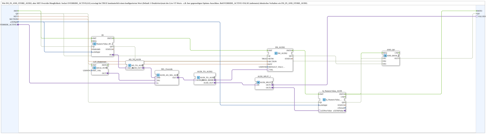

# INI_IN_AND_STORE_AUDI2_OVERRIDE

* * * * * * * * * *

## Introduction

`INI_IN_AND_STORE_AUDI2_OVERRIDE` is like [`INI_IN_AND_STORE_AUDI2`](./INI_IN_AND_STORE_AUDI2.md), but with an override option: while the `OVERRIDE_ACTIVE` socket (AX) is continuously TRUE, the value 1 (disabled) is forced instead of the live VT value - e.g. for mutual option exclusion. With `OVERRIDE_ACTIVE`=FALSE (unused) the behavior is identical to `INI_IN_AND_STORE_AUDI2`. The variant without `OVERRIDE_ACTIVE` is available separately as `INI_IN_AND_STORE_AUDI2` (rename in version 1.2).

For the general pattern, see [INI_IN_AND_STORE / NVS_IN_AND_STORE (shared pattern)](./INI-NVS-Storage-Blocks.md).

## Interface

### Input variables

- `KEY` (STRING): key name in the INI file.
- `SECTION` (STRING): section name in the INI file.
- `u16ObjId` (UINT, default `ID_NULL`): ObjectID of the VT input field.

### Adapters

- **Plug `VALUEO`** (`adapter::types::unidirectional::AUDI`): value for a further consumer.
- **Socket `OVERRIDE_ACTIVE`** (`adapter::types::unidirectional::AX`): when continuously TRUE, VAL=1 (disabled) is forced.

The block has no event ports of its own.

## How it works

1. `ID` (`NumericValue_IDA`, `QI`=TRUE) reads the VT input field; `AD_TO_AUDI` converts to AUDI.
2. `SEL_Override` (`AUDI_AX_SEL_AUDI`) selects: `IN0` = live VT value, `IN1` = override value from `LIT_Deaktiviert` (`initval_AUDI`, `INIT_VAL`=`UDINT#1`), selected via `G` = `OVERRIDE_ACTIVE`.
3. `AUDI_TO_AUDI2` converts into the bidirectional AUDI2 adapter for `INI_AUDI2` (`eclipse4diac::storage::INI_AUDI2`; `QI`=TRUE, `SETM`=TRUE, `DEFAULT_VALUE`=`UDINT#0`).
4. `AUDI_TO_AUDI2.AUDI_OUT` is duplicated via `AUDI_SPLIT_2`: `OUT1` to `VALUEO`, `OUT2` to `Q_NumericValue_AUDI` (`u32NewValue`, VT display).

## Technical notes

- The override runs over the same `INI_AUDI2`/`Q_NumericValue_AUDI` path: according to its own documentation, `Q_NumericValue` allows only one instance per ObjectID, so a second writing instance is not possible.
- For pure enum/integer values (e.g. dropdowns 0-3), no decimal places.
- `SETM`=TRUE: the boot value loads automatically (INIT → INITO → GET → GETO); `SETM`=TRUE additionally ensures that a live change is confirmed/echoed immediately.

## Summary

AUDI2 storage block with a switchable override to 1 (disabled), e.g. for mutual option exclusion.

---

### 🌐 Related topic subpages on ms-muc-docs.de

- [🌐 Eclipse 4diac IDE & color reference on ms-muc-docs.de](https://www.ms-muc-docs.de/iec-61499/eclipse-4diac/)
