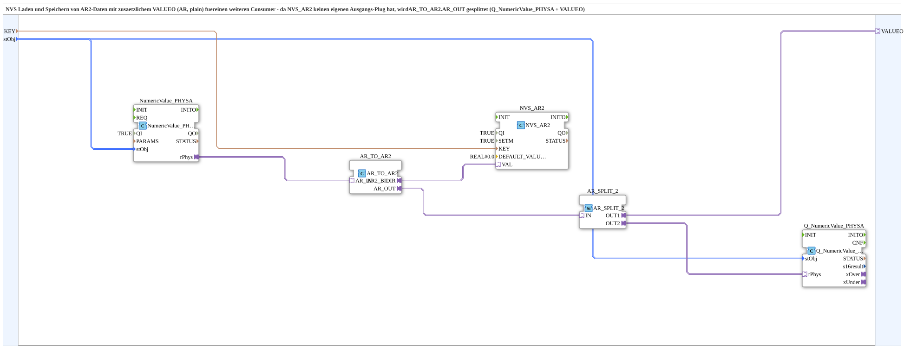

# NVS_IN_AND_STORE_AR2

* * * * * * * * * *

## Introduction

`NVS_IN_AND_STORE_AR2` is the AR2-adapter variant of `NVS_IN_AND_STORE_AR` (ESP32 flash storage instead of an INI file): a physically scaled REAL value entered via the VT is persistently stored in NVS flash via `logiBUS::storage::esp32_nvs::NVS_AR2`. Since `NVS_AR2` (unlike the INI variant) has no `SECTION` concept either, that parameter is absent compared to `INI_IN_AND_STORE_AR2`. As there, `AR_TO_AR2.AR_OUT` is duplicated via `AR_SPLIT_2`: VT display (`Q_NumericValue_PHYSA`) + `VALUEO` for a further consumer.

For the general pattern, see [INI_IN_AND_STORE / NVS_IN_AND_STORE (shared pattern)](./INI-NVS-Storage-Blocks.md).

## Technical notes

- `SETM=TRUE`, same reasoning as [`INI_IN_AND_STORE_AR2`](./INI_IN_AND_STORE_AR2.md): live changes are confirmed immediately, not only at the next boot.
- No `SECTION` parameter, since NVS keys are flat (no INI-section concept).

## Quality ports (QI/QO)

The block has the data input `QI` (`BOOL`, default `TRUE`, Quality Input - TRUE enables the service) and the data output `QO` (`BOOL`, Quality Output - TRUE if the service was executed successfully). `QI` is distributed to `Q_NumericValue_PHYSA`, `NumericValue_PHYSA` and `NVS_AR2`; their `QO` outputs are combined by `AND_QO` (`iec61131::booleanOperators::AND_BOOL_3`) into `QO`.

In addition, the block has the events `INIT` (input, `EInit`, initialization request) and `INITO` (output, `EInit`, initialization confirmation). Initialization: `INIT` → `Q_NumericValue_PHYSA.INIT`; `Q_NumericValue_PHYSA.INITO` → `NumericValue_PHYSA.INIT`; `NumericValue_PHYSA.INITO` → `NVS_AR2.INIT`; `NVS_AR2.INITO` → `INITO` and → `AND_QO.REQ`. Quality: `QI` → `Q_NumericValue_PHYSA.QI`, `NumericValue_PHYSA.QI`, `NVS_AR2.QI`; `Q_NumericValue_PHYSA.QO`, `NumericValue_PHYSA.QO`, `NVS_AR2.QO` → `AND_QO.IN1` to `AND_QO.IN3` (in this order); `AND_QO.OUT` → `QO` (`AND_QO`: `iec61131::booleanOperators::AND_BOOL_3`).

## Summary

AR2-adapter variant of the NVS storage family (ESP32 flash instead of an INI file), with an additional `VALUEO` output.

---

### 🌐 Related topic subpages on ms-muc-docs.de

- [🌐 Eclipse 4diac IDE & color reference on ms-muc-docs.de](https://www.ms-muc-docs.de/iec-61499/eclipse-4diac/)
