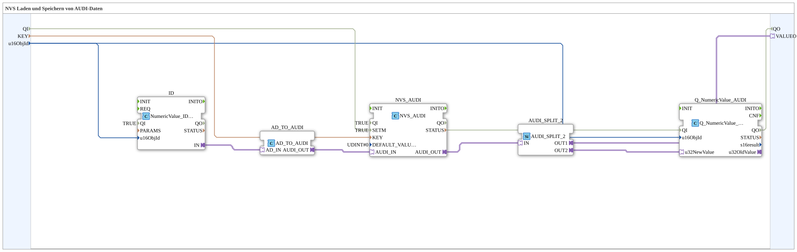

# NVS_IN_AND_STORE_AUDI

* * * * * * * * * *

## Introduction

`NVS_IN_AND_STORE_AUDI` persistently stores a UDINT value entered via the VT (AUDI adapter) in ESP32 flash (NVS) — otherwise identical to [`INI_IN_AND_STORE_AUDI`](./INI_IN_AND_STORE_AUDI.md).

For the general pattern, see [INI_IN_AND_STORE / NVS_IN_AND_STORE (shared pattern)](./INI-NVS-Storage-Blocks.md).

## Quality ports (QI/QO)

The block has the event input `INIT` (`EInit`, Initialization Request), the event output `INITO` (`EInit`, Initialization Confirm), the data input `QI` (`BOOL`, default `TRUE`, Quality Input - TRUE enables the service) and the data output `QO` (`BOOL`, Quality Output - TRUE if the service was executed successfully).

- Initialization chain: `INIT` → `ID.INIT`, `ID.INITO` → `NVS_AUDI.INIT`, `NVS_AUDI.INITO` → `Q_NumericValue_AUDI.INIT`, `Q_NumericValue_AUDI.INITO` → `INITO` (and additionally → `AND_QO.REQ`)
- `QI` is connected to `Q_NumericValue_AUDI.QI`, `NVS_AUDI.QI` and `ID.QI`
- `QO` is the AND (`AND_QO`, type `iec61131::booleanOperators::AND_BOOL_3`) of `Q_NumericValue_AUDI.QO`, `NVS_AUDI.QO` and `ID.QO`

## Summary

NVS counterpart to `INI_IN_AND_STORE_AUDI`.

---

### 🌐 Related topic subpages on ms-muc-docs.de

- [🌐 Eclipse 4diac IDE & color reference on ms-muc-docs.de](https://www.ms-muc-docs.de/iec-61499/eclipse-4diac/)
