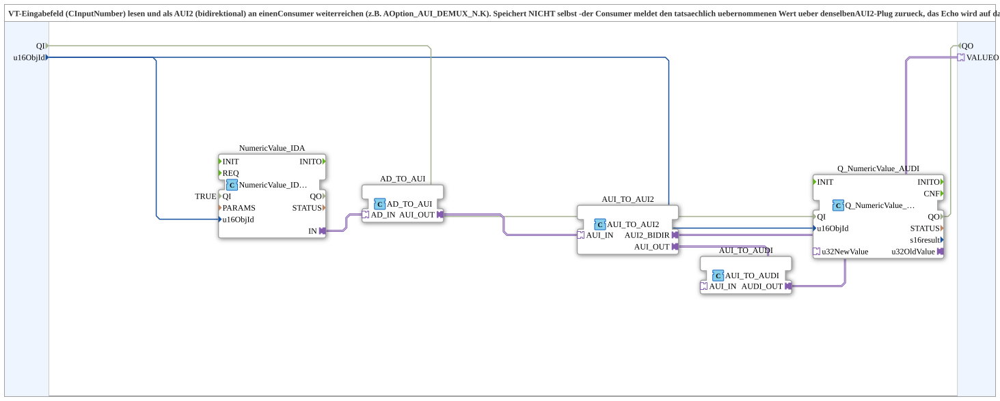

# NumericValue_TO_AUI2

* * * * * * * * * *

## Introduction

`NumericValue_TO_AUI2` reads a VT input field (CInputNumber) and passes the value bidirectionally as an AUI2 adapter (`VALUEO`) to a consumer (e.g. `AOption_AUI_DEMUX_N.K`). The block does **not** store anything itself: the consumer reports the value it actually accepted back over the same AUI2 plug, and the echo is written back to the VT field.

## Interface

### Input variables

- `QI` (BOOL, default `TRUE`): Quality Input - TRUE enables the service.
- `u16ObjId` (UINT, default `ID_NULL`): ObjectID of the VT input field.

### Output variables

- `QO` (BOOL): Quality Output - TRUE if the service was executed successfully (AND of `Q_NumericValue_AUDI.QO` and `NumericValue_IDA.QO`).

### Adapters

- **Plug `VALUEO`** (`adapter::types::bidirectional::AUI2`): value to the consumer and echo back.

### Events

- **INIT** (event input, `EInit`): initialization request
- **INITO** (event output, `EInit`): initialization confirmation

## How it works

1. `NumericValue_IDA` reads the VT input field; `AD_TO_AUI` converts to AUI.
2. `AUI_TO_AUI2` converts into the bidirectional AUI2 adapter, which is output on `VALUEO`.
3. The echo reported back by the consumer appears at `AUI_TO_AUI2.AUI_OUT`, is converted to UDINT via `AUI_TO_AUDI`, and written to the VT field under `u16ObjId` by `Q_NumericValue_AUDI` (`u32NewValue`).

`QI` is distributed to `Q_NumericValue_AUDI.QI` and `NumericValue_IDA.QI`; `Q_NumericValue_AUDI.QO` and `NumericValue_IDA.QO` are combined into `QO` via `AND_QO` (`iec61131::booleanOperators::AND_BOOL_2`).

Initialization: `INIT` → `NumericValue_IDA.INIT`; `NumericValue_IDA.INITO` → `Q_NumericValue_AUDI.INIT`; `Q_NumericValue_AUDI.INITO` → `INITO` (and → `AND_QO.REQ`).

## Technical notes

- Extracted from `Uebung_094c_AX`, where this was duplicated inline per dropdown.
- Analogous to [`NumericValue_TO_AR2`](./NumericValue_TO_AR2.md), but UINT/AUI2 instead of REAL/AR2 and a simple `u16ObjId` instead of `stObj` (no scale/offset/decimals needed for a pure index value).
- For a variant with INI persistence, see [`NumericValue_TO_AUI2_AND_STORE`](./NumericValue_TO_AUI2_AND_STORE.md).

## Summary

Bidirectional bridge from the VT input field to an AUI2 plug without its own persistence.

## 🛠️ Related Exercises

- [Uebung_094b3_AX](https://meisterschulen-am-ostbahnhof-munchen-docs.readthedocs.io/projects/4diac-exercises-docs/en/latest/Uebungen/test_AX/Uebungen_doc/Uebung_094b3_AX/)
- [Uebung_094b4_AX](https://meisterschulen-am-ostbahnhof-munchen-docs.readthedocs.io/projects/4diac-exercises-docs/en/latest/Uebungen/test_AX/Uebungen_doc/Uebung_094b4_AX/)
- [Uebung_094c2_AX](https://meisterschulen-am-ostbahnhof-munchen-docs.readthedocs.io/projects/4diac-exercises-docs/en/latest/Uebungen/test_AX/Uebungen_doc/Uebung_094c2_AX/)

---

### 🌐 Related topic subpages on ms-muc-docs.de

- [🌐 Eclipse 4diac IDE & color reference on ms-muc-docs.de](https://www.ms-muc-docs.de/iec-61499/eclipse-4diac/)
