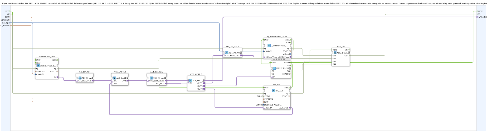

# NumericValue_TO_AUI2_AND_STORE_PUBLISH

* * * * * * * * * *

## Introduction

`NumericValue_TO_AUI2_AND_STORE_PUBLISH` is a copy of [`NumericValue_TO_AUI2_AND_STORE`](./NumericValue_TO_AUI2_AND_STORE.md) that additionally publishes the confirmed value via M2M publish: `AUI_SPLIT_2` was extended to `AUI_SPLIT_3`, and the third branch feeds `AUI_PUBLISH_1`. The M2M publish thus sits on the same internal confirm return path as the VT display (`AUI_TO_AUDI`) and the INI persistence (`INI_AUI`). An additional external self-loop via an `AUI2_TO_AUI` bridge block is no longer needed.

## Interface

### Input variables

- `QI` (BOOL, default `TRUE`): Quality Input - TRUE enables the service.
- `KEY` (STRING): key name in the INI file.
- `SECTION` (STRING): section name in the INI file.
- `u16ObjId` (UINT, default `ID_NULL`): ObjectID of the VT input field.
- `ID_WRITE` (WSTRING): local publish address (`ACTION=WRITE`) for the confirmed value; M2M, subscribed remotely.

### Output variables

- `QO` (BOOL): Quality Output - TRUE if all blocks involved succeeded (AND over `Q_NumericValue_AUDI`, `NumericValue_IDA`, `INI_AUI`, `AUI_PUBLISH_1`).

### Adapters

- **Plug `VALUEO`** (`adapter::types::bidirectional::AUI2`): value to the consumer and echo back.

The block has the events `INIT` (input) and `INITO` (output).

## Function Blocks (FBs) Used

- **NumericValue_IDA** (`isobus::UT::io::NumericValue::NumericValue_IDA`): reads the VT input field.
- **AD_TO_AUI** (`adapter::conversion::unidirectional::AD_TO_AUI`): converts the value to AUI.
- **AUI_LAST_2** (`adapter::events::unidirectional::AUI_LAST_2`): last writer wins; at boot the INI value wins (`IN2`), afterwards every live VT change (`IN1`).
- **AUI_TO_AUI2** (`adapter::conversion::bidirectional::AUI_TO_AUI2`): bridge to the external consumer (e.g. `AOption_AUI_DEMUX_N.K`).
- **AUI_SPLIT_3** (`adapter::events::unidirectional::AUI_SPLIT_3`): third branch `OUT3` for `INI_AUI`, `OUT2` for `AUI_PUBLISH_1`, `OUT1` for the VT display.
- **AUI_TO_AUDI** (`adapter::conversion::unidirectional::AUI_TO_AUDI`) and **Q_NumericValue_AUDI** (`isobus::UT::Q::Q_NumericValue_AUDI`): VT display under `u16ObjId`.
- **INI_AUI** (`eclipse4diac::storage::INI_AUI`): parameters `SETM`=FALSE, `DEFAULT_VALUE`=`UINT#0`.
- **AUI_PUBLISH_1** (`adapter::net::AUI_PUBLISH_1`): M2M publish of the confirmed value on `ID_WRITE`.
- **AND_QO** (`iec61131::booleanOperators::AND_BOOL_4`): combines the four `QO` outputs.

## How it works

1. `NumericValue_IDA` reads the VT input field; `AD_TO_AUI` converts to AUI and feeds `AUI_LAST_2.IN1`.
2. `AUI_LAST_2` goes to `AUI_TO_AUI2`, whose bidirectional output goes to `VALUEO`.
3. The result reported back by the consumer appears at `AUI_TO_AUI2.AUI_OUT` and is distributed by `AUI_SPLIT_3`: `OUT1` -> `AUI_TO_AUDI` -> `Q_NumericValue_AUDI.u32NewValue` (VT display), `OUT2` -> `AUI_PUBLISH_1.IN` (M2M publish), `OUT3` -> `INI_AUI.AUI_IN` (persistence).
4. `INI_AUI.AUI_OUT` feeds the loaded value back to `AUI_LAST_2.IN2`.
5. Initialization chain: `INIT` -> `NumericValue_IDA` -> `INI_AUI` -> `Q_NumericValue_AUDI` -> `AUI_PUBLISH_1` -> `INITO`. `AUI_PUBLISH_1.INITO` also triggers `AND_QO.REQ`, whose result goes to `QO`.
6. `QI` is distributed to `Q_NumericValue_AUDI`, `NumericValue_IDA`, `INI_AUI` and `AUI_PUBLISH_1`.

## Technical notes

- `SETM`=FALSE: `INI_AUI` acknowledges automatically only at boot, not on every later write. With `SETM`=TRUE every write would trigger a new echo and create an endless loop (see also [`NumericValue_TO_AUI2_AND_STORE`](./NumericValue_TO_AUI2_AND_STORE.md)).
- The M2M publish deliberately sits in the already proven internal return path so that it cannot get lost during an external rework.
- The block is its own class; `NumericValue_TO_AUI2_AND_STORE` remains unchanged.

## Application Scenarios

- Numeric VT input field with INI persistence where the value confirmed by the consumer is additionally to be published to other modules.

## Summary

Like `NumericValue_TO_AUI2_AND_STORE`, with an additional M2M publish of the confirmed value on the third branch of `AUI_SPLIT_3`.

---

### 🌐 Related topic subpages on ms-muc-docs.de

- [🌐 Eclipse 4diac IDE & color reference on ms-muc-docs.de](https://www.ms-muc-docs.de/iec-61499/eclipse-4diac/)
