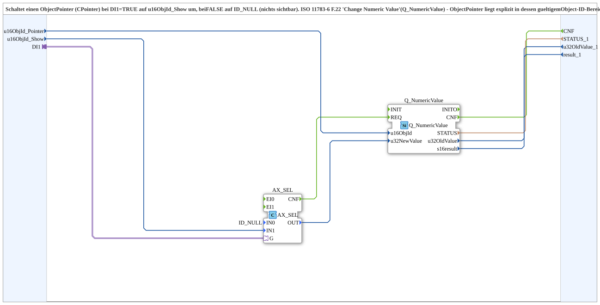

# ObjectPointer_Swap_AX

* * * * * * * * * *

## Introduction

`ObjectPointer_Swap_AX` switches an object pointer (CPointer) in the VT: with `DI1 = TRUE` it points to `u16ObjId_Show`, with FALSE to `ID_NULL` (nothing visible). The switching uses ISO 11783-6 F.22 "Change Numeric Value" (`Q_NumericValue`); the object pointer lies explicitly within its valid object ID range (27000-27999). F.38 "Change Attribute" (`Q_Attribute`) must not be used because `AID_OP_PTR.VALUE` is read-only there.

## Interface Structure

### **Event Inputs**

The function block has no direct event inputs.

### **Event Outputs**

- **CNF**: execution confirmation, passed through from `Q_NumericValue.CNF`

### **Data Inputs**

- **u16ObjId_Pointer** (UINT): object ID of the object pointer (CPointer) whose target is switched (default `ID_NULL`)
- **u16ObjId_Show** (UINT): object ID that is shown under the pointer when `DI1 = TRUE` (default `ID_NULL`)

### **Data Outputs**

- **STATUS_1** (STRING): service status of `Q_NumericValue`
- **u32OldValue_1** (UDINT): old value of the ID
- **result_1** (INT): return value (see `Q_NumericValue`)

### **Adapters**

- **DI1** (socket, `adapter::types::unidirectional::AX`): selector

## Functionality

The network consists of two blocks:

- `AX_SEL` (`adapter::iec61131::selection::AX_SEL`): binary selection with `IN0 = ID_NULL` (parameter), `IN1` = `u16ObjId_Show` and selector `G` = `DI1`. An output event is generated only when `G` changes.
- `Q_NumericValue` (`isobus::UT::Q::Q_NumericValue`): `AX_SEL.OUT` → `u32NewValue`, `u16ObjId_Pointer` → `u16ObjId`, triggered by `AX_SEL.CNF` → `Q_NumericValue.REQ`. `Q_NumericValue.CNF` → `CNF`; `STATUS`, `u32OldValue` and `s16result` are output as `STATUS_1`, `u32OldValue_1` and `result_1`.

When `DI1` changes, the new target value (`u16ObjId_Show` or `ID_NULL`) is thereby written as a numeric value to the object pointer.

## Technical Details

- Structure analogous to `GreenWhiteBackground1_AX` (AX_SEL wrapper around a `Q_` FB)
- `Q_NumericValue` (F.22) is the right way for object pointers; `Q_Attribute` (F.38) was discarded
- For the pattern see the exercise `Uebung_015` in the workspace `test_B`

## Application Scenarios

- Showing and hiding a VT object (e.g. warning symbol) at a fixed place via an AX state
- Switching between an empty state and a content via object pointer

## Conclusion

`ObjectPointer_Swap_AX` translates an AX state into an object pointer switch between `u16ObjId_Show` and `ID_NULL` via `Q_NumericValue`.
