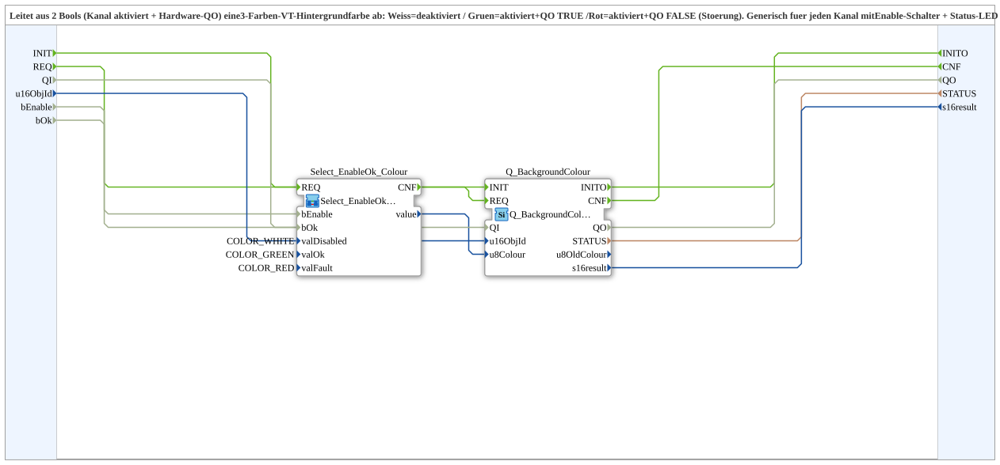

# Q_BackgroundColour_EnableOk_A

* * * * * * * * * *

## Introduction

`Q_BackgroundColour_EnableOk_A` derives a 3-colour VT background colour from two Boolean values (channel enabled and hardware `QO`): **White** = disabled, **Green** = enabled and `QO` TRUE, **Red** = enabled and `QO` FALSE (fault). Generic for any channel with an enable switch and status LED (PWM, PI, …).

## Function Blocks (FBs) Used

### Sub-blocks: Q_BackgroundColour_EnableOk_A

- **Type**: SubAppType
- **Internal blocks used**:
    - **Select_EnableOk_Colour**: SubApp [`MyLib::sys::Select_EnableOk_a`](./Select_EnableOk_a.md) with `valDisabled=COLOR_WHITE`, `valOk=COLOR_GREEN`, `valFault=COLOR_RED` - selects one of the three colours based on `bEnable` and `bOk`
    - **Q_BackgroundColour**: `isobus::UT::Q::Q_BackgroundColour` - writes the selected colour to the VT object `u16ObjId`
- **Imports**: `COLOR_GREEN`, `COLOR_RED`, `COLOR_WHITE`

## Interface Structure

### **Event Inputs**

- **INIT** (`EInit`): Initialization request (to `Q_BackgroundColour.INIT`)
- **REQ**: Re-evaluate - fired by the caller once per possible change of `bEnable` or `bOk` (switch toggled or fresh `QO` arrived); both values are supplied together

### **Event Outputs**

- **INITO** (`EInit`): Initialization confirmation (from `Q_BackgroundColour.INITO`)
- **CNF**: Colour sent (passthrough of `Q_BackgroundColour.CNF`)

### **Data Inputs**

- **QI** (`BOOL`, default `TRUE`): Quality Input - TRUE enables the service
- **u16ObjId** (`UINT`): Object ID of the status display (`CButton`, background colour only, no text) - set once via parameter at instantiation
- **bEnable** (`BOOL`): Channel enabled (e.g. enable flip-flop `Q`)
- **bOk** (`BOOL`): Hardware confirms active (e.g. `logiBUS_..._IDA.QO`) - only relevant if `bEnable=TRUE`

### **Data Outputs**

- **QO** (`BOOL`): Quality Output - TRUE if the service was executed successfully
- **STATUS** (`STRING`): Service status (passthrough of `Q_BackgroundColour.STATUS`)
- **s16result** (`INT`): Return value (passthrough of `Q_BackgroundColour.s16result`)

## Program Flow and Connections

- `REQ` → `Select_EnableOk_Colour.REQ`; `Select_EnableOk_Colour.CNF` → `Q_BackgroundColour.REQ`; `Q_BackgroundColour.CNF` → `CNF`
- `bEnable` → `Select_EnableOk_Colour.bEnable`; `bOk` → `Select_EnableOk_Colour.bOk`
- `Select_EnableOk_Colour.value` → `Q_BackgroundColour.u8Colour`
- `u16ObjId` → `Q_BackgroundColour.u16ObjId`
- `Q_BackgroundColour.STATUS` → `STATUS`; `Q_BackgroundColour.s16result` → `s16result`
- `INIT` → `Q_BackgroundColour.INIT`; `Q_BackgroundColour.INITO` → `INITO`
- `QI` → `Q_BackgroundColour.QI`; `Q_BackgroundColour.QO` → `QO`

## Technical Details

- The pure "2 bools → 1 of 3 values" logic is factored out into `MyLib::sys::Select_EnableOk` (generic, not limited to colours); this block merely instantiates it with the three colours as parameters
- Variant with AX adapters: [`Q_BackgroundColour_EnableOk_AX`](./Q_BackgroundColour_EnableOk_AX.md)
- Version 1.1 (2026-08-31)

## State Overview

| `bEnable` | `bOk` | Colour |
| :--- | :--- | :--- |
| FALSE | any | White (`COLOR_WHITE`) |
| TRUE | TRUE | Green (`COLOR_GREEN`) |
| TRUE | FALSE | Red (`COLOR_RED`) |

## Application Scenarios

- Status display of a channel with an enable switch and hardware feedback (PWM, PI, …)

## Summary

`Q_BackgroundColour_EnableOk_A` sets the background colour of a VT object following the white/green/red scheme from `bEnable` and `bOk`.
