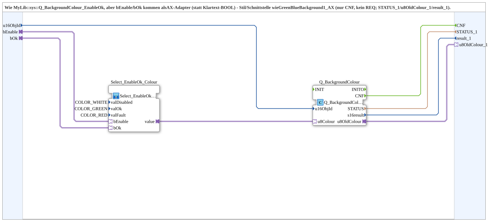

# Q_BackgroundColour_EnableOk_AX

* * * * * * * * * *

## Introduction

`Q_BackgroundColour_EnableOk_AX` corresponds to `Q_BackgroundColour_EnableOk`, but `bEnable`/`bOk` arrive as AX adapters (instead of plain BOOL) - style/interface matching the existing GreenBlueBackground1_AX/GreenRedBackground1_AX family: only `CNF` (no `REQ`), plus `INIT`/`INITO` and `QI`/`QO`, as well as `STATUS_1`/`u8OldColour_1`/`result_1` as named outputs.

## Function blocks used

- **Select_EnableOk_Colour** (SubApp, type `MyLib::sys::Select_EnableOk_AX`): `valDisabled=COLOR_WHITE`, `valOk=COLOR_GREEN`, `valFault=COLOR_RED`.
- **Q_BackgroundColour** (`isobus::UT::Q::Q_BackgroundColour_AUS`): AUS-adapter variant, writes the color to `u16ObjId` and returns `u8OldColour_1` (previous color) as an AUS adapter.

## Quality ports (QI/QO)

The block has the data input `QI` (`BOOL`, default `TRUE`, Quality Input - TRUE enables the service) and the data output `QO` (`BOOL`, Quality Output - TRUE if the service was executed successfully). `QI` is connected to `Q_BackgroundColour.QI`, and `Q_BackgroundColour.QO` to `QO`.

In addition, the block has the events `INIT` (input, `EInit`, initialization request) and `INITO` (output, `EInit`, initialization confirmation): `INIT` → `Q_BackgroundColour.INIT`, `Q_BackgroundColour.INITO` → `INITO`.

## Summary

AX-adapter variant of [`Q_BackgroundColour_EnableOk`](../../MyLib_B/sys/Q_BackgroundColour_EnableOk.md), matching the existing GreenBlueBackground1_AX/GreenRedBackground1_AX family.

---

### 🌐 Related topic subpages on ms-muc-docs.de

- [🌐 Eclipse 4diac IDE & color reference on ms-muc-docs.de](https://www.ms-muc-docs.de/iec-61499/eclipse-4diac/)
