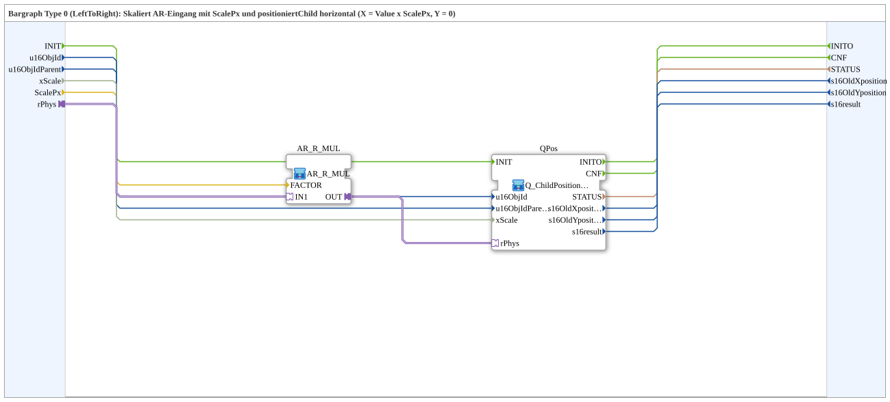

# Q_ChildPosition_AR_Bargraph_LeftToRight

* * * * * * * * * *

## Introduction

`Q_ChildPosition_AR_Bargraph_LeftToRight` implements a bargraph of type 0 (left to right): the AR input `rPhys` is scaled with `ScalePx` (pixels per value unit) and positions the child object horizontally (X = value × `ScalePx`, Y = 0).

## Interface Structure

### **Event Inputs**

- **INIT**: service initialisation (`EInit`)

### **Event Outputs**

- **INITO**: initialisation confirmation (`EInit`)
- **CNF**: confirmation of the requested service

### **Data Inputs**

- **u16ObjId** (UINT): object ID of the child object (default `ID_NULL`)
- **u16ObjIdParent** (UINT): object ID of the parent object (default `ID_NULL`)
- **xScale** (BOOL): FALSE = bypass; TRUE (default) = scale by the DM/SKM factor for `u16ObjIdParent`
- **ScalePx** (REAL): pixels per value unit (multiplication factor), default `REAL#1.0`

### **Data Outputs**

- **STATUS** (STRING): service status, passed through from the internal `Q_ChildPosition`
- **s16OldXposition** (INT): old X position, passed through
- **s16OldYposition** (INT): old Y position, passed through
- **s16result** (INT): return value, passed through (see `Q_ChildPosition`)

### **Adapters**

- **rPhys** (socket, `adapter::types::unidirectional::AR`): physical REAL value (scaled and mapped to the X position)

## Functionality

The network consists of two SubApps:

- `AR_R_MUL` ([`MyLib::sys::AR_R_MUL`](AR_R_MUL.md)): `rPhys` → `AR_R_MUL.IN1`, `ScalePx` → `AR_R_MUL.FACTOR`; multiplies the AR value by the factor.
- `QPos` (`MyLib::sys::Q_ChildPosition_AR_Horizontal`): `AR_R_MUL.OUT` → `QPos.rPhys`; sets the X position of the child object via the AR adapter (Y fixed 0).

The events `INIT`, `INITO` and `CNF` as well as `u16ObjId`, `u16ObjIdParent`, `xScale` and the four outputs are passed directly from/to `QPos`.

## Technical Details

- Type 0 (LeftToRight) of the bargraph variants: the position grows with the value in X direction, Y stays 0
- `xScale` defaults to TRUE here (scaling by DM/SKM factor), in contrast to [`Q_ChildPosition_AR_Vertikal`](Q_ChildPosition_AR_Vertikal.md) with default FALSE
- Stateless at SubApp level; all status outputs come from the inner `Q_ChildPosition`

## Application Scenarios

- Bar display in which a child object is shifted horizontally proportionally to a measured value

## Conclusion

`Q_ChildPosition_AR_Bargraph_LeftToRight` scales an AR value with `ScalePx` and thereby sets the X position of a child object for a left-to-right bargraph.
