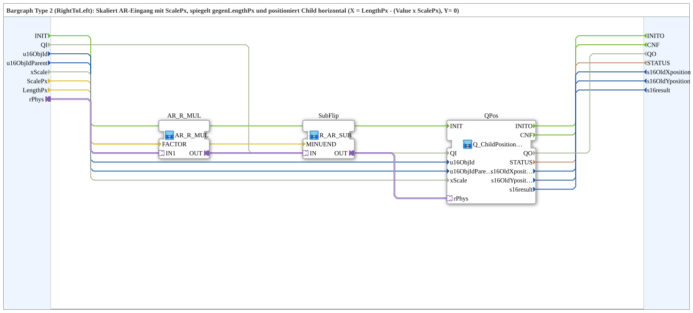

# Q_ChildPosition_AR_Bargraph_RightToLeft

* * * * * * * * * *

## Introduction

`Q_ChildPosition_AR_Bargraph_RightToLeft` is a bargraph of type 2 (right to left): the `AR` input is scaled with `ScalePx`, mirrored against `LengthPx` and set as the horizontal position of a child object in the VT (`X = LengthPx - (value × ScalePx)`, `Y = 0`). Counterpart of [`Q_ChildPosition_AR_Bargraph_LeftToRight`](./Q_ChildPosition_AR_Bargraph_LeftToRight.md).

## Interface Structure

### **Event Inputs**

- **INIT** (`EInit`): service initialisation (passed on to `QPos.INIT`)

### **Event Outputs**

- **INITO** (`EInit`): initialisation confirm (from `QPos.INITO`)
- **CNF**: confirmation of the requested positioning (from `QPos.CNF`)

### **Data Inputs**

- **QI** (`BOOL`, default `TRUE`): Quality Input - TRUE enables the service (passed on to `QPos.QI`)
- **u16ObjId** (`UINT`): object ID of the child object (default `ID_NULL`)
- **u16ObjIdParent** (`UINT`): object ID of the parent object (default `ID_NULL`)
- **xScale** (`BOOL`): `FALSE` = bypass; `TRUE` (default) = scale by the DM/SKM factor for `u16ObjIdParent`
- **ScalePx** (`REAL`): pixels per value unit (multiplication factor), default `REAL#1.0`
- **LengthPx** (`REAL`): total length of the bargraph in pixels (for mirroring), default `REAL#100.0`

### **Data Outputs**

- **QO** (`BOOL`): Quality Output - TRUE if the service was executed successfully (from `QPos.QO`)
- **STATUS** (`STRING`): service status, passed through from the internal `Q_ChildPosition`
- **s16OldXposition** (`INT`): old X position, passed through
- **s16OldYposition** (`INT`): old Y position, passed through
- **s16result** (`INT`): return value, passed through from the internal `Q_ChildPosition`

### **Adapters**

- **rPhys** (socket, `adapter::types::unidirectional::AR`): physical `REAL` value; scaled, mirrored and mapped to the X position

## Function Blocks (FBs) Used

- **`AR_R_MUL`** (SubApp `MyLib::sys::AR_R_MUL`, [AR_R_MUL](./AR_R_MUL.md)): multiplies the value by `ScalePx`
- **`SubFlip`** (SubApp `MyLib::sys::R_AR_SUB`): subtracts the scaled value from `LengthPx` (`MINUEND = LengthPx`)
- **`QPos`** (SubApp `MyLib::sys::Q_ChildPosition_AR_Horizontal`, [Q_ChildPosition_AR_Horizontal](./Q_ChildPosition_AR_Horizontal.md)): sets the horizontal position of the child object

## Functionality

- `rPhys` → `AR_R_MUL.IN1`; `ScalePx` → `AR_R_MUL.FACTOR`
- `AR_R_MUL.OUT` → `SubFlip.IN`; `LengthPx` → `SubFlip.MINUEND`
- `SubFlip.OUT` → `QPos.rPhys`
- `INIT` → `QPos.INIT`; `QPos.INITO` → `INITO`; `QPos.CNF` → `CNF`
- `QI` → `QPos.QI`; `QPos.QO` → `QO`
- `u16ObjId`, `u16ObjIdParent`, `xScale` → the like-named inputs of `QPos`
- `QPos.STATUS`, `QPos.s16OldXposition`, `QPos.s16OldYposition`, `QPos.s16result` → the like-named outputs

## Technical Details

- The mirroring (`LengthPx - value × ScalePx`) lets the bar grow from right to left
- All status and position outputs are pure pass-throughs of the internal `Q_ChildPosition`

## Application Scenarios

- A horizontal bar display in the VT that grows from right to left (e.g. fill level, utilisation)

## Summary

`Q_ChildPosition_AR_Bargraph_RightToLeft` maps an `AR` value, mirrored, to the X position of a VT child object.

---

### 🌐 Related topic pages on ms-muc-docs.de

- [🌐 Eclipse 4diac IDE & color reference on ms-muc-docs.de](https://www.ms-muc-docs.de/iec-61499/eclipse-4diac/)
