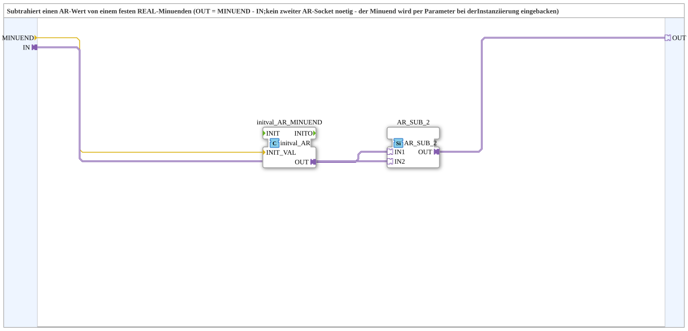

# R_AR_SUB

* * * * * * * * * *

## Introduction

`R_AR_SUB` subtracts an `AR` value from a fixed `REAL` minuend: `OUT = MINUEND - IN`. A second `AR` socket is not needed, since the minuend is baked in via a parameter at instantiation.

## Function Blocks (FBs) Used

### Sub-blocks: R_AR_SUB

- **Type**: SubAppType
- **Internal FBs used**:
    - **initval_AR_MINUEND**: `adapter::types::unidirectional::AR::initval::initval_AR` - converts the parameter `MINUEND` into an `AR` signal
    - **AR_SUB_2**: `adapter::iec61131::arithmetic::AR_SUB_2` - forms the difference `IN1 - IN2`

## Interface Structure

### **Event Inputs / Event Outputs**

None - events travel via the adapters.

### **Data Inputs**

- **MINUEND** (`REAL`, initial value `0.0`): Fixed minuend, set via parameter at instantiation

### **Data Outputs**

None.

### **Adapters**

- **IN** (socket): `adapter::types::unidirectional::AR` - subtrahend to be subtracted
- **OUT** (plug): `adapter::types::unidirectional::AR` - `MINUEND - IN`

## Program Flow and Connections

- `MINUEND` → `initval_AR_MINUEND.INIT_VAL`
- `initval_AR_MINUEND.OUT` → `AR_SUB_2.IN1`
- `IN` → `AR_SUB_2.IN2`
- `AR_SUB_2.OUT` → `OUT`

## Technical Details

- The minuend is fixed as a parameter; no second `AR` input is needed
- Version 1.0 (2026-09-27)

## Application Scenarios

- Inversion relative to a fixed quantity, e.g. `100 - value`

## Summary

`R_AR_SUB` provides `MINUEND - IN` for an `AR` value with a minuend fixed by parameter.
