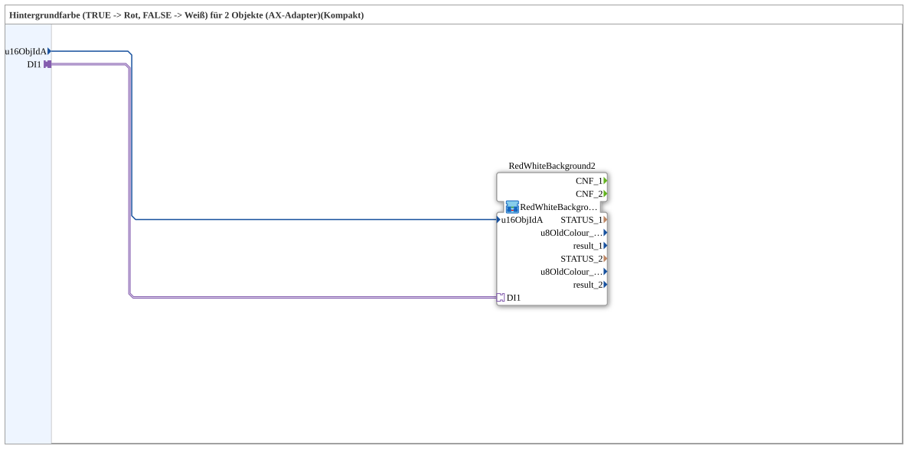

# RedWhiteBackground2_AXC

* * * * * * * * * *

## Introduction

`RedWhiteBackground2_AXC` is a **compact wrapper** around [`RedWhiteBackground2_AX`](RedWhiteBackground2_AX.md) — passes `u16ObjId` and the selector straight through, without exposing the `CNF` event outputs and diagnostic values (`STATUS_n`, `u8OldColour_n`, `result_n`).

Interface (quality pattern): The wrapper additionally has the event input `INIT` and the event output `INITO` (each `EInit`) as well as the data input `QI` (`BOOL`, default `TRUE`) and the data output `QO` (`BOOL`). They are passed straight through to the inner instance `RedWhiteBackground2`: `INIT` → `RedWhiteBackground2.INIT`, `RedWhiteBackground2.INITO` → `INITO`, `QI` → `RedWhiteBackground2.QI`, `RedWhiteBackground2.QO` → `QO`.

For the shared pattern, see [Background Color Blocks (shared pattern)](./Background-Color-Blocks.md).

## Summary

A pure pass-through to `RedWhiteBackground2_AX` for the common case where the diagnostic values aren't needed.

---

### 🌐 Related topic subpages on ms-muc-docs.de

* [🌐 Eclipse 4diac IDE & color reference on ms-muc-docs.de](https://www.ms-muc-docs.de/iec-61499/eclipse-4diac/)
