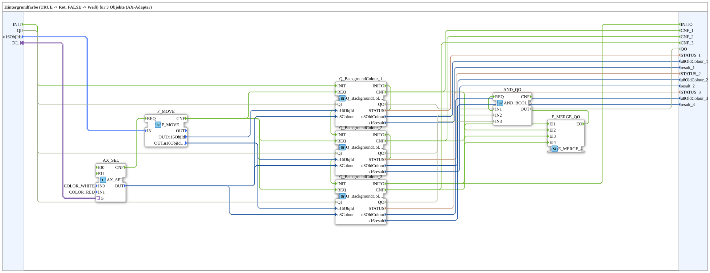
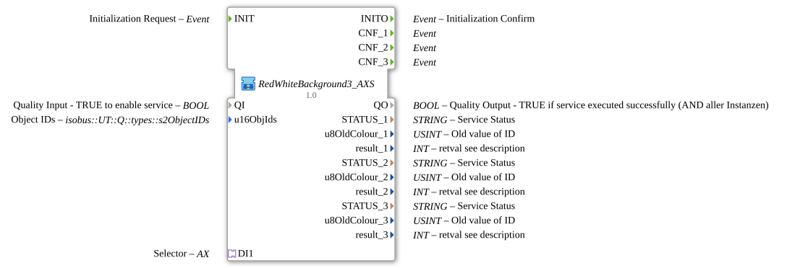

# RedWhiteBackground3_AXS

* * * * * * * * * *

## Introduction

`RedWhiteBackground3_AXS` switches the VT background color of 3 objects based on a boolean selector signal: `TRUE` → **Rot**, `FALSE` → **Weiß**. The selector signal arrives via an `AX` adapter socket (`DI1`). The object ID is passed via the structured type `s1ObjectID` (`u16ObjIds`).

| Position | Object ID source       | Block                                               |
| -------- | ---------------------- | --------------------------------------------------- |
| 1        | `F_MOVE.OUT.u16ObjId`  | `Q_BackgroundColour` (regular object)               |
| 2        | `F_MOVE.OUT.u16ObjIdA` | `Q_BackgroundColour` (regular object)               |
| 3        | `F_MOVE.OUT.u16ObjIdA` | `Q_BackgroundColourAux` (auxiliary function object) |

For the general pattern (selector → `AX_SEL`/`F_SEL` → `Q_BackgroundColour`), see [Background Color Blocks (shared pattern)](./Background-Color-Blocks.md).

In addition, the block has the initialization and quality interface: event input `INIT`, event output `INITO`, data input `QI` (`BOOL`, initial value `TRUE`) and data output `QO` (`BOOL`, AND of all instances). `INIT` → `Q_BackgroundColour_1.INIT`, `Q_BackgroundColour_1.INITO` → `Q_BackgroundColour_2.INIT`, `Q_BackgroundColour_2.INITO` → `Q_BackgroundColour_3.INIT`, `Q_BackgroundColour_3.INITO` → `INITO` (so the three instances are initialized one after another). `QI` is passed to `QI` of all three instances. `QO` is the output of the instance `AND_QO` (`iec61131::booleanOperators::AND_BOOL_3`), which combines `Q_BackgroundColour_1.QO`, `Q_BackgroundColour_2.QO` and `Q_BackgroundColour_3.QO`; its `REQ` is triggered by `E_MERGE_QO` (`iec61499::events::E_MERGE_4`), which merges `Q_BackgroundColour_3.INITO` and the `CNF` events of the three instances.

## Summary

One of many variants in the background color block family: color pair Rot/Weiß, 3 objects, adapter selector, struct. object ID.

---

### 🌐 Related topic subpages on ms-muc-docs.de

* [🌐 Eclipse 4diac IDE & color reference on ms-muc-docs.de](https://www.ms-muc-docs.de/iec-61499/eclipse-4diac/)
