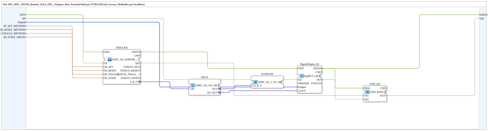

# SRT_RPC_FROM_Remote_QXA_OPC_Adapter_LOC

* * * * * * * * * *

## Introduction

`SRT_RPC_FROM_Remote_QXA_OPC_Adapter_LOC` is the local variant of [`SRT_RPC_FROM_Remote_QXA_OPC_Adapter`](./SRT_RPC_FROM_Remote_QXA_OPC_Adapter.md): instead of writing the state remotely via an `AX_CLIENT_1_0`, it is written locally via `AX_PUBLISH_1` (single device, methods via `localhost`, no endpoint). The server, flip-flop and publish logic is bundled in the SubApp [`MyLib::net::ASRT_AX_SERVER_0_PUBLISH_1`](../net/ASRT_AX_SERVER_0_PUBLISH_1.md) behind the bidirectional adapter `S_R_T`; `ASRT_AX_AX_SPLIT` feeds both `DigitalOutput_Q1` and the flip-flop (`ASRT_AX_T_FF_SR_2`).

## Interface Structure

### **Event Inputs**

- `INIT` (`EInit`): Initialization Request

### **Event Outputs**

- `INITO` (`EInit`): Initialization Confirm

### **Data Inputs**

| Name | Type | Description |
|------|-----|--------------|
| `QI` | `BOOL` | Quality Input - TRUE to enable the service. Initial value `TRUE`. |
| `Output` | `logiBUS::io::DQ::logiBUS_DO_S` | Identifies the output `Output_Q1..Q8`. Initial value `logiBUS_DO::Invalid`. |
| `ID_SET_METHOD` | `WSTRING` | Local method address (`ACTION=CREATE_METHOD`) for the Set method call, called by device A via `CALL_METHOD`. |
| `ID_RESET_METHOD` | `WSTRING` | Local method address (`ACTION=CREATE_METHOD`) for the Reset method call, called by device A via `CALL_METHOD`. |
| `ID_TOGGLE_METHOD` | `WSTRING` | Local method address (`ACTION=CREATE_METHOD`) for the Toggle method call, called by device A via `CALL_METHOD`. |
| `ID_STATE_WRITE` | `WSTRING` | Local node address (`BOOL`, `ACTION=WRITE`) for the state. |

### **Data Outputs**

| Name | Type | Description |
|------|-----|--------------|
| `QO` | `BOOL` | Quality Output - TRUE if the service was executed successfully. |

### **Adapters**

None.

## Function Blocks (FBs) Used

- **TRIGGER** (SubApp `MyLib::net::ASRT_AX_SERVER_0_PUBLISH_1`): bundles the three method servers (set/reset/toggle) and the local publish of the state (`ID_SET`, `ID_RESET`, `ID_TOGGLE`, `ID_STATE`); plug `S_R_T` (`adapter::types::bidirectional::ASRT_AX`).
- **SPLIT** (`adapter::events::bidirectional::ASRT_AX_AX_SPLIT`): branches the adapter to the flip-flop and the physical output.
- **FLIPFLOP** (`adapter::events::bidirectional::ASRT_AX_T_FF_SR_2`): set/reset/toggle flip-flop as an adapter block.
- **DigitalOutput_Q1** (`logiBUS::io::DQ::logiBUS_QXA`): physical output.
- **AND_QO** (`iec61131::booleanOperators::AND_BOOL_2`): combines `TRIGGER.QO` and `DigitalOutput_Q1.QO` into `QO`.

## Program Flow and Connections

1. Initialization: `INIT` → `TRIGGER.INIT`; `TRIGGER.INITO` → `DigitalOutput_Q1.INIT`; `DigitalOutput_Q1.INITO` → `INITO` and → `AND_QO.REQ`.
2. Adapter: `TRIGGER.S_R_T` → `SPLIT.IN`; `SPLIT.OUT` → `FLIPFLOP.S_R_T`; `SPLIT.AX_OUT` → `DigitalOutput_Q1.OUT`.
3. Data: `Output` → `DigitalOutput_Q1.Output`; `ID_SET_METHOD` → `TRIGGER.ID_SET`; `ID_RESET_METHOD` → `TRIGGER.ID_RESET`; `ID_TOGGLE_METHOD` → `TRIGGER.ID_TOGGLE`; `ID_STATE_WRITE` → `TRIGGER.ID_STATE`.
4. Qualifier: `QI` → `TRIGGER.QI` and `DigitalOutput_Q1.QI`.
5. Quality evaluation: `TRIGGER.QO` → `AND_QO.IN1`; `DigitalOutput_Q1.QO` → `AND_QO.IN2`; `AND_QO.OUT` → `QO`.

## Technical Features

- The local publish of the state is inside the SubApp `MyLib::net::ASRT_AX_SERVER_0_PUBLISH_1` (there `STATE_PUBLISH`, `AX_PUBLISH_1`, input `ID_STATE`), not in this SubApp.
- The interface corresponds to that of the non-adapter variant [`SRT_RPC_FROM_Remote_QXA_OPC_LOC`](./SRT_RPC_FROM_Remote_QXA_OPC_LOC.md).
- The contained SubApp [`MyLib::net::ASRT_AX_SERVER_0_PUBLISH_1`](../net/ASRT_AX_SERVER_0_PUBLISH_1.md) wires `IND` → `RSP` on every `SERVER_0`; rule see [SERVER_0](../../../StandardLibraries/net/SERVER_0.md).

## Application Scenarios

- Local exercise on a single device with adapter-bundled set/reset/toggle logic and local state publish.
- More compact wiring compared with [`SRT_RPC_FROM_Remote_QXA_OPC_LOC`](./SRT_RPC_FROM_Remote_QXA_OPC_LOC.md).

## Summary

Adapter-bundled local variant of [`SRT_RPC_FROM_Remote_QXA_OPC_Adapter`](./SRT_RPC_FROM_Remote_QXA_OPC_Adapter.md): method servers, flip-flop logic and local state publish behind the adapter `S_R_T`.

## 🛠️ Related Exercises

- [Uebung_OPC_L06_AX](https://meisterschulen-am-ostbahnhof-munchen-docs.readthedocs.io/projects/4diac-exercises-docs/en/latest/Uebungen/test_AX/Meins/OPC_UA_Lokal/Uebung_OPC_L06_AX/)

---

### 🌐 Related topic subpages on ms-muc-docs.de

- [🌐 Eclipse 4diac IDE & color reference on ms-muc-docs.de](https://www.ms-muc-docs.de/iec-61499/eclipse-4diac/)
