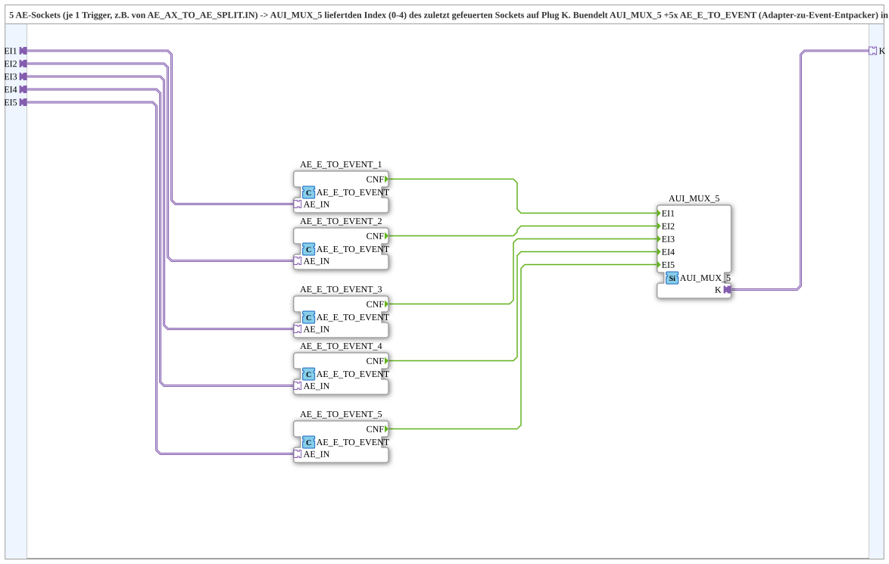

# Select5_AE_AUI

* * * * * * * * * *

## Introduction

`Select5_AE_AUI` accepts five `AE` sockets (one trigger each, e.g. from `AE_AX_TO_AE_SPLIT.IN`) and provides on plug `K` the index (0-4) of the socket that fired last. The block bundles `AUI_MUX_5` and five `AE_E_TO_EVENT` (adapter-to-event unpackers) into a reusable block.

## Function Blocks (FBs) Used

### Sub-blocks: Select5_AE_AUI

- **Type**: SubAppType
- **Internal FBs used**:
    - **AE_E_TO_EVENT_1** to **AE_E_TO_EVENT_5**: each `adapter::conversion::unidirectional::AE_E_TO_EVENT` - converts an `AE` adapter event into a normal event (`CNF`)
    - **AUI_MUX_5**: `adapter::events::unidirectional::AUI_MUX_5` - provides the index of the most recently active input on `K`

## Interface Structure

### **Event Inputs / Event Outputs**

None - events travel via the adapters.

### **Data Inputs / Data Outputs**

No direct data ports.

### **Adapters**

- **EI1** (socket, `adapter::types::unidirectional::AE`): Trigger 1 (index 0)
- **EI2** (socket, `AE`): Trigger 2 (index 1)
- **EI3** (socket, `AE`): Trigger 3 (index 2)
- **EI4** (socket, `AE`): Trigger 4 (index 3)
- **EI5** (socket, `AE`): Trigger 5 (index 4)
- **K** (plug, `adapter::types::unidirectional::AUI`): Index (0-4) of the socket that fired last

## Program Flow and Connections

- `EI1`…`EI5` → `AE_E_TO_EVENT_1`…`AE_E_TO_EVENT_5` (`AE_IN`)
- `AE_E_TO_EVENT_n.CNF` → `AUI_MUX_5.EIn` (n = 1…5)
- `AUI_MUX_5.K` → `K`

## Technical Details

- Index mapping: `EI1` → 0, `EI2` → 1, `EI3` → 2, `EI4` → 3, `EI5` → 4
- Version 1.0 (2026-09-12): encapsulated for the exclusive TECU speed source selection (5x `AE_AX_TO_AE_SPLIT.IN` as source)

## Application Scenarios

- Exclusive source selection: the most recently activated of five triggers determines the selected index (e.g. TECU speed source)

## Summary

`Select5_AE_AUI` converts five `AE` triggers into the index of the most recently fired trigger as an `AUI` signal.
