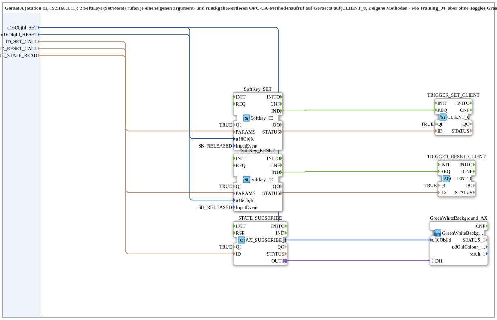

# SoftKeySR_PC_A_OPC

* * * * * * * * * *

## Introduction

`SoftKeySR_PC_A_OPC` is the device-A side (station 11, 192.168.1.11) of a PC-to-PC OPC-UA set/reset pattern: 2 softkeys (set/reset) each call their own argument- and return-value-less OPC-UA method on device B (`CLIENT_0`, 2 distinct methods - like Training_04, but without toggle). `GreenWhiteBackground1_AX` on the set softkey shows the flip-flop state locally monitored from device B. "SUB style": the protocol lives in the `MyLib::sys` composite, not in the device's resource - counterpart: [`SoftKeySR_PC_B_OPC`](./SoftKeySR_PC_B_OPC.md).

## Function blocks used

- **SoftKey_SET / SoftKey_RESET** (`isobus::UT::io::Softkey::Softkey_IE`): the two physical softkeys.
- **TRIGGER_SET_CLIENT / TRIGGER_RESET_CLIENT** (`iec61499::net::CLIENT_0`): each calls its own argument-less remote method on device B (`ID_SET_CALL`/`ID_RESET_CALL`).
- **STATE_SUBSCRIBE** (`adapter::net::AX_SUBSCRIBE_1`): subscribes to the flip-flop state under `ID_STATE_READ`.
- **GreenWhiteBackground_AX** (SubApp, type `MyLib::sys::GreenWhiteBackground1_AX`): displays the state at the set softkey.
- **AND_QO** (`iec61131::booleanOperators::AND_BOOL_6`): combines the `QO` outputs of the six blocks above into the SubApp output `QO`.

## Initialization and quality

- Events: `INIT` (EInit, input) and `INITO` (EInit, output, comes from `GreenWhiteBackground_AX.INITO`).
- Data input `QI` (BOOL, default `TRUE`) and data output `QO` (BOOL); the internal FBs no longer carry a fixed `QI=TRUE`.
- Initialization chain: `INIT` → `SoftKey_SET.INIT` → `SoftKey_RESET.INIT` → `TRIGGER_SET_CLIENT.INIT` → `TRIGGER_RESET_CLIENT.INIT` → `STATE_SUBSCRIBE.INIT` → `GreenWhiteBackground_AX.INIT` (each via `INITO`); `GreenWhiteBackground_AX.INITO` → `INITO` and → `AND_QO.REQ`.
- Quality: `QI` → `.QI` of all six blocks; their `QO` outputs → `AND_QO.IN1` to `IN6` (`SoftKey_SET`, `SoftKey_RESET`, `TRIGGER_SET_CLIENT`, `TRIGGER_RESET_CLIENT`, `STATE_SUBSCRIBE`, `GreenWhiteBackground_AX`); `AND_QO.OUT` → `QO`.

## Summary

Device-A side of a set/reset RPC pattern with 2 distinct method calls (instead of one string parameter) and state feedback.

---

### 🌐 Related topic subpages on ms-muc-docs.de

- [🌐 Eclipse 4diac IDE & color reference on ms-muc-docs.de](https://www.ms-muc-docs.de/iec-61499/eclipse-4diac/)
