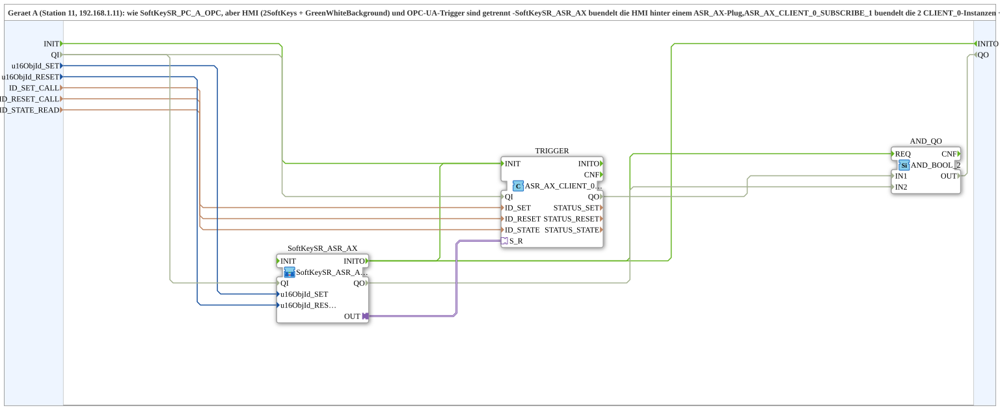

# SoftKeySR_PC_A_OPC_Adapter

* * * * * * * * * *

## Introduction

`SoftKeySR_PC_A_OPC_Adapter` is the adapter-bundled variant of [`SoftKeySR_PC_A_OPC`](./SoftKeySR_PC_A_OPC.md) (device A, station 11): HMI (2 softkeys + `GreenWhiteBackground`) and OPC-UA trigger are separated. [`SoftKeySR_ASR_AX`](./SoftKeySR_ASR_AX.md) bundles the HMI behind an `ASR_AX` plug; `ASR_AX_CLIENT_0_SUBSCRIBE_1` bundles the 2 `CLIENT_0` instances + `AX_SUBSCRIBE_1` behind an `ASR_AX` socket. Counterpart: [`SoftKeySR_PC_B_OPC_Adapter`](./SoftKeySR_PC_B_OPC_Adapter.md).

## Function blocks used

- **SoftKeySR_ASR_AX** (SubApp, type `MyLib::sys::SoftKeySR_ASR_AX`): 2 softkeys + status display, bundled behind an `ASR_AX` plug.
- **TRIGGER** (`adapter::net::ASR_AX_CLIENT_0_SUBSCRIBE_1`): bundles 2 method calls (`ID_SET_CALL`/`ID_RESET_CALL`) and the state subscription (`ID_STATE_READ`) behind a single `ASR_AX` socket.
- **AND_QO** (`iec61131::booleanOperators::AND_BOOL_2`): combines `TRIGGER.QO` and `SoftKeySR_ASR_AX.QO` into the output `QO`.

**Initialization and quality:** The SubApp has the events `INIT`/`INITO` as well as `QI` (BOOL, initial value `TRUE`) and `QO` (BOOL). Init chain: `INIT` → `TRIGGER.INIT`, `TRIGGER.INITO` → `SoftKeySR_ASR_AX.INIT`, `SoftKeySR_ASR_AX.INITO` → `INITO` and `AND_QO.REQ`. `QI` is passed on to `TRIGGER.QI` and `SoftKeySR_ASR_AX.QI`; `TRIGGER.QO` → `AND_QO.IN1`, `SoftKeySR_ASR_AX.QO` → `AND_QO.IN2`, `AND_QO.OUT` → `QO`.

## Summary

Adapter-bundled variant of `SoftKeySR_PC_A_OPC`: HMI and network protocol cleanly separated, reusable via [`SoftKeySR_ASR_AX`](./SoftKeySR_ASR_AX.md).

---

### 🌐 Related topic subpages on ms-muc-docs.de

- [🌐 Eclipse 4diac IDE & color reference on ms-muc-docs.de](https://www.ms-muc-docs.de/iec-61499/eclipse-4diac/)
