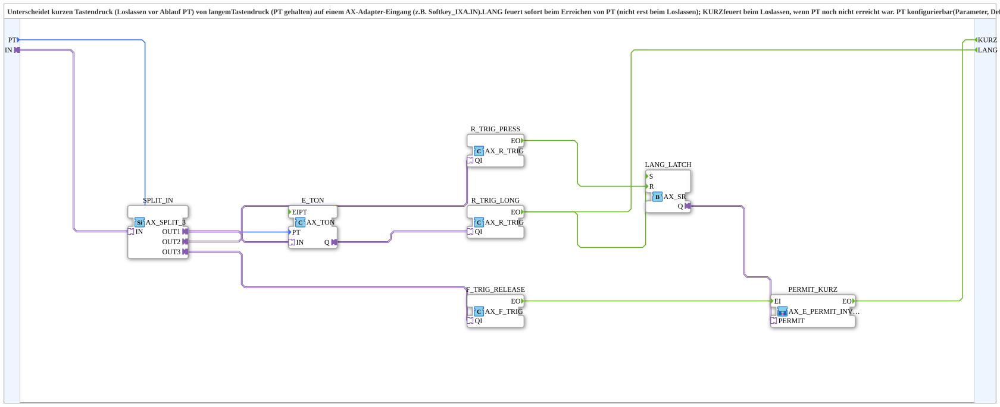

# SoftKey_Kurz_Lang

* * * * * * * * * *

## Introduction

`SoftKey_Kurz_Lang` distinguishes a **short** key press (released before `PT` elapses) from a **long** key press (`PT` held) on an `AX` adapter input (e.g. `Softkey_IXA.IN`). `LANG` fires immediately when `PT` is reached (not only on release); `KURZ` fires on release if `PT` had not yet been reached. `PT` is configurable (default 5 s).

## Interface Structure

### **Event Inputs**

None.

### **Event Outputs**

- **KURZ**: short press confirmed (released before `PT` elapses)
- **LANG**: long press confirmed (`PT` reached, fires immediately, not only on release)

### **Data Inputs**

- **PT** (`TIME`): hold time for "long", default `T#5s`

### **Data Outputs**

None.

### **Adapters**

- **IN** (socket, `adapter::types::unidirectional::AX`): raw key state (e.g. `Softkey_IXA.IN`)

## Function Blocks (FBs) Used

- **`SPLIT_IN`** (`adapter::events::unidirectional::AX_SPLIT_3`): distributes `IN` to three targets
- **`E_TON`** (`adapter::events::unidirectional::timers::AX_TON`): on-delay with `PT`
- **`R_TRIG_LONG`** (`adapter::events::unidirectional::AX_R_TRIG`): rising edge of `E_TON.Q`
- **`R_TRIG_PRESS`** (`adapter::events::unidirectional::AX_R_TRIG`): rising edge of `IN` (start of key press)
- **`LANG_LATCH`** (`adapter::events::unidirectional::AX_SR`): remembers that `LANG` has already fired in this cycle
- **`F_TRIG_RELEASE`** (`adapter::events::unidirectional::AX_F_TRIG`): falling edge of `IN` (release)
- **`PERMIT_KURZ`** (SubApp `MyLib::sys::AX_E_PERMIT_INVERT_1`, [AX_E_PERMIT_INVERT_1](./AX_E_PERMIT_INVERT_1.md)): lets the release event pass only if the permit is FALSE

## Functionality

- `IN` → `SPLIT_IN.IN`; `SPLIT_IN.OUT1` → `E_TON.IN`; `PT` → `E_TON.PT`
- `SPLIT_IN.OUT2` → `R_TRIG_PRESS.QI`; `SPLIT_IN.OUT3` → `F_TRIG_RELEASE.QI`
- `E_TON.Q` → `R_TRIG_LONG.QI`
- `R_TRIG_LONG.EO` → `LANG` and `LANG_LATCH.S`
- `R_TRIG_PRESS.EO` → `LANG_LATCH.R`
- `F_TRIG_RELEASE.EO` → `PERMIT_KURZ.EI`; `LANG_LATCH.Q` → `PERMIT_KURZ.PERMIT`; `PERMIT_KURZ.EO` → `KURZ`

`E_TON` runs as long as `IN` is held. The rising edge of `E_TON.Q` (the moment `PT` is reached while the key is still held) triggers `LANG` immediately and sets `LANG_LATCH`. On release, `F_TRIG_RELEASE` detects the falling edge; `PERMIT_KURZ` only lets it pass if `LANG_LATCH.Q` is FALSE, i.e. `LANG` has not yet fired in this press cycle. At the start of the next key press (`R_TRIG_PRESS`) `LANG_LATCH` is reset.

## Technical Details

- **Bugfix compared to version 1.0:** the check must not be made directly on `E_TON.Q`. `E_TON.Q` is reset to FALSE by the same `IN` edge change (release) that also triggers `F_TRIG_RELEASE` (`AX_TON`: no `IN` → no `Q`). Since both targets are fed by the same `IN` event, the execution order between them is not guaranteed; `E_TON.Q` would practically always already be FALSE at the time of the check, and `KURZ` would additionally have fired even after `LANG` had already fired.
- `LANG_LATCH` is completely decoupled from the reset timing (set while holding, reset only at the next key press) and makes the check robust.
- `PT` is configurable as a parameter.

## Application Scenarios

- Dual-function key: short press for one function, long press (e.g. 5 s) for another, together with [`Softkey_Web_IXA`](./Softkey_Web_IXA.md) for keys that should also be operable via the web client

## Summary

`SoftKey_Kurz_Lang` derives the separate events `KURZ` and `LANG` with a configurable hold time from an `AX` key state.

---

### 🌐 Related topic pages on ms-muc-docs.de

- [🌐 Eclipse 4diac IDE & color reference on ms-muc-docs.de](https://www.ms-muc-docs.de/iec-61499/eclipse-4diac/)
